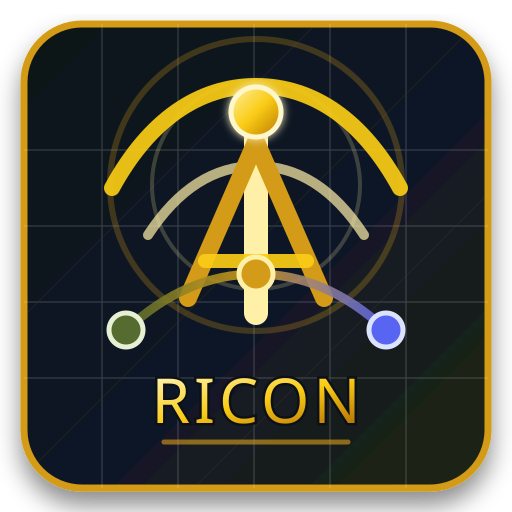

<div align="center">



# RICON · Reforger

**Радиосвязь для Arma Reforger — проект в разработке.**

 

</div>

## Выпуск 0.6.3

Игровой аддон для Arma Reforger и плагин радиосвязи для TeamSpeak 3.6.2 x64. Версии отображаются в главном меню. Обновления плагина подписаны и применяются после выхода из TeamSpeak.

[Скачать выпуск](https://github.com/Iosif2321/RICON-Reforger/releases/latest) · [Установка на Windows](docs/INSTALL_RU.md) · [Сборка плагина](tools/RICON_TS3Probe/BUILD.md)

## Радиооборудование и Game Master в текущих исходниках

- [Индивидуальные параметры раций на сервере](docs/RADIO_HARDWARE_RU.md).
- [Инфраструктурные объекты и РЭБ в Game Master](docs/GM_RF_INFRASTRUCTURE_RU.md).

Автоматическая ретрансляция для объектов, размещённых через GM, и голосовая приёмка остаются в работе. Эти изменения относятся к исходникам в main. Архив 0.6.3 содержит состав выпущенной версии.


Добро пожаловать в **RICON — Realistic Integrated Communication Network** («реалистичная интегрированная сеть связи»)! Здесь мы создаём основу системы связи для Arma Reforger: от характеристик раций и распространения сигнала до экспериментальных маршрутов передачи голоса.

## Что здесь разрабатывается

- **Радиосвязь и устройства:** состояние раций, передатчиков и приёмников, а также правила формирования связей.
- **Радиосреда:** мощность сигнала, шум, антенны, рельеф, материалы и другие факторы на пути сигнала.
- **Передача голоса:** экспериментальные форматы, очереди, приёмники и ретрансляция PCM.

> **Статус Alpha.** Проверены локальная загрузка аддона, загрузка плагина в TS3 и его обновление по HTTPS. Приёмка сквозной речи в обычной многопользовательской сессии остаётся открытой.

## Как устроен репозиторий

```text
addons/                 Аддоны проекта
└── RICON_Core/         Ядро RICON для Arma Reforger
    ├── Prefabs/        Игровые шаблоны устройств
    └── Scripts/        Исходный код Enforce Script
        └── Game/RICON/
            ├── Core/         Состояние и управление связью
            ├── Device/       Адаптеры радиоустройств
            ├── Network/      Маршруты и экспериментальный медиатракт
            └── Propagation/  Модели распространения сигнала
```

Начните с [аддонов](addons/README.md) или [карты исходного кода](addons/RICON_Core/Scripts/Game/RICON/README.md). В каждой папке есть свой README с описанием её содержимого.

Модель PCM и отдельные контракты остаются экспериментальными; `TEST_ONLY` в их обозначениях сохраняет эту границу.

## Права и использование

Новые README-файлы предоставлены для ознакомления. На ранее опубликованный исходный код и ресурсы сохраняются права, предоставленные по APL-SA. Подробности — в [уведомлении о правах](LICENSE).
