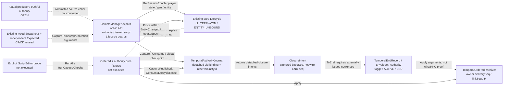

# Отдельная typed CT10 source delta — 2026-11-10

**Текущий observation-срез:** [статический read-only source adapter и actual pure2065](../evidence/E-ct10-physical-observation-20261110.md), [контракт](../req/REQ-physical-observation.md). Dataflow: trusted request/source/limits → stateless Sample → existing terrain helpers + injected source callbacks → detached observation frame либо typed failure. Native source использует public radio/height/TraceMove/Physics/WorldTimestamp; его getters скомпилированы, но world execution NOT_RUN. Actual285 observation checks +1780 прежних PASS. Production edge от observation к physical descriptor/producer пока отсутствует: RF/profile/applicability/history/clock gaps не замещаются scalar-Q или LOST. Новые классы не добавлены в исторические57nodes/83edges; root strict validator подтверждает прежние320refs/72files без drift, runtime=false. Ниже сохранены producer и более ранние source-срезы.

**Предыдущий producer source-срез:** [explicit producer2 + manager-owned journal/registry co-commit](../evidence/E-ct10-producer-owner-20261110.md), [API](../req/REQ-temporal-producer.md). Actual dataflow Manager.PublishTemporalPairs2 → Owner → actual PairService/evaluator → sibling S3b2(shared protected planning) → private scratch withdraw/capture → no-callback adoption; full source handoff не network FULL/ACK. CurrentExpected всех post-active пар/early projection validation/reserved ID and seq failures/typed END/new rebind IDs проверены selected SDK fixtures. Producer1496 + остальные284 =1780PASS; legacy106passдо/после. Новый Agy final QA не выполнялся из-за automatic external-payload rejection; Core/Reviewer выполнили независимую проверку. Physical builder/world/nativeManager/RPC/RECEIVER production parity/audio/load ещё OPEN. Предыдущие source pins ниже — история.

**Актуальное последующее обновление:** [локальный atomic capture-batch / actual pure SDK284 PASS](../evidence/E-ct10-capture-batch-20261110.md), [receipt](../evidence/receipts/ct10-capture-batch-result-20261110.json). Existing Journal теперь имеет shared row admission + CapturePublishedBatch: все rows проверяются до единственного map/byte commit, final retained budget учитывает все replacements. Existing Manager использует shared PrepareTemporalCapture и all-row guarded CaptureTemporalPublications; SourceNext/dispatch/реального producer commit не добавлено. Snapshot/Clock57 + ordered40 + capture59 + lease67 + batch61 исполнены в ScriptEditor; actual native manager role/admission всё ещё NOT_RUN. Предыдущие source-срезы и pins ниже сохранены как история.

**Последующее обновление 10.11:** [SDK compile и текущие source pins](../evidence/E-ct10-sdk-compile-20261110.md), [receipt](../evidence/receipts/ct10-sdk-compile-result-20261110.json). В existing Lifecycle добавлен read-only QueryActiveLease(leaseId, lifecycleNowMs); manager CaptureTemporalPublication теперь требует lifecycleNowMs и сверяет actual active lease id/owner/generation/device до journal. Getter не выполняет sweep/clock observation и возвращает detached copy9полей. Agy #8338/Reviewer8331–8332 source QA; extracted-source leaf16/3 PASS. Actual ScriptEditor log query-fix04: Game/WorkbenchGame compiled, SCRIPT(E)=0; SteamAPI_Init failed до fixtures. Pure execution/producer/transport/audio остаются OPEN.

**Ниже сохранён ранний source-срез до compile fixes и lease-query.** Его таблица фиксирует исторические pins, а не текущие хэши изменённых файлов. Для текущего среза используйте receipt выше; исходные source evidence/receipts не переписаны.

Это дополнение к историческому графу 09.11.2026, **не добавление узлов в его 57/83** и не новая runtime qualification. Source-кандидаты опубликованы root; compile/RunAll/engine/audio здесь NOT_RUN. Agy #8314 дал два RX source-counter, #8317 подтвердил entity-aware исправление в source scope. Actual producer commit, truthful Expected/retired scope, epoch coordinator, transport и audio OPEN.

Сплошная стрелка — найденный вызов метода в source. Пунктир — передаваемый аргумент/результат либо явно ещё отсутствующий production caller; это не утверждение о работающем dispatcher.

| Canonical source delta / reuse | Pin и точный предел |
|---|---|
| [RICON_CommsManagerComponent.c:333](<C:/Users/Ded/Documents/Projects/ARMA 3 Scripts/RICON-Reforger/addons/RICON_Core/Scripts/Game/RICON/Core/RICON_CommsManagerComponent.c:333>) | `bde099e32a0a03632c138ccdf46074d739104ad0534eb06f5ec9d5098883ffa8`; nullable journal/default-off; Configure/Capture/Consume/Checkpoint callable API. Issued seq не producer commit. Старые method bodies unchanged. |
| [RICON_TemporalAuthorityJournal.c:95](<C:/Users/Ded/Documents/Projects/ARMA 3 Scripts/RICON-Reforger/addons/RICON_Core/Scripts/Game/RICON/Core/RICON_TemporalAuthorityJournal.c:95>) | `3b0a11e50d9e1446a0bd94495d639053c27a23f087a3c319abba36805daf7e8d`; Capture stores source-only receiverEntityId, existing-link rebind запрещён; old ENTITY_UNBOUND закрывает только old entity. Global source checkpoint ALL owners не per-owner network FULL. |
| [RICON_TemporalLifecycle.c:2](<C:/Users/Ded/Documents/Projects/ARMA 3 Scripts/RICON-Reforger/addons/RICON_Core/Scripts/Game/RICON/Core/RICON_TemporalLifecycle.c:2>) | `23a9ec398b9b409226ae9fb2109be656f04bc913103c5030610d3f8aa5c61551`; typed EndRecord/authority/envelope/ordered receiver, source port принятого HOST protocol. Runtime source authenticity не выводится из Expected DTO. |
| [RICON_TemporalLifecycleFixtures.c:1](<C:/Users/Ded/Documents/Projects/ARMA 3 Scripts/RICON-Reforger/addons/RICON_CoreTests/Scripts/Game/RICON_Tests/RICON_TemporalLifecycleFixtures.c:1>) | `a885df72d704493197cf0d0ccf27e2e5c5ad5af8b6d8f8da037856bdc434a019`; source fixtures, не выполненный Enforce parity. |
| [RICON_TemporalAuthorityFixtures.c:116](<C:/Users/Ded/Documents/Projects/ARMA 3 Scripts/RICON-Reforger/addons/RICON_CoreTests/Scripts/Game/RICON_Tests/RICON_TemporalAuthorityFixtures.c:116>) | `5da0c046f9f76c223de1b0035bd741d1a070aea03aef021e972dd4ed13225d52`; реальные pure Lifecycle calls в коде, включая schema0 prelude, same-generation entity change, replay и rotation; NOT_RUN. |
| [RICON_TemporalIntegrationProbePlugin.c:6](<C:/Users/Ded/Documents/Projects/ARMA 3 Scripts/RICON-Reforger/tools/RICON_TestRunner/Scripts/WorkbenchGame/RICON_TemporalIntegrationProbePlugin.c:6>) | `deb80d3483923d8e5ad5d66479f1c13bf3db3a97bcdc8208c54530baea03e57c`; только explicit pure runners/Print/Workbench.Exit, без autorun/Play/world. |
| [tools/RICON_TestRunner/run.ps1:3](<C:/Users/Ded/Documents/Projects/ARMA 3 Scripts/RICON-Reforger/tools/RICON_TestRunner/run.ps1:3>) | `0c6934205d389002a6194e7d9df2ec4c5d375bb17bacdbe80eea88a251e6fb90`; existing parent runner reuse, opt-in plugin selection и DryRun early return. Launcher не является engine/compile evidence. |

Сохранены schema1 APIs, RCFD/1, useful-channel kernel и Clock; второго Core/codec/voice backend нет. Retained receiver entity — source metadata, не новое поле wire Snapshot2. Полная Goal/21 раздел/RECEIVER+SERVER/A-B/shared RX/калибровка/lifecycle/load/M1–M3 остаётся незавершённой.

Публикация частичного основного graph-refresh меняет только manager source SHA/line refs и dated note. Статусы узлов, старые graph edges/problems/requirements, snapshot_date/generated_utc и остальные source pins не переоцениваются этим delta. Browser/render, Enforce compile, runtime и audio не проверялись.
