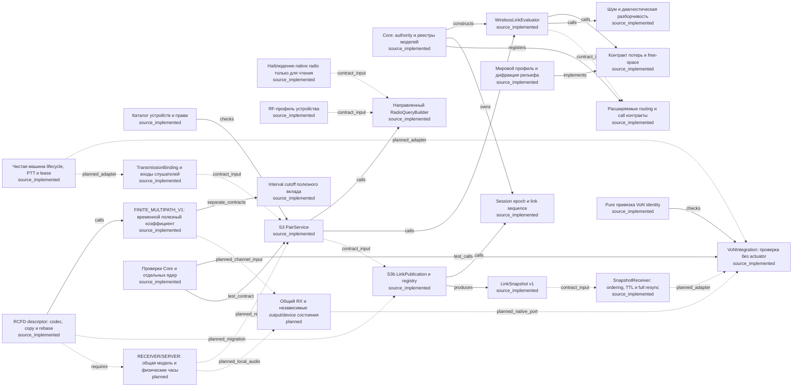

# RICON: граф логики, кода и доказательств

Срез: 2026-11-09. Источник навигации — [JSON](RICON_KNOWLEDGE_GRAPH.json); [полный Mermaid](RICON_KNOWLEDGE_GRAPH.mmd).
Граф описывает текущий dirty checkout и сохранённые доказательства. Owning source и прямое поручение владельца сохраняют приоритет.

## Как читать статусы

- `source_implemented` — Реализация или контракт в исходнике; не runtime PASS.
- `source` — Проверенная source-связь в указанном scope.
- `runtime_metadata` — Наблюдались metadata/identity; не содержание или DSP.
- `runtime_cache` — Дискретные cache-снимки; не fresh evaluation/звук.
- `candidate` — Гипотеза с конкретным основанием; join ещё открыт.
- `open` — Требуемое доказательство отсутствует.
- `planned` — Требуется планом; реализация не заявлена.
- `historical` — Историческая версия; перенос в текущую не разрешён автоматически.
- `required_open` — Обязательная сохраняемая часть цели, приёмка открыта.

## Core и контракты

## Native, наблюдение и границы

```mermaid
flowchart LR
  G_RT_OWNER_CONTINUE["Проектная работа продолжается по поручению владельца<br/>source"]
  G_RT_MACHINE_CARD["Последняя machine-card: blocked, причина неизвестна<br/>open"]
  G_RT_ACCEPTANCE_OPEN["Writer, DSP, содержание, DIRECT и 32 пользователя открыты<br/>open"]
  G_RT_WATCH_GUARDS["Read-only observer: identity, bounds, race guards<br/>source"]
  G_RT_PREREG_GATES["A6 preregistration и B505 release gates<br/>source"]
  E_RT_CAPTURE10["Capture10: пять дискретных numeric cache наблюдений<br/>runtime_cache"]
  N_RT_C["C: actual ownB native VoNComponent<br/>runtime_metadata"]
  N_RT_V["V: sender-key1 native VonStream<br/>runtime_metadata"]
  N_RT_T["T: private AudioSourceTemplate данного stream<br/>runtime_metadata"]
  N_RT_R["R: current own ACP resource<br/>runtime_metadata"]
  N_RT_SOURCE_SGM["Source proxy SGM: local index75, readback1<br/>runtime_metadata"]
  N_RT_INPUT_MAP["Native parameter k → packed state/record mapping<br/>runtime_metadata"]
  N_RT_INPUT_CACHE["INPUT cache: q≈0.9999994, gain0<br/>runtime_cache"]
  N_RT_OUTPUT_CACHE["OUTPUT cache: IDs5/8 ненулевые, ID12 present-zero<br/>runtime_cache"]
  N_RT_AUTHORED_GRAPH["Authored own ACP/SIG: 30733:12 → Radio_V<br/>source"]
  N_RT_CONTROL_DESCRIPTOR["Actual Radio control descriptor ещё не связан<br/>open"]
  N_RT_PROJECT_READERS["Два current entry readers: 150 и 280 байт<br/>source"]
  N_RT_OUTPUT_GETTER["Current output reader54 → leaf49<br/>source"]
  N_RT_EVAL_BOUNDARY["A39D70/A1DF90: hydration и evaluation effects открыты<br/>open"]
  N_RT_PUBLIC_WRITER["Supported private-T writer/accessor ещё не найден<br/>open"]
  E_RT_HISTORICAL18["Исторические 1.8 DSP/VoN исследования<br/>historical"]
  N_ARCH_CAPTURE["Штатные PTT и capture<br/>required_open"]
  N_ARCH_OPUS["Штатное кодирование Opus<br/>required_open"]
  N_ARCH_DELIVERY["Штатная сеть, recipients и native Radio<br/>required_open"]
  N_ARCH_DECODE["Штатные decode и audio output<br/>required_open"]
  N_RT_PLAYBACK_SUBMISSION["Same-T: source307 подготавливает array-like submission<br/>source"]
  N_RT_T_CONSTRUCTION["Same-T source519: event record, construction и registration args<br/>source"]
  N_RT_CONSTRUCTED_P["Constructed P: explicit same T в P+68 и original P return<br/>source"]
  N_RT_P_CONTROL_CONSUMER["Same P: generic E737C0 consumer и collector insertion<br/>source"]
  N_RT_MUTABLE_INITIALIZER_HANDOFF["A3AA40 source2207: mutable ctx/item/T-P handoff<br/>source"]
  N_RT_MUTABLE_DELEGATE_STATE["A3B6D0 source838: mutable hooks, recursion и P-linked bitmap<br/>source"]
  N_RT_P_ITEM_LOOKUP_CFG["E73830 closed entry-CFG66: P-table ordinal, не Radio selector<br/>source"]
  G_RT_OWNER_CONTINUE -.->|"requires_full_goal"| G_RT_ACCEPTANCE_OPEN
  G_RT_MACHINE_CARD -.->|"separate_status_axes"| G_RT_OWNER_CONTINUE
  G_RT_WATCH_GUARDS -->|"bounds_observation"| E_RT_CAPTURE10
  G_RT_PREREG_GATES -->|"registers_and_checks_local_signal"| N_RT_SOURCE_SGM
  G_RT_PREREG_GATES -->|"admitted_before_release"| E_RT_CAPTURE10
  E_RT_CAPTURE10 -->|"observes_typed_chain"| N_RT_C
  N_RT_C -->|"sender_key_lookup"| N_RT_V
  N_RT_V -->|"owns_private_template"| N_RT_T
  N_RT_T -->|"current_resource_pointer"| N_RT_R
  N_RT_R -->|"own_resource_guid_match"| N_RT_AUTHORED_GRAPH
  E_RT_CAPTURE10 -->|"observes_input_records"| N_RT_INPUT_CACHE
  E_RT_CAPTURE10 -->|"observes_output_records"| N_RT_OUTPUT_CACHE
  N_RT_SOURCE_SGM -.->|"stored_propagation_unqualified"| N_RT_INPUT_CACHE
  N_RT_R -->|"name_to_native_input_k"| N_RT_INPUT_MAP
  N_RT_INPUT_MAP -->|"selects_input_record"| N_RT_INPUT_CACHE
  N_RT_INPUT_MAP -->|"anchors_selected_state_only"| N_RT_OUTPUT_CACHE
  N_RT_AUTHORED_GRAPH -.->|"suggests_compiled_connection"| N_RT_CONTROL_DESCRIPTOR
  N_RT_AUTHORED_GRAPH -.->|"source_hint_only"| N_RT_OUTPUT_CACHE
  N_RT_CONTROL_DESCRIPTOR -->|"decoded_selector_contract"| N_RT_PROJECT_READERS
  N_RT_T -->|"interface_provenance"| N_RT_PROJECT_READERS
  N_RT_PROJECT_READERS -->|"calls_prepare"| N_RT_EVAL_BOUNDARY
  N_RT_PROJECT_READERS -->|"calls_output_reader"| N_RT_OUTPUT_GETTER
  N_RT_OUTPUT_GETTER -->|"calls_update_before_leaf"| N_RT_EVAL_BOUNDARY
  N_RT_OUTPUT_GETTER -->|"defines_output_vector_layout"| N_RT_OUTPUT_CACHE
  N_RT_EVAL_BOUNDARY -.->|"freshness_unqualified"| N_RT_OUTPUT_CACHE
  N_RT_PUBLIC_WRITER -.->|"requires_supported_same_instance_join"| N_RT_T
  N_RT_PUBLIC_WRITER -.->|"blocks_actuation_acceptance"| G_RT_ACCEPTANCE_OPEN
  N_RT_OUTPUT_CACHE -.->|"does_not_prove_audio_acceptance"| G_RT_ACCEPTANCE_OPEN
  E_RT_HISTORICAL18 -->|"navigation_only"| N_RT_PROJECT_READERS
  N_ARCH_CAPTURE -.->|"required_preserve"| N_ARCH_OPUS
  N_ARCH_OPUS -.->|"required_preserve"| N_ARCH_DELIVERY
  N_ARCH_DELIVERY -.->|"required_preserve"| N_RT_C
  N_RT_T -.->|"required_preserve"| N_ARCH_DECODE
  N_RT_T -->|"same_T_source_forwarding"| N_RT_PLAYBACK_SUBMISSION
  N_RT_PLAYBACK_SUBMISSION -->|"calls_with_T_params_array"| N_RT_T_CONSTRUCTION
  N_RT_PLAYBACK_SUBMISSION -.->|"actual_Radio_control_join_open"| N_RT_CONTROL_DESCRIPTOR
  N_RT_PLAYBACK_SUBMISSION -.->|"does_not_prove_runtime_audio"| G_RT_ACCEPTANCE_OPEN
  N_RT_T_CONSTRUCTION -->|"calls_constructor_with_same_T"| N_RT_CONSTRUCTED_P
  N_RT_CONSTRUCTED_P -->|"result_passed_to_registration"| N_RT_T_CONSTRUCTION
  N_RT_CONSTRUCTED_P -.->|"actual_Radio_owner_unqualified"| N_RT_CONTROL_DESCRIPTOR
  N_RT_CONSTRUCTED_P -->|"stores_same_T_at_68"| N_RT_T
  N_RT_CONSTRUCTED_P -->|"same_P_passed_to_E737C0"| N_RT_P_CONTROL_CONSUMER
  N_RT_P_CONTROL_CONSUMER -->|"conditional_current_P68_control_read"| N_RT_PROJECT_READERS
  N_RT_P_CONTROL_CONSUMER -.->|"same_T_after_initializer_unqualified"| N_RT_T
  N_RT_P_CONTROL_CONSUMER -.->|"authored_Radio_mapping_open"| N_RT_CONTROL_DESCRIPTOR
  N_RT_P_CONTROL_CONSUMER -->|"pre_consumer_mutable_initializer"| N_RT_MUTABLE_INITIALIZER_HANDOFF
  N_RT_MUTABLE_INITIALIZER_HANDOFF -->|"mutable_ctx_item_bundle_handoff"| N_RT_MUTABLE_DELEGATE_STATE
  N_RT_MUTABLE_DELEGATE_STATE -->|"conditional_pointer_key_lookup"| N_RT_P_ITEM_LOOKUP_CFG
  N_RT_MUTABLE_DELEGATE_STATE -.->|"requires_exact_same_item_C0_provenance"| N_RT_CONTROL_DESCRIPTOR
```

## Проблемы и следующий недостающий факт

| ID | Проблема | Влияние | Следующий факт |
|---|---|---|---|
| C_P_ACTUATOR | Native actuator остаётся открытым | Проверка identity и native metadata не доказывают адресное изменение Radio или сохранность DIRECT. | Один квалифицированный private-stream Radio writer с actual native эффектом и отрицательными контролями A/B. |
| C_P_CT10 | Temporal descriptor не проходит через snapshot v1 | Отдельные fading/codec не являются готовой интеграцией. Изменение descriptor при прежнем Q может потеряться при скрытом расширении. | Явная версия CT10 и независимые vectors: producer/copy/codec/publication/full receiver/port; атомарный отказ при позднем дефекте партии. |
| C_P_LEGACY_LOST | Legacy LOST нельзя переносить в live mute | Нужна явная миграция diagnostic state отдельно от power/user mute/squelch/технического отказа; иначе исчезнут шум и будущие просветы. | Typed channel/RX/device/output причины и контроли Q0 с открытым шумом, физического нуля, stale/unknown и непрерывной доставки. |
| C_P_CLOCKS | Физическое время и сетевые lease/TTL требуют mapping | Keepalive/epoch/resync нельзя использовать для продления physical validity или перезапуска фаз. Реальная mapping этим source-обзором не доказана. | Mapping model/source/receive/native frames с anchor/window и границами задержек; parity при разных call steps и PTT без сброса фаз. |
| C_P_ORCHESTRATION | Source-компоненты не равны общей runtime цепочке | Рёбра contract_input показывают совместимость данных. Нельзя выдавать их за уже работающий production control plane. | Owning dispatcher/callers, transport и binding/lifetime adapters; исполняемая цепочка действительный TX → accepted snapshot → native port. |
| C_P_CALIBRATION | RF/RX profiles и разборчивость требуют калибровки | Synthetic RF/Q не подтверждают реальную слышимость, понятые слова, полноту геометрии или общий RX. | Подтверждённые RF/RX profiles с единицами/областью и реальные world sources; независимые RF/слуховые vectors, общий RX двух источников. |
| C_P_RECEIVER_MODE | Server authority не доказывает RECEIVER mode | Нужны доверенные devices/права и общая модель без превращения клиента в authority. Missing geometry не равна свободному пути. | Новые явные execution-location/trusted-input contracts и parity vectors с unknown geometry при одинаковых profile/state/time. |
| C_P_ATOMIC_OBSERVATION | Последовательные radio getters не атомарный снимок | Смена частоты, power или binding во время чтения может дать смешанный input. Граница указана в коде, runtime квалификация здесь отсутствует. | Reader/binding generation/window и явный отказ при изменении во время observation; целевой сценарий churn. |
| P_RT_SUPPORTED_WRITER | Нет qualified supported writer к actual private T | Нельзя подключить product actuator, объявить APPLIED или выдать public call/readback за native DSP изменение. | Положительный current supported handle/catalog/attachment contract, который выбирает тот же T для заданных sender/listener/generation и даёт наблюдаемое адресное воздействие. |
| P_RT_RADIO_DESCRIPTOR | Source30733:12 не связан с actual native Radio descriptor | Найденный output12=value0 нельзя назвать consumed Radio_V=0, mute или PCM/DSP результатом. | Один exact current owning-type/vtable provenance факт того же effective resource item на source838 callsite0x140A3B746, RCX=item/RDX=mutable bundle, virtual slot+0xC0. Absolute vtable cell/target UNKNOWN: сначала frozen provenance, затем только при exact identity отдельная qualification одной cell/target. Не угадывать тип по shape/соседству/1.8 и не сканировать все hooks; C8/E74350/A3B2E0 parked. Same-T/actual Radio/supported writer/A/B/DSP/content/full Goal — отдельные открытые gates. |
| P_RT_EVALUATION_FRESHNESS | Evaluation/default policy и cache freshness не установлены | Нельзя свести Input0 к returned graph output0 или принять dirty0/ненулевые соседние outputs за initialized/fresh consumer state. | Current owning-body qualification A1DF90 по direct callsite ED1FDD: какое условие обновляет selected OUTPUT state и какой проверяемый freshness contract из этого следует. A39D70 при этом остаётся отдельной открытой prepare boundary. |
| P_RT_AUDIO_CONTENT_DIRECT | Содержание, DIRECT и другие потоки ещё не приняты | Нельзя объявлять player-voice transformation, intelligibility/content reliability, DIRECT preservation или shared-RX isolation. | После квалификации actuator — независимый native A→B content test с известным исходником, отдельными Direct/другой sender/listener controls и lifecycle generation checks. |
| P_RT_TIMING_BOUNDARIES | Дискретный observer и 1500/2000 ms guard boundary различны | Нельзя обещать10ms continuous sampling, строгий1500ms cutoff, отсутствие всех пропущенных событий или штатное native release по alone valid receipt. | Явный согласованный timing contract и независимое измерение фактического native capture/release/owned cleanup в нужной среде; без расширения окна ради результата. |
| P_RT_SCALE32 | Нет runtime приёмки 32 пользователей | Нельзя переносить bounded two-client cache evidence на нагрузку/latency/full delivery или production limits. | После functional native qualification — разрешённый нагрузочный сценарий32 пользователей с объявленными параметрами и независимыми раздельными метриками/cleanup. |
| P_RT_MACHINE_STATUS_AXIS | Machine-card status нельзя подменять статусом проектной работы | Нельзя отображать machine Goal как active либо считать user-authorized project continuation запрещённым из-за этой карточки. | Свежая подтверждённая системная запись после фактического resume/изменения карточки; проектную цель и права владельца при этом сохранять отдельно. |
| P_MEDIA_DELIVERY_A | A: содержание и достаточная доставка фрагментов ещё не приняты | Без исходных полезных фрагментов listener DSP не может восстановить удалённое содержание. | Квалифицированный native player content path с раздельными метриками доставки, разборчивости и информативности. |

## Реестр узлов

### C_MANAGER — Core: authority и реестры моделей

Статус: `source_implemented`. CommsManager хранит модели, диапазоны и политики. RegisterBand разрешает зависимости и создаёт evaluator; mutation требует authority сервера, после freeze запрещена.

Предел: Исходники; runtime и полная Goal этой картой не подтверждены.

- [repo:addons/RICON_Core/Scripts/Game/RICON/Core/RICON_CommsManagerComponent.c:59](../../addons/RICON_Core/Scripts/Game/RICON/Core/RICON_CommsManagerComponent.c) — `RICON_CommsManagerComponent`.
- [repo:addons/RICON_Core/Scripts/Game/RICON/Core/RICON_CommsManagerComponent.c:159](../../addons/RICON_Core/Scripts/Game/RICON/Core/RICON_CommsManagerComponent.c) — `RegisterBand`.
- [repo:addons/RICON_Core/Scripts/Game/RICON/Core/RICON_CommsManagerComponent.c:315](../../addons/RICON_Core/Scripts/Game/RICON/Core/RICON_CommsManagerComponent.c) — `CanMutateRegistries`.
### C_SEQUENCE — Session epoch и link sequence

Статус: `source_implemented`. Менеджер выдаёт per-link sequence и ротирует epoch до переполнения. Это сетевые поколения, не физическое время канала.

Предел: Исходники; runtime и полная Goal этой картой не подтверждены.

- [repo:addons/RICON_Core/Scripts/Game/RICON/Core/RICON_CommsManagerComponent.c:271](../../addons/RICON_Core/Scripts/Game/RICON/Core/RICON_CommsManagerComponent.c) — `GetSessionEpoch`.
- [repo:addons/RICON_Core/Scripts/Game/RICON/Core/RICON_CommsManagerComponent.c:290](../../addons/RICON_Core/Scripts/Game/RICON/Core/RICON_CommsManagerComponent.c) — `NextLinkSequence`.
- [repo:docs/plan/GOAL_RICON_TEMPORAL_RU.md:42](../../docs/plan/GOAL_RICON_TEMPORAL_RU.md) — `Full Goal`.
### C_OBSERVATION — Наблюдение native radio только для чтения

Статус: `source_implemented`. BaseRadioObservationReader.TryRead проверяет authority и binding, читает power, opaque tuning и key. deviceId и antennaPos получает извне. Getters последовательные, атомарности нет.

Предел: Исходники; runtime и полная Goal этой картой не подтверждены.

- [repo:addons/RICON_Core/Scripts/Game/RICON/Device/RICON_RadioDeviceAdapter.c:170](../../addons/RICON_Core/Scripts/Game/RICON/Device/RICON_RadioDeviceAdapter.c) — `RICON_BaseRadioObservationReader`.
- [repo:addons/RICON_Core/Scripts/Game/RICON/Device/RICON_RadioDeviceAdapter.c:174](../../addons/RICON_Core/Scripts/Game/RICON/Device/RICON_RadioDeviceAdapter.c) — `TryRead`.
- [repo:addons/RICON_Core/Scripts/Game/RICON/Device/RICON_RadioDeviceAdapter.c:191](../../addons/RICON_Core/Scripts/Game/RICON/Device/RICON_RadioDeviceAdapter.c) — `native getters`.
### C_RF_PROFILE — RF-профиль устройства

Статус: `source_implemented`. RadioRfProfile задаёт разные TX/RX параметры и явные единицы; текущая валидация принимает только TEST_ONLY или ASSUMED provenance. Native tuning не отождествляется с MHz.

Предел: Исходники; runtime и полная Goal этой картой не подтверждены.

- [repo:addons/RICON_Core/Scripts/Game/RICON/Device/RICON_RadioDeviceAdapter.c:25](../../addons/RICON_Core/Scripts/Game/RICON/Device/RICON_RadioDeviceAdapter.c) — `m_iTuningValue`.
- [repo:addons/RICON_Core/Scripts/Game/RICON/Device/RICON_RadioDeviceAdapter.c:31](../../addons/RICON_Core/Scripts/Game/RICON/Device/RICON_RadioDeviceAdapter.c) — `RICON_RadioRfProfile`.
- [repo:addons/RICON_Core/Scripts/Game/RICON/Device/RICON_RadioDeviceAdapter.c:77](../../addons/RICON_Core/Scripts/Game/RICON/Device/RICON_RadioDeviceAdapter.c) — `IsValidProfile`.
### C_QUERY — Направленный RadioQueryBuilder

Статус: `source_implemented`. Чистый Build проверяет observation/profile/context, identity, power, tuning, частоту и равенство opaque key. TX-поля берёт у TX, RX-поля у RX; при отказе query=null.

Предел: Исходники; runtime и полная Goal этой картой не подтверждены.

- [repo:addons/RICON_Core/Scripts/Game/RICON/Device/RICON_RadioDeviceAdapter.c:114](../../addons/RICON_Core/Scripts/Game/RICON/Device/RICON_RadioDeviceAdapter.c) — `RICON_RadioQueryBuilder.Build`.
- [repo:addons/RICON_Core/Scripts/Game/RICON/Device/RICON_RadioDeviceAdapter.c:140](../../addons/RICON_Core/Scripts/Game/RICON/Device/RICON_RadioDeviceAdapter.c) — `RICON_LinkQuery construction`.
### C_DEVICE_CATALOG — Каталог устройств и права

Статус: `source_implemented`. LifecycleDevice содержит carried/world тип, owner, power, access и допустимые network/channel пары. PairService проверяет CanAccess/Allows до вычисления.

Предел: Исходники; runtime и полная Goal этой картой не подтверждены.

- [repo:addons/RICON_Core/Scripts/Game/RICON/Core/RICON_Lifecycle.c:163](../../addons/RICON_Core/Scripts/Game/RICON/Core/RICON_Lifecycle.c) — `RICON_LifecycleDevice`.
- [repo:addons/RICON_Core/Scripts/Game/RICON/Core/RICON_Lifecycle.c:201](../../addons/RICON_Core/Scripts/Game/RICON/Core/RICON_Lifecycle.c) — `CanAccess`.
- [repo:addons/RICON_Core/Scripts/Game/RICON/Core/RICON_Lifecycle.c:208](../../addons/RICON_Core/Scripts/Game/RICON/Core/RICON_Lifecycle.c) — `Allows`.
### C_LIFECYCLE — Чистая машина lifecycle, PTT и lease

Статус: `source_implemented`. LifecycleStateMachine хранит поколения игроков и lease, принимает явное nowMs, возвращает ordered effects. Sweep прекращает просроченные lease. VON_EXPIRY_INTENDED и FULL_RESYNC_REQUIRED являются намерениями, не выполненным native действием.

Предел: Исходники; runtime и полная Goal этой картой не подтверждены.

- [repo:addons/RICON_Core/Scripts/Game/RICON/Core/RICON_Lifecycle.c:421](../../addons/RICON_Core/Scripts/Game/RICON/Core/RICON_Lifecycle.c) — `RICON_LifecycleStateMachine`.
- [repo:addons/RICON_Core/Scripts/Game/RICON/Core/RICON_Lifecycle.c:925](../../addons/RICON_Core/Scripts/Game/RICON/Core/RICON_Lifecycle.c) — `ObserveAndSweep`.
- [repo:addons/RICON_Core/Scripts/Game/RICON/Core/RICON_Lifecycle.c:1355](../../addons/RICON_Core/Scripts/Game/RICON/Core/RICON_Lifecycle.c) — `AddVonExpiryEffect`.
### C_TRANSMISSION — TransmissionBinding и входы слушателей

Статус: `source_implemented`. Binding связывает lease, epoch, player generation, device/transceiver, network/channel и TTL. PairListener, PairPlayer и PairEndpoint передаются явным входом S3.

Предел: Исходники; runtime и полная Goal этой картой не подтверждены.

- [repo:addons/RICON_Core/Scripts/Game/RICON/Core/RICON_PairService.c:26](../../addons/RICON_Core/Scripts/Game/RICON/Core/RICON_PairService.c) — `RICON_TransmissionBinding`.
- [repo:addons/RICON_Core/Scripts/Game/RICON/Core/RICON_PairService.c:73](../../addons/RICON_Core/Scripts/Game/RICON/Core/RICON_PairService.c) — `RICON_PairServiceInput`.
### C_PAIR — S3 PairService

Статус: `source_implemented`. Evaluate валидирует весь вход, сортирует lease/listener и вычисляет направленные пары. EvaluatePair проверяет lease TTL, поколение, доступ и согласованность power, затем вызывает S2 и общий evaluator. Результат хранит значения без ссылок на budget.

Предел: Исходники; runtime и полная Goal этой картой не подтверждены.

- [repo:addons/RICON_Core/Scripts/Game/RICON/Core/RICON_PairService.c:274](../../addons/RICON_Core/Scripts/Game/RICON/Core/RICON_PairService.c) — `EvaluatePair`.
- [repo:addons/RICON_Core/Scripts/Game/RICON/Core/RICON_PairService.c:336](../../addons/RICON_Core/Scripts/Game/RICON/Core/RICON_PairService.c) — `Evaluate`.
### C_EVALUATOR — WirelessLinkEvaluator

Статус: `source_implemented`. Чистая цепочка: слои потерь, RX power, thermal/environment noise плюс interference, SINR, legacy sensitivity/Q/state. LOST ниже sensitivity является текущей диагностической семантикой, не разрешением live mute.

Предел: Исходники; runtime и полная Goal этой картой не подтверждены.

- [repo:addons/RICON_Core/Scripts/Game/RICON/Propagation/RICON_LinkEvaluator.c:43](../../addons/RICON_Core/Scripts/Game/RICON/Propagation/RICON_LinkEvaluator.c) — `RICON_WirelessLinkEvaluator.Evaluate`.
- [repo:addons/RICON_Core/Scripts/Game/RICON/Propagation/RICON_LinkEvaluator.c:97](../../addons/RICON_Core/Scripts/Game/RICON/Propagation/RICON_LinkEvaluator.c) — `AppendLosses`.
- [repo:addons/RICON_Core/Scripts/Game/RICON/Propagation/RICON_LinkEvaluator.c:145](../../addons/RICON_Core/Scripts/Game/RICON/Propagation/RICON_LinkEvaluator.c) — `legacy sensitivity branch`.
- [repo:docs/plan/GOAL_RICON_TEMPORAL_RU.md:17](../../docs/plan/GOAL_RICON_TEMPORAL_RU.md) — `Full Goal`.
### C_PROPAGATION — Контракт потерь и free-space

Статус: `source_implemented`. PropagationModel.AppendLosses возвращает именованные слои. FreeSpaceModel вычисляет FSPL с нижней границей расстояния в одну длину волны. Модель выбирается через registry.

Предел: Исходники; runtime и полная Goal этой картой не подтверждены.

- [repo:addons/RICON_Core/Scripts/Game/RICON/Propagation/RICON_PropagationModel.c:5](../../addons/RICON_Core/Scripts/Game/RICON/Propagation/RICON_PropagationModel.c) — `RICON_PropagationModel`.
- [repo:addons/RICON_Core/Scripts/Game/RICON/Propagation/RICON_PropagationModel.c:57](../../addons/RICON_Core/Scripts/Game/RICON/Propagation/RICON_PropagationModel.c) — `RICON_FreeSpaceModel.AppendLosses`.
- [repo:addons/RICON_Core/Scripts/Game/RICON/Propagation/RICON_PropagationModel.c:75](../../addons/RICON_Core/Scripts/Game/RICON/Propagation/RICON_PropagationModel.c) — `LossDb`.
### C_NOISE_Q — Шум и диагностическая разборчивость

Статус: `source_implemented`. Evaluator соединяет noise model и intelligibility model; мощности noise/interference суммируются через TryPowerSumDbm. LinearTestIntelligibility явно TEST_ONLY и не является моделью речи.

Предел: Исходники; runtime и полная Goal этой картой не подтверждены.

- [repo:addons/RICON_Core/Scripts/Game/RICON/Propagation/RICON_LinkEvaluator.c:117](../../addons/RICON_Core/Scripts/Game/RICON/Propagation/RICON_LinkEvaluator.c) — `noise/SINR calculation`.
- [repo:addons/RICON_Core/Scripts/Game/RICON/Propagation/RICON_IntelligibilityModel.c:32](../../addons/RICON_Core/Scripts/Game/RICON/Propagation/RICON_IntelligibilityModel.c) — `RICON_LinearTestIntelligibility`.
- [repo:addons/RICON_Core/Scripts/Game/RICON/Propagation/RICON_NoiseModel.c:13](../../addons/RICON_Core/Scripts/Game/RICON/Propagation/RICON_NoiseModel.c) — `RICON_NoiseModel`.
### C_WORLD_TERRAIN — Мировой профиль и дифракция рельефа

Статус: `source_implemented`. BaseWorldHeightSource читает GetSurfaceY с проверкой finite; WorldProfileProvider реализует TerrainProfileProvider. TerrainDiffractionModel расширяет PropagationModel. Наличие механизма не доказывает полноту всей среды.

Предел: Исходники; runtime и полная Goal этой картой не подтверждены.

- [repo:addons/RICON_Core/Scripts/Game/RICON/Propagation/RICON_WorldProfileProvider.c:12](../../addons/RICON_Core/Scripts/Game/RICON/Propagation/RICON_WorldProfileProvider.c) — `RICON_BaseWorldHeightSource`.
- [repo:addons/RICON_Core/Scripts/Game/RICON/Propagation/RICON_WorldProfileProvider.c:26](../../addons/RICON_Core/Scripts/Game/RICON/Propagation/RICON_WorldProfileProvider.c) — `GetSurfaceY`.
- [repo:addons/RICON_Core/Scripts/Game/RICON/Propagation/RICON_WorldProfileProvider.c:36](../../addons/RICON_Core/Scripts/Game/RICON/Propagation/RICON_WorldProfileProvider.c) — `RICON_WorldProfileProvider`.
- [repo:addons/RICON_Core/Scripts/Game/RICON/Propagation/RICON_TerrainDiffractionModel.c:763](../../addons/RICON_Core/Scripts/Game/RICON/Propagation/RICON_TerrainDiffractionModel.c) — `RICON_TerrainDiffractionModel`.
### C_SNAPSHOT — LinkSnapshot v1

Статус: `source_implemented`. Контракт содержит schema, epoch, link, seq, TTL, route, players, state и Q; CloneSnapshot копирует значения. Temporal descriptor, RX-control и физического окна в v1 нет.

Предел: Исходники; runtime и полная Goal этой картой не подтверждены.

- [repo:addons/RICON_Core/Scripts/Game/RICON/Core/RICON_LinkSnapshot.c:32](../../addons/RICON_Core/Scripts/Game/RICON/Core/RICON_LinkSnapshot.c) — `RICON_LinkSnapshot`.
- [repo:addons/RICON_Core/Scripts/Game/RICON/Core/RICON_LinkSnapshot.c:87](../../addons/RICON_Core/Scripts/Game/RICON/Core/RICON_LinkSnapshot.c) — `CloneSnapshot`.
### C_PUBLICATION — S3b LinkPublication и registry

Статус: `source_implemented`. Чистый Publish строит snapshots и новый registry из S3 result и bindings. Нет RPC, отправки, таймеров, мира или звука. NeedSnapshot учитывает state, TTL, qualityDelta и обновление через половину TTL.

Предел: Исходники; runtime и полная Goal этой картой не подтверждены.

- [repo:addons/RICON_Core/Scripts/Game/RICON/Core/RICON_LinkPublication.c:1](../../addons/RICON_Core/Scripts/Game/RICON/Core/RICON_LinkPublication.c) — `pure scope`.
- [repo:addons/RICON_Core/Scripts/Game/RICON/Core/RICON_LinkPublication.c:28](../../addons/RICON_Core/Scripts/Game/RICON/Core/RICON_LinkPublication.c) — `RICON_LinkPublicationInput`.
- [repo:addons/RICON_Core/Scripts/Game/RICON/Core/RICON_LinkPublication.c:549](../../addons/RICON_Core/Scripts/Game/RICON/Core/RICON_LinkPublication.c) — `NeedSnapshot`.
- [repo:addons/RICON_Core/Scripts/Game/RICON/Core/RICON_LinkPublication.c:566](../../addons/RICON_Core/Scripts/Game/RICON/Core/RICON_LinkPublication.c) — `Publish`.
### C_RECEIVER — SnapshotReceiver: ordering, TTL и full resync

Статус: `source_implemented`. Receive проверяет schema/epoch/linkSeq и копирует снимки. TTL отсчитывает от местного nowMs при получении. FullResync проверяет всю партию до замены состояния; неверная партия сбрасывает identity.

Предел: Исходники; runtime и полная Goal этой картой не подтверждены.

- [repo:addons/RICON_Core/Scripts/Game/RICON/Core/RICON_LinkSnapshot.c:106](../../addons/RICON_Core/Scripts/Game/RICON/Core/RICON_LinkSnapshot.c) — `RICON_LinkSnapshotReceiver`.
- [repo:addons/RICON_Core/Scripts/Game/RICON/Core/RICON_LinkSnapshot.c:120](../../addons/RICON_Core/Scripts/Game/RICON/Core/RICON_LinkSnapshot.c) — `ApplyFullResync`.
- [repo:addons/RICON_Core/Scripts/Game/RICON/Core/RICON_LinkSnapshot.c:161](../../addons/RICON_Core/Scripts/Game/RICON/Core/RICON_LinkSnapshot.c) — `Receive`.
- [repo:addons/RICON_Core/Scripts/Game/RICON/Core/RICON_LinkSnapshot.c:187](../../addons/RICON_Core/Scripts/Game/RICON/Core/RICON_LinkSnapshot.c) — `IsVisible`.
### C_ROUTE — Расширяемые routing и call контракты

Статус: `source_implemented`. Route.Evaluate проверяет маршрут целиком, endpoints, budgets, continuity и cycles; агрегирует минимум quality/state. RoutingPolicy и CallSessionFactory являются расширениями, не готовой сотовой или relay сетью.

Предел: Исходники; runtime и полная Goal этой картой не подтверждены.

- [repo:addons/RICON_Core/Scripts/Game/RICON/Network/RICON_NetworkContracts.c:119](../../addons/RICON_Core/Scripts/Game/RICON/Network/RICON_NetworkContracts.c) — `RICON_Route.Evaluate`.
- [repo:addons/RICON_Core/Scripts/Game/RICON/Network/RICON_NetworkContracts.c:174](../../addons/RICON_Core/Scripts/Game/RICON/Network/RICON_NetworkContracts.c) — `route aggregate`.
- [repo:addons/RICON_Core/Scripts/Game/RICON/Network/RICON_NetworkContracts.c:249](../../addons/RICON_Core/Scripts/Game/RICON/Network/RICON_NetworkContracts.c) — `RICON_RoutingPolicy`.
- [repo:addons/RICON_Core/Scripts/Game/RICON/Network/RICON_NetworkContracts.c:289](../../addons/RICON_Core/Scripts/Game/RICON/Network/RICON_NetworkContracts.c) — `RICON_CallSessionFactory`.
### C_VON_BINDING — Pure привязка VoN identity

Статус: `source_implemented`. VoNDeviceBinding содержит epoch/link/player/device/lease/transceiver индексы и проверяет различимость концов. Не владеет engine handle и не связывает private audio instance.

Предел: Исходники; runtime и полная Goal этой картой не подтверждены.

- [repo:addons/RICON_Core/Scripts/Game/RICON/Network/RICON_NetworkContracts.c:323](../../addons/RICON_Core/Scripts/Game/RICON/Network/RICON_NetworkContracts.c) — `RICON_VoNDeviceBinding`.
- [repo:addons/RICON_Core/Scripts/Game/RICON/Network/RICON_NetworkContracts.c:336](../../addons/RICON_Core/Scripts/Game/RICON/Network/RICON_NetworkContracts.c) — `IsValid`.
### C_VON_SEAM — VoNIntegration: проверка без actuator

Статус: `source_implemented`. ApplySnapshot проверяет snapshot, upstream decision, binding и identity. Любой допустимый вызов завершается BLOCKED_NO_ACTUATOR. OnTransmitLeaseExpired также не выполняет native действие; APPLIED отсутствует.

Предел: Исходники; runtime и полная Goal этой картой не подтверждены.

- [repo:addons/RICON_Core/Scripts/Game/RICON/Network/RICON_NetworkContracts.c:311](../../addons/RICON_Core/Scripts/Game/RICON/Network/RICON_NetworkContracts.c) — `RICON_EVoNSeamDecision`.
- [repo:addons/RICON_Core/Scripts/Game/RICON/Network/RICON_NetworkContracts.c:350](../../addons/RICON_Core/Scripts/Game/RICON/Network/RICON_NetworkContracts.c) — `ApplySnapshot`.
- [repo:addons/RICON_Core/Scripts/Game/RICON/Network/RICON_NetworkContracts.c:367](../../addons/RICON_Core/Scripts/Game/RICON/Network/RICON_NetworkContracts.c) — `BLOCKED_NO_ACTUATOR`.
- [repo:addons/RICON_Core/Scripts/Game/RICON/Network/RICON_NetworkContracts.c:370](../../addons/RICON_Core/Scripts/Game/RICON/Network/RICON_NetworkContracts.c) — `OnTransmitLeaseExpired`.
### C_FADING — FINITE_MULTIPATH_V1: временной полезный коэффициент

Статус: `source_implemented`. Чистое ядро получает descriptor/query/time извне, проверяет coverage/context/validity/domain, суммирует комплексные компоненты. EMPTY_MEDIUM, ZERO_AT_SAMPLE и NUMERIC_FAILURE разделены. Не знает PTT/epoch и не выдаёт LOST.

Предел: Исходники; runtime и полная Goal этой картой не подтверждены.

- [repo:addons/RICON_Core/Scripts/Game/RICON/Propagation/RICON_ChannelFading.c:1](../../addons/RICON_Core/Scripts/Game/RICON/Propagation/RICON_ChannelFading.c) — `scope`.
- [repo:addons/RICON_Core/Scripts/Game/RICON/Propagation/RICON_ChannelFading.c:311](../../addons/RICON_Core/Scripts/Game/RICON/Propagation/RICON_ChannelFading.c) — `RICON_FiniteMultipath.Evaluate`.
- [repo:addons/RICON_Core/Scripts/Game/RICON/Propagation/RICON_ChannelFading.c:372](../../addons/RICON_Core/Scripts/Game/RICON/Propagation/RICON_ChannelFading.c) — `Classify`.
### C_DESCRIPTOR — RCFD descriptor: codec, copy и rebase

Статус: `source_implemented`. DescriptorCodec проверяет модель, размер, версию и canonical representation, создаёт копии. Rebase переносит фазы и anchor внутри окна, не увеличивает validUntil. Это отдельный контракт, не поле snapshot v1.

Предел: Исходники; runtime и полная Goal этой картой не подтверждены.

- [repo:addons/RICON_Core/Scripts/Game/RICON/Propagation/RICON_ChannelDescriptor.c:92](../../addons/RICON_Core/Scripts/Game/RICON/Propagation/RICON_ChannelDescriptor.c) — `RICON_DescriptorCodec`.
- [repo:addons/RICON_Core/Scripts/Game/RICON/Propagation/RICON_ChannelDescriptor.c:212](../../addons/RICON_Core/Scripts/Game/RICON/Propagation/RICON_ChannelDescriptor.c) — `Clone`.
- [repo:addons/RICON_Core/Scripts/Game/RICON/Propagation/RICON_ChannelDescriptor.c:298](../../addons/RICON_Core/Scripts/Game/RICON/Propagation/RICON_ChannelDescriptor.c) — `Encode`.
- [repo:addons/RICON_Core/Scripts/Game/RICON/Propagation/RICON_ChannelDescriptor.c:313](../../addons/RICON_Core/Scripts/Game/RICON/Propagation/RICON_ChannelDescriptor.c) — `Decode`.
- [repo:addons/RICON_Core/Scripts/Game/RICON/Propagation/RICON_ChannelDescriptor.c:389](../../addons/RICON_Core/Scripts/Game/RICON/Propagation/RICON_ChannelDescriptor.c) — `Rebase`.
### C_CUTOFF — Interval cutoff полезного вклада

Статус: `source_implemented`. Assess требует полные пути, coverage, revisions, интервал и numerical guard. Амплитудная верхняя граница суммирует слабые пути. Только strict U<tolerance даёт BOUNDED; равенство CONTINUE. Не отключает шум, другие источники или устройство; production calls не подключены.

Предел: Исходники; runtime и полная Goal этой картой не подтверждены.

- [repo:addons/RICON_Core/Scripts/Game/RICON/Propagation/RICON_ChannelCutoff.c:1](../../addons/RICON_Core/Scripts/Game/RICON/Propagation/RICON_ChannelCutoff.c) — `scope`.
- [repo:addons/RICON_Core/Scripts/Game/RICON/Propagation/RICON_ChannelCutoff.c:110](../../addons/RICON_Core/Scripts/Game/RICON/Propagation/RICON_ChannelCutoff.c) — `Assess`.
- [repo:addons/RICON_Core/Scripts/Game/RICON/Propagation/RICON_ChannelCutoff.c:137](../../addons/RICON_Core/Scripts/Game/RICON/Propagation/RICON_ChannelCutoff.c) — `amplitude bound`.
- [repo:addons/RICON_Core/Scripts/Game/RICON/Propagation/RICON_ChannelCutoff.c:147](../../addons/RICON_Core/Scripts/Game/RICON/Propagation/RICON_ChannelCutoff.c) — `strict comparison`.
- [repo:docs/plan/GOAL_RICON_TEMPORAL_RU.md:40](../../docs/plan/GOAL_RICON_TEMPORAL_RU.md) — `Full Goal`.
### C_SHARED_RX — Общий RX и независимые output/device состояния

Статус: `planned`. Целевая ступень 2 объединяет полезные и конкурирующие вклады в RX, шум, профиль, AGC, selectivity, squelch и локальный звук. Q0/LOST не являются mute. Фон открытого RX требует квалифицированного native пути.

Предел: Требование полной Goal; реализация и native-квалификация здесь не установлены.

- [repo:docs/plan/GOAL_RICON_TEMPORAL_RU.md:17](../../docs/plan/GOAL_RICON_TEMPORAL_RU.md) — `Full Goal`.
- [repo:docs/plan/GOAL_RICON_TEMPORAL_RU.md:26](../../docs/plan/GOAL_RICON_TEMPORAL_RU.md) — `Full Goal`.
- [repo:docs/plan/GOAL_RICON_TEMPORAL_RU.md:34](../../docs/plan/GOAL_RICON_TEMPORAL_RU.md) — `Full Goal`.
### C_CALC_MODES — RECEIVER/SERVER: общая модель и физические часы

Статус: `planned`. Оба места расчёта должны использовать одинаковые доверенные inputs/profile/state/time и давать согласованный результат. PCM остаётся у слушателя. Clock mapping и CT10 требуют согласованной миграции контрактов.

Предел: Требование полной Goal; реализация и native-квалификация здесь не установлены.

- [repo:docs/plan/GOAL_RICON_TEMPORAL_RU.md:20](../../docs/plan/GOAL_RICON_TEMPORAL_RU.md) — `Full Goal`.
- [repo:docs/plan/GOAL_RICON_TEMPORAL_RU.md:42](../../docs/plan/GOAL_RICON_TEMPORAL_RU.md) — `Full Goal`.
- [repo:docs/plan/GOAL_RICON_TEMPORAL_RU.md:48](../../docs/plan/GOAL_RICON_TEMPORAL_RU.md) — `Full Goal`.
### C_FIXTURES — Проверки Core и отдельных ядер

Статус: `source_implemented`. CoreTests содержит lifecycle, snapshot, device, pair, publication, seam и channel fixtures. Support сравнивает результаты и неизменность входов. Runner декларирует ENFORCE_PARITY без Play/репликации/VoN. В этом поручении тесты не запускались.

Предел: Карта существующих проверок; не новый PASS и не native runtime.

- [repo:tools/RICON_TestRunner/README.md:10](../../tools/RICON_TestRunner/README.md) — `evidence level`.
- [repo:tools/RICON_TestRunner/README.md:17](../../tools/RICON_TestRunner/README.md) — `suites`.
- [repo:addons/RICON_CoreTests/Scripts/Game/RICON_Tests/RICON_VoNSeamFixtureSupport.c:46](../../addons/RICON_CoreTests/Scripts/Game/RICON_Tests/RICON_VoNSeamFixtureSupport.c) — `seam call/assertions`.
- [repo:addons/RICON_CoreTests/Scripts/Game/RICON_Tests/RICON_PairServiceFixtureSupport.c:248](../../addons/RICON_CoreTests/Scripts/Game/RICON_Tests/RICON_PairServiceFixtureSupport.c) — `negative controls`.
### G_RT_OWNER_CONTINUE — Проектная работа продолжается по поручению владельца

Статус: `source`. Команды продолжать действуют; полный native RICON Goal не завершён. Это отдельная ось от состояния системной machine-card.

Предел: Разрешение и цель проекта; не утверждение active у machine-card.

- [repo:docs/plan/STATUS_RU.md:3](../../docs/plan/STATUS_RU.md) — `owner continuation / machine-status correction`.
### G_RT_MACHINE_CARD — Последняя machine-card: blocked, причина неизвестна

Статус: `open`. Сохранённый get_goal от 2026-11-06 20:35 UTC: blocked, updatedAt 17:11:38 UTC, cause UNKNOWN. Владелец просил продолжать; projectWorkCanContinue=true, fullObjectiveComplete=false.

Предел: Датированная карточка, не свежий tool query; active/resume не приписывается.

- [evidence:latest-machine-goal-observation.json:5](../../../Cellular System/output/ricon-goal-plan-20261106/latest-machine-goal-observation.json) — `status / updatedAtUtc / cause`.
- [repo:docs/plan/STATUS_RU.md:3](../../docs/plan/STATUS_RU.md) — `machine-card status correction`.
### G_RT_ACCEPTANCE_OPEN — Writer, DSP, содержание, DIRECT и 32 пользователя открыты

Статус: `open`. Нужен supported per-source/listener native Radio actuator с сохранением DIRECT/других потоков/user state; затем независимая content/audio/lifecycle/load приёмка. Numeric cache и SDK compile не заменяют эти gates.

Предел: Полная цель сохранена; Graph/DSP/content PASS не объявлены.

- [repo:docs/plan/GOAL_RICON_TEMPORAL_RU.md:34](../../docs/plan/GOAL_RICON_TEMPORAL_RU.md) — `B — адресное управление Radio`.
- [repo:docs/plan/GOAL_RICON_TEMPORAL_RU.md:60](../../docs/plan/GOAL_RICON_TEMPORAL_RU.md) — `сценарий 32 пользователей`.
- [evidence:guarded-cli-capture/capture10/review.json:996](../../../Cellular System/output/ricon-goal-plan-20261106/guarded-cli-capture/capture10/review.json) — `qualification`.
### G_RT_WATCH_GUARDS — Read-only observer: identity, bounds, race guards

Статус: `source`. Held own-process identity/image/module checks, C/V/T/resource signatures, bounded counts/bytes, double reads, no heap scan/write/native invocation. F7 исправляет manifest-before-status.b publication race: b=null ожидается, не считается target identity.

Предел: F7→60→55→DD13→381 pinned chain; non-atomic/lifetime/ABA и timing ограничения сохраняются.

- [evidence:native-observer/own_process_reader.py:150](../../../Cellular System/output/ricon-goal-plan-20261106/native-observer/own_process_reader.py) — `OwnProcessReader`.
- [evidence:native-von-ref-probe/watch-stream.py:259](../../../Cellular System/output/ricon-goal-plan-20261106/native-von-ref-probe/watch-stream.py) — `if b is None`.
- [evidence:source-preregister/watch-outputs.py:70](../../../Cellular System/output/ricon-goal-plan-20261106/source-preregister/watch-outputs.py) — `wrap_snapshot / output budget`.
### G_RT_PREREG_GATES — A6 preregistration и B505 release gates

Статус: `source`. B-only MpTest opt-in делает AddOrFindSignal(name,1) после exact preFind=-1 и callbacks=0; повторно только читает manager/index/value1. READY→HEARTBEAT проверяется до coordinator и после ARM перед release. Creation/ownership остаются UNQUALIFIED.

Предел: Source A6AB, runner B505, gate9E22; без .25 challenge, SetSignalValue/restore/remove.

- [repo:tools/RICON_LiveProbe/Scripts/Game/RICON_Live/RICON_LiveNativeRxProbe.c:800](../../tools/RICON_LiveProbe/Scripts/Game/RICON_Live/RICON_LiveNativeRxProbe.c) — `SourceSignalReady`.
- [evidence:source-preregister/gate.ps1:2](../../../Cellular System/output/ricon-goal-plan-20261106/source-preregister/gate.ps1) — `Get-CliSourceSignalReady`.
- [evidence:guarded-cli-capture/run-source-preregister-capture.ps1:215](../../../Cellular System/output/ricon-goal-plan-20261106/guarded-cli-capture/run-source-preregister-capture.ps1) — `Assert-CliSourceSignalReady injection`.
### E_RT_CAPTURE10 — Capture10: пять дискретных numeric cache наблюдений

Статус: `runtime_cache`. Независимый review принял одну fresh A/B fixture: source1 до release/RX, одна цепочка T/R/state во всех пяти точках; parent elapsed≈0/103.6031/312.8568/601.5514/912.5764 ms. A capture31/used30, B RX30 — callback metadata, не packets или содержание.

Предел: У snapshot есть отдельные OUTPUT timestamps; не continuous trace/hard realtime/native evaluation time.

- [evidence:guarded-cli-capture/capture10/review.json:3](../../../Cellular System/output/ricon-goal-plan-20261106/guarded-cli-capture/capture10/review.json) — `independent outcome verdict`.
- [evidence:guarded-cli-capture/capture10/review.json:751](../../../Cellular System/output/ricon-goal-plan-20261106/guarded-cli-capture/capture10/review.json) — `timing_interpretation`.
### N_RT_C — C: actual ownB native VoNComponent

Статус: `runtime_metadata`. Known current C сопоставлен с B script reference и RX context; пять expected vptr signatures. Внутренний bounded vector C+80 содержит запись sender key1; C creation resource+78 не заменяет current T+28 resource.

Предел: Own process/run/generation correlation; не atomic lifetime или public accessor.

- [evidence:native-observer-locators/component-c-locators.json:13](../../../Cellular System/output/ricon-goal-plan-20261106/native-observer-locators/component-c-locators.json) — `native_type / five vptrs`.
- [evidence:guarded-cli-capture/capture10/review.json:98](../../../Cellular System/output/ricon-goal-plan-20261106/guarded-cli-capture/capture10/review.json) — `typed_T_R`.
### N_RT_V — V: sender-key1 native VonStream

Статус: `runtime_metadata`. V выбран только через C vector и key1, с expected native VonStream signatures. T берётся из V+20. Callback RX коррелирует эту цепочку с A→B fixture.

Предел: Метаданные selected native stream; не доказательство содержимого PCM.

- [evidence:native-observer-locators/component-c-locators.json:61](../../../Cellular System/output/ricon-goal-plan-20261106/native-observer-locators/component-c-locators.json) — `fields.lookup / next_links`.
- [evidence:guarded-cli-capture/capture10/review.json:98](../../../Cellular System/output/ricon-goal-plan-20261106/guarded-cli-capture/capture10/review.json) — `typed_T_R.key / vptr checks`.
### N_RT_T — T: private AudioSourceTemplate данного stream

Статус: `runtime_metadata`. Текущий T связан с V+20; private manager M=T+10, selected-state array qword[T+18], count u32[T+24]. Same T/R во всех пяти input/output snapshots.

Предел: Raw private identity не превращается в script handle/writer; offsets привязаны к владельцу.

- [evidence:native-observer-locators/game19-locators.json:197](../../../Cellular System/output/ricon-goal-plan-20261106/native-observer-locators/game19-locators.json) — `T`.
- [evidence:guarded-cli-capture/capture10/review.json:98](../../../Cellular System/output/ricon-goal-plan-20261106/guarded-cli-capture/capture10/review.json) — `all_five_saved_typed_chains_equal`.
### N_RT_R — R: current own ACP resource

Статус: `runtime_metadata`. R=qword[T+28] прошёл resource type/GUID checks; own ACP GUID63C2132413FE4337. Source ACP/SIG pins согласуются с проверенной fixture; compiled-cache identity не устанавливает Bus descriptor mapping.

Предел: GUID/source selection; не именованная native connection/consumer qualification.

- [evidence:guarded-cli-capture/capture10/review.json:98](../../../Cellular System/output/ricon-goal-plan-20261106/guarded-cli-capture/capture10/review.json) — `typed_T_R.GUID / initial_name_metadata`.
- [evidence:source-preregister/radio-output-mapping.json:6](../../../Cellular System/output/ricon-goal-plan-20261106/source-preregister/radio-output-mapping.json) — `pins`.
### N_RT_SOURCE_SGM — Source proxy SGM: local index75, readback1

Статус: `runtime_metadata`. B sourceAproxy получил READY и fresh heartbeat до first RX; SDK local signal index75 стабильно читался как1. Exact preFind=-1 — отрицательное наблюдение, а не доказательство создания/владения.

Предел: Machine-local SGM namespace; не private native parameter k и не supported DSP actuator.

- [evidence:guarded-cli-capture/capture10/review.json:50](../../../Cellular System/output/ricon-goal-plan-20261106/guarded-cli-capture/capture10/review.json) — `source1_and_release`.
- [repo:tools/RICON_LiveProbe/Scripts/Game/RICON_Live/RICON_LiveNativeRxProbe.c:800](../../tools/RICON_LiveProbe/Scripts/Game/RICON_Live/RICON_LiveNativeRxProbe.c) — `SourceSignalReady`.
### N_RT_INPUT_MAP — Native parameter k → packed state/record mapping

Статус: `runtime_metadata`. В actual R exact gain name имеет native k1; packed9216 даёт low9 state0 и high22 input record18. Quality k0/packed512 даёт state0/record1. Source SGM index75, k1, record18 и output12 различны.

Предел: Точный INPUT mapping; source source-class30733 или output selector12 из него не следуют.

- [evidence:guarded-cli-capture/capture10/review.json:796](../../../Cellular System/output/ricon-goal-plan-20261106/guarded-cli-capture/capture10/review.json) — `input_control.gain_mapping`.
- [evidence:current-scalar-store/final-item/caller-binding.json:1](../../../Cellular System/output/ricon-goal-plan-20261106/current-scalar-store/final-item/caller-binding.json) — `resource_mapping / packed split`.
### N_RT_INPUT_CACHE — INPUT cache: q≈0.9999994, gain0

Статус: `runtime_cache`. В пяти точках state0 input record1 содержит q=0.9999994039535522, record18 gain=0, guard0. INPUT vector — I+8/countI+14, record float e+18; local source readback1 не дал observed stored-input1 в этих точках.

Предел: Bounded discrete stored values, не universal no-binding/provider impossibility или consumed gain0.

- [evidence:guarded-cli-capture/capture10/review.json:796](../../../Cellular System/output/ricon-goal-plan-20261106/guarded-cli-capture/capture10/review.json) — `input_control`.
- [evidence:current-scalar-store/final-item/final-item.asm:2](../../../Cellular System/output/ricon-goal-plan-20261106/current-scalar-store/final-item/final-item.asm) — `A1DC20 scalar record writer`.
### N_RT_OUTPUT_CACHE — OUTPUT cache: IDs5/8 ненулевые, ID12 present-zero

Статус: `runtime_cache`. Во всех пяти точках selected state0/output count3: ID5=0.20000040531158447; ID8=0.0010000000474974513; ID12 присутствует и равен0. Dirty mask0. Quality_W/Noise_V/Radio_V — только source hints, mappingQualified=false.

Предел: OUTPUT vector I+18/countI+24 отдельно от INPUT. Present-zero не fallback absence; readiness/actual consumption/DSP не квалифицированы.

- [evidence:guarded-cli-capture/capture10/review.json:138](../../../Cellular System/output/ricon-goal-plan-20261106/guarded-cli-capture/capture10/review.json) — `output_cache`.
- [evidence:source-preregister/watch-outputs.py:28](../../../Cellular System/output/ricon-goal-plan-20261106/source-preregister/watch-outputs.py) — `cache_pass`.
### N_RT_AUTHORED_GRAPH — Authored own ACP/SIG: 30733:12 → Radio_V

Статус: `source`. ACP SignalClass30733 использует own SIG181E1B71C9410BEF; Bus50183 'Bus Voice + Noise' con0→30733:12. SIG output12 Radio_V получает mul19 с gain input18. VON_RADIO содержит Direct и Radio paths.

Предел: Source class/node/port namespaces; не автоматически native descriptor pair(state0,selector12).

- [repo:tools/RICON_LiveProbe/Sounds/RICON_VoNProbe/RICON_VoNProbe.acp:3](../../tools/RICON_LiveProbe/Sounds/RICON_VoNProbe/RICON_VoNProbe.acp) — `SignalClass30733`.
- [repo:tools/RICON_LiveProbe/Sounds/RICON_VoNProbe/RICON_VoNProbe.acp:411](../../tools/RICON_LiveProbe/Sounds/RICON_VoNProbe/RICON_VoNProbe.acp) — `BusClass50183 con0`.
- [repo:tools/RICON_LiveProbe/Sounds/RICON_VoNProbe/RICON_VoNProbe.sig:159](../../tools/RICON_LiveProbe/Sounds/RICON_VoNProbe/RICON_VoNProbe.sig) — `IOPItemOutputClass id12 Radio_V`.
### N_RT_CONTROL_DESCRIPTOR — Actual Radio control descriptor ещё не связан

Статус: `open`. Current A3CA00 понимает signed16 index/selector; scaler E737F0 передаёт qword[object+68] и descriptor, multiply/MAXSS либо -1 bypass. Actual Bus object/P и его привязка к Radio, same T и source30733:12 остаются открытыми.

Предел: Descriptor может выбирать graph либо -2/-4/-8 literal/provider paths; actual Radio instance не предъявлен.

- [evidence:source-preregister/control-reader.asm:6](../../../Cellular System/output/ricon-goal-plan-20261106/source-preregister/control-reader.asm) — `A3CA00`.
- [evidence:source-preregister/gain-evaluate-current.asm:6](../../../Cellular System/output/ricon-goal-plan-20261106/source-preregister/gain-evaluate-current.asm) — `E737F0`.
- [evidence:source-preregister/radio-output-mapping.json:53](../../../Cellular System/output/ricon-goal-plan-20261106/source-preregister/radio-output-mapping.json) — `exactMissingQualification`.
### N_RT_PROJECT_READERS — Два current entry readers: 150 и 280 байт

Статус: `source`. A3CB20(150) и A3CA00(280) — разные entry paths, а не последовательность150→280. Оба передают graph context в A39D70 и затем вызывают ED1FC0; mutable index перечитывается после prepare.

Предел: Current source dataflow; actual runtime invocation конкретного Radio control не наблюдалось.

- [evidence:source-preregister/current-project-reader.asm:6](../../../Cellular System/output/ricon-goal-plan-20261106/source-preregister/current-project-reader.asm) — `A3CB20`.
- [evidence:source-preregister/control-reader.asm:6](../../../Cellular System/output/ricon-goal-plan-20261106/source-preregister/control-reader.asm) — `A3CA00`.
### N_RT_OUTPUT_GETTER — Current output reader54 → leaf49

Статус: `source`. ED1FC0(54) выбирает selected I, вызывает A1DF90(I), затем tail-calls A1DAF0(49). Leaf ищет EDX ID в OUTPUT I+18/countI+24, descriptor+8; найденный float возвращается из e+18, no-match тоже возвращает0.

Предел: Leaf49 read-only, whole reader вызывает unread update. Passive cache mirror не является native fresh return.

- [evidence:source-preregister/output-reader.asm:6](../../../Cellular System/output/ricon-goal-plan-20261106/source-preregister/output-reader.asm) — `ED1FC0`.
- [evidence:source-preregister/final-output-getter.asm:6](../../../Cellular System/output/ricon-goal-plan-20261106/source-preregister/final-output-getter.asm) — `A1DAF0`.
### N_RT_EVAL_BOUNDARY — A39D70/A1DF90: hydration и evaluation effects открыты

Статус: `open`. Current caller bodies передают контекст/selected I в A39D70 и A1DF90, но их owning bodies в принятых evidence не прочитаны. Из input/output stored values нельзя вывести default policy или актуальный native evaluation result.

Предел: Observer эти функции не вызывает; lifetime/ABA и свежесть graph evaluation не квалифицированы.

- [evidence:source-preregister/current-project-reader.asm:37](../../../Cellular System/output/ricon-goal-plan-20261106/source-preregister/current-project-reader.asm) — `CALL A39D70`.
- [evidence:source-preregister/output-reader.asm:15](../../../Cellular System/output/ricon-goal-plan-20261106/source-preregister/output-reader.asm) — `CALL A1DF90`.
- [evidence:source-preregister/output-reader-review.json:110](../../../Cellular System/output/ricon-goal-plan-20261106/source-preregister/output-reader-review.json) — `reader54_dataflow limits`.
### N_RT_PUBLIC_WRITER — Supported private-T writer/accessor ещё не найден

Статус: `open`. Source SGM API и generic Snd component surface не дают доказанного same-T writer. Current C RTTI не предъявил sound base для нового Script cast route; SoundEventPriority contract относится к AI event, не human control-only port.

Предел: Scoped gaps не доказывают универсальную невозможность; private pointer/DLL/type-punning не являются Workshop API.

- [evidence:source-preregister/von-base-hierarchy.json:67](../../../Cellular System/output/ricon-goal-plan-20261106/source-preregister/von-base-hierarchy.json) — `accessorVerdict`.
- [evidence:source-preregister/soundevent-feasibility.json:2](../../../Cellular System/output/ricon-goal-plan-20261106/source-preregister/soundevent-feasibility.json) — `AI contract feasibility`.
- [evidence:guarded-cli-capture/capture10/review.json:996](../../../Cellular System/output/ricon-goal-plan-20261106/guarded-cli-capture/capture10/review.json) — `qualification.actual_consumer_private_writer`.
### E_RT_HISTORICAL18 — Исторические 1.8 DSP/VoN исследования

Статус: `historical`. Старые transport/DSP/helper исследования служат навигацией и вопросами. Current1.9 адреса, ABI, reader semantics и runtime acceptance требуют отдельных evidence; historical PASS не переносится.

Предел: Строго отделено от current e877/Game1.9 graph.

- [repo:docs/analysis/VON_RADIO_DSP_BINDING_RU.md:3](../../docs/analysis/VON_RADIO_DSP_BINDING_RU.md) — `historical1.8 snapshot warning`.
### N_ARCH_CAPTURE — Штатные PTT и capture

Статус: `required_open`. Элемент штатного голосового пути требуется сохранить. Capture10 не квалифицирует содержание/полный media path.

Предел: Требование текущей Goal; подробный native-разбор 1.8 остаётся историческим.

- [repo:docs/plan/GOAL_RICON_TEMPORAL_RU.md:6](../../docs/plan/GOAL_RICON_TEMPORAL_RU.md) — ``.
### N_ARCH_OPUS — Штатное кодирование Opus

Статус: `required_open`. Элемент штатного голосового пути требуется сохранить. Capture10 не квалифицирует содержание/полный media path.

Предел: Требование текущей Goal; подробный native-разбор 1.8 остаётся историческим.

- [repo:docs/plan/GOAL_RICON_TEMPORAL_RU.md:6](../../docs/plan/GOAL_RICON_TEMPORAL_RU.md) — ``.
### N_ARCH_DELIVERY — Штатная сеть, recipients и native Radio

Статус: `required_open`. Элемент штатного голосового пути требуется сохранить. Capture10 не квалифицирует содержание/полный media path.

Предел: Требование текущей Goal; подробный native-разбор 1.8 остаётся историческим.

- [repo:docs/plan/GOAL_RICON_TEMPORAL_RU.md:6](../../docs/plan/GOAL_RICON_TEMPORAL_RU.md) — ``.
### N_ARCH_DECODE — Штатные decode и audio output

Статус: `required_open`. Элемент штатного голосового пути требуется сохранить. Capture10 не квалифицирует содержание/полный media path.

Предел: Требование текущей Goal; подробный native-разбор 1.8 остаётся историческим.

- [repo:docs/plan/GOAL_RICON_TEMPORAL_RU.md:6](../../docs/plan/GOAL_RICON_TEMPORAL_RU.md) — ``.
### N_RT_PLAYBACK_SUBMISSION — Same-T: source307 подготавливает array-like submission

Статус: `source`. Current V+20 T передаётся в 908C40 и далее A3A830(T, params, local array-like). 909100 получает opaque service, тот же local array и caller out aggregate. Только при nonzero AL caller переносит первый DWORD результата в V+38.

Предел: Pinned current image e8774b04, owning body307 bytes. Тип service, array element, V+38 и actual Radio control owner не установлены; source forwarding не доказывает runtime invocation, playback или DSP.

- [evidence:native-playback-owner-20261107/review.json:45](../../../Cellular System/output/ricon-goal-plan-20261106/native-playback-owner-20261107/review.json) — `frozen_caller_anchor`.
- [evidence:native-playback-owner-20261107/review.json:94](../../../Cellular System/output/ricon-goal-plan-20261106/native-playback-owner-20261107/review.json) — `same_T_and_submission`.
- [evidence:native-playback-owner-20261107/playback-owner.asm:59](../../../Cellular System/output/ricon-goal-plan-20261106/native-playback-owner-20261107/playback-owner.asm) — `same T -> A3A830`.
- [evidence:native-playback-owner-20261107/receipt.json:2](../../../Cellular System/output/ricon-goal-plan-20261106/native-playback-owner-20261107/receipt.json) — `current image e8774b04 / 307 bytes`.
### N_RT_T_CONSTRUCTION — Same-T source519: event record, construction и registration args

Статус: `source`. A3A830 читает R=T+28 и bounded event record из R+218/count R+224. Поле record+18 выбирает R12 через R+178 table; record+1A идёт в E72090 R8D. E72090 получает same T в RDX, byte[T+80] в R9D, arg5=16; запрос allocation0x98=152 байта. A39930 получает same T/R12/constructor result/original array.

Предел: Current519 source, не runtime. Для selector record+18 отдельный local range check не показан: MOVSX в ECX затем zero-extends RCX. R12 не назван RadioBus; A39930 retain/store/null-handling и units float gate неизвестны. Outer307 не проверяет return A3A830.

- [evidence:native-playback-owner-20261107/same-t-construction/review.json:64](../../../Cellular System/output/ricon-goal-plan-20261106/native-playback-owner-20261107/same-t-construction/review.json) — `construction_and_registration`.
- [evidence:native-playback-owner-20261107/same-t-construction/review.json:49](../../../Cellular System/output/ricon-goal-plan-20261106/native-playback-owner-20261107/same-t-construction/review.json) — `guards_and_event_lookup`.
- [evidence:native-playback-owner-20261107/same-t-construction/same-t-construction.asm:72](../../../Cellular System/output/ricon-goal-plan-20261106/native-playback-owner-20261107/same-t-construction/same-t-construction.asm) — `same T -> E72090`.
- [evidence:native-playback-owner-20261107/same-t-construction/receipt.json:2](../../../Cellular System/output/ricon-goal-plan-20261106/native-playback-owner-20261107/same-t-construction/receipt.json) — `current image / 519 bytes`.
### N_RT_CONSTRUCTED_P — Constructed P: explicit same T в P+68 и original P return

Статус: `source`. Current E72090 сохраняет entry same T в qword[P+68], устанавливает vtable141B37CC8 и возвращает original allocation P без this adjustment. Поэтому result, переданный source519 в A39930, имеет P+68=same T. Из signed record+1A в P+96 сохраняются только low8; byte[T+80] попадает в P+95.

Предел: Current346 source, без live invocation. Точный native class/RadioBus и signed control descriptor не установлены. P+96 low8 не является квалифицированным control selector; ref-like mechanics не дают полного lifetime contract.

- [evidence:native-playback-owner-20261107/same-t-object/review.json:35](../../../Cellular System/output/ricon-goal-plan-20261106/native-playback-owner-20261107/same-t-object/review.json) — `constructor_join`.
- [evidence:native-playback-owner-20261107/same-t-object/review.json:48](../../../Cellular System/output/ricon-goal-plan-20261106/native-playback-owner-20261107/same-t-object/review.json) — `argument_and_constant_fields`.
- [evidence:native-playback-owner-20261107/same-t-object/same-t-construction.asm:48](../../../Cellular System/output/ricon-goal-plan-20261106/native-playback-owner-20261107/same-t-object/same-t-construction.asm) — `P+68 = entry same T`.
- [evidence:native-playback-owner-20261107/same-t-object/receipt.json:2](../../../Cellular System/output/ricon-goal-plan-20261106/native-playback-owner-20261107/same-t-object/receipt.json) — `current image / 346 bytes`.
### N_RT_P_CONTROL_CONSUMER — Same P: generic E737C0 consumer и collector insertion

Статус: `source`. Исторический source1084-срез7Nov: слово unread ниже относится к тому срезу. Дополнение9Nov раскрывает A3AA40→A3B6D0→E73830 в N_RT_MUTABLE_INITIALIZER_HANDOFF/N_RT_MUTABLE_DELEGATE_STATE/N_RT_P_ITEM_LOOKUP_CFG; full same-T/Radio join всё ещё открыт. Исторический текст: A39930 сначала вызывает unread A3AA40(&ctx{T,P}, resourceItem). Только zero-status путь передаёт same returned P в E737C0 с descriptor=resourceItem+80 и initialized floatOut0. При descriptor!=-1 helper читает current[P+68] и вызывает A3CA00; иначе возвращает false без чтения. Caller не проверяет AL: floatOut конвертируется в integer, складывается с item+12A, clamp/lowbyte→P+94. На поздней успешной ветке same P вставляется в original collector, затем same T/item/P/collector передаются A3B2E0.

Предел: Current1084 и frozen44 source, не runtime. Mutable initializer A3AA40 находится между constructor P68=T и consumer, поэтому current[P68]==same T к чтению ещё не доказано. Это E737C0, не E737F0 gain/scaling; P94 и generic item+80 не квалифицированы как Radio_V/actual RadioBus. A3B2E0 остаётся parked.

- [evidence:native-playback-owner-20261107/same-t-nodes/review.json:59](../../../Cellular System/output/ricon-goal-plan-20261106/native-playback-owner-20261107/same-t-nodes/review.json) — `concrete_control_consumer`.
- [evidence:native-playback-owner-20261107/same-t-nodes/review.json:49](../../../Cellular System/output/ricon-goal-plan-20261106/native-playback-owner-20261107/same-t-nodes/review.json) — `first_unread_preparation_gate`.
- [evidence:native-playback-owner-20261107/same-t-nodes/review.json:79](../../../Cellular System/output/ricon-goal-plan-20261106/native-playback-owner-20261107/same-t-nodes/review.json) — `collector_and_handoff`.
- [evidence:native-playback-owner-20261107/same-t-nodes/same-t-nodes.asm:82](../../../Cellular System/output/ricon-goal-plan-20261106/native-playback-owner-20261107/same-t-nodes/same-t-nodes.asm) — `same P -> E737C0(item+80, floatOut)`.
- [evidence:native-playback-owner-20261107/same-t-nodes/receipt.json:2](../../../Cellular System/output/ricon-goal-plan-20261106/native-playback-owner-20261107/same-t-nodes/receipt.json) — `current image / 1084 bytes`.
- [evidence:source-preregister/control-caller-44.asm:15](../../../Cellular System/output/ricon-goal-plan-20261106/source-preregister/control-caller-44.asm) — `conditional current[P+68] -> A3CA00`.
- [evidence:source-preregister/control-gain-review.json:50](../../../Cellular System/output/ricon-goal-plan-20261106/source-preregister/control-gain-review.json) — `neighbor44`.
### N_RT_MUTABLE_INITIALIZER_HANDOFF — A3AA40 source2207: mutable ctx/item/T-P handoff

Статус: `source`. Current e877/Game1.9.0.37 A3AA40 [A3AA40,A3B2DF), 2207 bytes/588 instructions, сохраняет entry ctx/item и копирует ctx.T/P в local bundle. На A3AEAB RCX=original mutable ctx, RDX=effective item/node с fallback на original item, R8=&bundle передаются A3B6D0. EAX delegate возвращается после cleanup.

Предел: Bounded source-only .pdata range, не runtime/EH/funclet/lifetime. R15 переиспользуется для selected node: [r15+68] не доказанный P68. Нет предъявленного fixed P68 direct store/read, но mutable aliases/opaque calls не позволяют объявить P68 неизменным. Actual Radio/item80/writer/DSP/content/DIRECT/sharedRX/full Goal не квалифицированы.

- [repo:output/native-resume-20261109/same-t-initializer/review.json:5](../../output/native-resume-20261109/same-t-initializer/review.json) — `Accepted bounded source2207`.
- [repo:output/native-resume-20261109/same-t-initializer/SOURCE_FINDINGS_RU.md:23](../../output/native-resume-20261109/same-t-initializer/SOURCE_FINDINGS_RU.md) — `Local T/P bundle and mutable handoff`.
- [repo:output/native-resume-20261109/same-t-initializer/body.asm:330](../../output/native-resume-20261109/same-t-initializer/body.asm) — `A3AEAB ctx/item/bundle handoff`.
### N_RT_MUTABLE_DELEGATE_STATE — A3B6D0 source838: mutable hooks, recursion и P-linked bitmap

Статус: `source`. Current A3B6D0 [A3B6D0,A3BA16), 838 bytes/246 instructions, использует map-like states0/1/2, virtual+C0/C8 с RCX=effective item/RDX=mutable bundle и self-recursion. После successful recursive return явно читает/BTS/пишет P-linked bitmap. Cached state1/flagbit0 clear вызывает E73830(current bundle.P,item), сохраняет EAX в bundle+20 и возвращает0 без проверки returned index.

Предел: Source-only, не simply-delegation и не P-immutability. Child bundle+10 — pointer value parent+10, не address-of-slot; child index+20 и parent index+24 различны. Fixed P68/same-T/Radio/public writer/runtime/DSP/EH/lifetime не квалифицированы; hooks/helpers/aliases mutable. C8/E74350/A3B2E0 parked, не выданы за прочитанные bodies. Field offsets hex.

- [repo:output/native-resume-20261109/same-t-delegate/review.json:13](../../output/native-resume-20261109/same-t-delegate/review.json) — `Accepted states/hooks/recursion/bitmap/index`.
- [repo:output/native-resume-20261109/same-t-delegate/SOURCE_FINDINGS_RU.md:27](../../output/native-resume-20261109/same-t-delegate/SOURCE_FINDINGS_RU.md) — `Concrete P-linked effects; mutable scope`.
- [repo:output/native-resume-20261109/same-t-delegate/body.asm:121](../../output/native-resume-20261109/same-t-delegate/body.asm) — `P-linked bitmap read/BTS/write`.
- [repo:output/native-resume-20261109/same-t-delegate/body.asm:44](../../output/native-resume-20261109/same-t-delegate/body.asm) — `A3B746 virtual slot C0 ABI`.
### N_RT_P_ITEM_LOOKUP_CFG — E73830 closed entry-CFG66: P-table ordinal, не Radio selector

Статус: `source`. Current closed contiguous reachable CFG [E73830,E73872), 66 bytes/21 instructions/23 internal edges/2 RET: data=qword[P+18], count=u32[P+24], stride50h. Первая запись с qword[record+38]==item и clear bit20h byte[record+4B] возвращает ordinal, иначе FFFFFFFF. Item только pointer-compare. В выбранном CFG нет heap stores/calls/fixed P68 access. Source-compatible count0→lookupFFFFFFFF→bundle indexFFFFFFFF→outer838 return0: status0 не APPLIED.

Предел: Source-only selected CFG, pdata exact/containing0/0 и metadata end/bytes NULL сохраняются. Не semantic function/funclets/EH/termination/runtime leaf/lifetime/ownership/races; fence80 — span budget, не extent/cumulative I/O, prefetch мог включать unreachable bytes. Ordinal не native k/input18/output12/source30733/SGM75/Radio; read-only CFG не отменяет mutable effects838. Counter не runtime опыт. Field offsets hex.

- [repo:output/native-resume-20261109/p-item-lookup/review.json:13](../../output/native-resume-20261109/p-item-lookup/review.json) — `Closed CFG66, pdata UNKNOWN and limits`.
- [repo:output/native-resume-20261109/p-item-lookup/SOURCE_FINDINGS_RU.md:27](../../output/native-resume-20261109/p-item-lookup/SOURCE_FINDINGS_RU.md) — `Stride50 first pointer/clear-bit lookup`.
- [repo:output/native-resume-20261109/p-item-lookup/leaf-cfg.json:312](../../output/native-resume-20261109/p-item-lookup/leaf-cfg.json) — `Closed CFG, not function/runtime extent`.
- [repo:output/native-resume-20261109/p-item-lookup/leaf-cfg.asm:1](../../output/native-resume-20261109/p-item-lookup/leaf-cfg.asm) — `Selected 21 instructions`.
- [repo:output/native-resume-20261109/p-item-lookup/SOURCE_FINDINGS_RU.md:39](../../output/native-resume-20261109/p-item-lookup/SOURCE_FINDINGS_RU.md) — `Count0 to FFFFFFFF to outer0 source counter`.

## Полная цель и правила

[Анкета агента](../../AGENT_CONTEXT_RU.md) · [Работа Agora с графом](../plan/native-integration-20261104/AGORA_GRAPH_WORKFLOW_RU.md)
