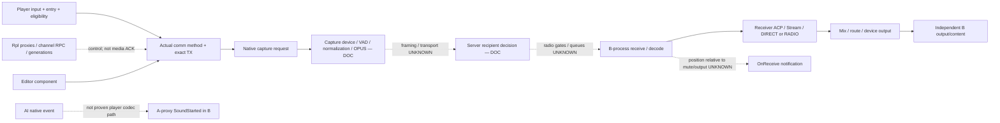

# Штатный VoN Reforger: полная карта цепочки и границ знания

> **Исторический статический срез Reforger 1.8.0.13.** Этот документ не подтверждает исполнение кода или управление VoN в версии 1.9. Старые адреса, размеры и смещения объектов требуют отдельной проверки для 1.9.
> Текущий статус ресурсов и привязки: [ASSET_PREPARATION](../evidence/native-von-access-20261104/ASSET_PREPARATION_RU.md) и [проверка native 1.9](<C:/Users/Ded/Documents/Projects/ARMA 3 Scripts/Cellular System/output/ricon-von-attachment-20261104/attachment/version19/RESULT_RU.md>). Исходные хеши, выводы и границы исследования ниже сохранены.

<!-- VON_NATIVE_CODE_REVIEW_20261104_BEGIN -->
**Дополнение native-разбором, 2026-11-04:** сквозной путь с входящим и исходящим окружением теперь проверен по коду и текущим ресурсам. [Читаемый граф](VON_RADIO_DATAFLOW_RU.html) · [адресная карта и источники](VON_RADIO_DATAFLOW_RU.md). Ниже сохранён исходный source/API-срез от 2026-11-03; его UNKNOWN нужно читать с учётом последующего native-исследования. Статическое закрытие не подтверждает фактическую слышимость или готовность RICON actuator.
<!-- VON_NATIVE_CODE_REVIEW_20261104_END -->

Дата: 2026-11-03. Фаза владельца Agora #6582, пункты 1–2. Статус: **CANONICAL_SYNTHESIS / SOURCE_COVERAGE_REVIEWED**. Это source-backed анализ всей цепочки, не сообщение о новом runtime PASS и не восстановление закрытого движка. Полнота означает, что каждое звено имеет источник, observable, предел знания и следующий probe.

Текущий порядок и критерии исполнения — [PLAN_NATIVE_VON_RU](../plan/PLAN_NATIVE_VON_RU.md); подробные радиовлияния — [VON_RADIO_MECHANISMS_RU](VON_RADIO_MECHANISMS_RU.md). Исторические планы и результаты не переписаны. Нового source/reader/игрового/audio/DLL/binary RE опыта при консолидации нет.

## 1. Версия и сила свидетельств

Официальный Script-Diff закреплён на [3d77cc212d5cda9922daf5f45635c7300d2d4cce](https://github.com/BohemiaInteractive/Arma-Reforger-Script-Diff/commit/3d77cc212d5cda9922daf5f45635c7300d2d4cce), commit label **1.8.0.13**. Live GitHub connector сменил устаревший web-cache 1.8.0.10; номера строк ниже относятся к pin, а не произвольному main. Game Diag и Workbench Diag имеют FileVersion 1.8.0.13, SHA соответственно `51F941DEE28BDA7865E2428D7FC92FCBE7C5C7FF666CAF642C0FF23C2ACED457` и `7DD36CA1F662B0C13669A4F2F7F10E3C461C2906B021E742272D64B3AB7E9798`.

API-агент сравнил только два сохранённых installed окна: controller622–636 и SCR component78–92, 15/15+15/15 строк после trim конечного whitespace. Radio-агент сверил75 line observations/62 уникальные строки controller349–363/538–567/622–638. Это **BOUNDED_PARITY**, не whole-file identity, одинаковый native ABI или фактический codec/wire format. HTML Doxygen version не является версией игры. Полные source/blob/raw/HTML fingerprints — в supplemental manifest, закреплённом в плане.

| Уровень | Что подтверждает | Чего не подтверждает |
|---|---|---|
| DOC / API_DECL | Обещанный интерфейс или vendor architecture | Реализацию private native, actual authority/каденцию/вывод |
| SCRIPT / BOUNDED_PARITY | Конкретную ветвь опубликованного кода / совпавшее окно установленного source | Whole installed file, media packet или слышимость |
| HOST / ENFORCE | Чистую модель, контракт и исполненные проверки | Native capture/RX/playback/production integration |
| RUNTIME | Только названное наблюдение с exact source/build/ролью и controls | Свойства другого пути или более сильный evidence tier |
| UNKNOWN | Проверенный предел текущего знания | Ни отсутствие механизма в игре, ни разрешение придумать API |

Основные owning-документы: [последний native-срез](../evidence/E-agora-radio-native-20261103.md), [script windows](../evidence/E-von-windows-ea.md), [PTT source](../evidence/E-standard-radio-ptt-source.md), [qualification](../evidence/E-k0-von-qualification.md), [исторический ACP](../evidence/E-acp-gui.md), [native extension](../evidence/E-native-extension-feasibility.md). Их даты и уровни остаются видимыми.

## 2. Источники для карты

| Код | Закреплённый первичный источник | Видимая граница |
|---|---|---|
| C | [SCR_VONController](https://github.com/BohemiaInteractive/Arma-Reforger-Script-Diff/blob/3d77cc212d5cda9922daf5f45635c7300d2d4cce/scripts/Game/VON/SCR_VONController.c#L341), blob `e367516182273fd985518c6567415347d46796cd` | Dispatch341–365, faction555–567/801–808, capture577–578/595, TX623–637, Owner RPC647–659, component reset674–757, listeners815–882 |
| V | [SCR_VoNComponent](https://github.com/BohemiaInteractive/Arma-Reforger-Script-Diff/blob/3d77cc212d5cda9922daf5f45635c7300d2d4cce/scripts/GameCode/Network/SCR_VoNComponent.c#L62), blob `6c413465931c0aba4c121d4cbec54f5c5ea84ff1` | Native capture/RX → display/invoker, без PCM/veto |
| NV | [Generated VoNComponent](https://github.com/BohemiaInteractive/Arma-Reforger-Script-Diff/blob/3d77cc212d5cda9922daf5f45635c7300d2d4cce/scripts/Game/generated/Components/VoNComponent.c#L19), blob `7b9bfb4ed91d3e6eb17191464fcabea1984fac5f` | Public native capture/method/TX/AI/editor declarations; callbacks45–58 |
| ED | [Editor manager](https://github.com/BohemiaInteractive/Arma-Reforger-Script-Diff/blob/3d77cc212d5cda9922daf5f45635c7300d2d4cce/scripts/Game/Editor/Entities/SCR_EditorManagerEntity.c#L145), blob `d7d0dba9334216fdfaa18e3e05a703b27066bf3a` | Editor145–164 подключает свой VoN;224–242 возвращает player component |
| AI | [SCR_AISoundHandling](https://github.com/BohemiaInteractive/Arma-Reforger-Script-Diff/blob/3d77cc212d5cda9922daf5f45635c7300d2d4cce/scripts/Game/AI/Talk/SCR_AISoundHandling.c#L38), blob `7df7fec0c19fef0ad398418617ae07c988857a7d` | Seed index/value38–44, event170/175, pair packing495–498 |
| BI | [Voice over Network](https://community.bistudio.com/wiki/Arma_Reforger%3AAudio%3A_Voice_over_Network) | Capture OPUS → server hearers → decode/receiver ACP; primary indexed text, direct-open403 в исследовании |
| API | [VoN API](https://community.bistudio.com/wikidata/external-data/arma-reforger/ArmaReforgerScriptAPIPublic/interfaceVoNComponent.html), [Signals](https://community.bistudio.com/wiki/Arma_Reforger%3AAudio%3A_Signals), [Audio nodes](https://community.bistudio.com/wiki/Arma_Reforger%3AAudio_Editor%3A_Nodes) | Документированные members/asset processing; native sender-aware stream binding не следует из имени сигнала |

Публичные generated VoNSystem и VonRadioMessage — пустые native subclasses в исследованном snapshot: их наличие не открывает codec, packet serializer или recipient veto. Rpl lifecycle/Owner RPC — отдельный control/object plane, не доказанный media transport.

## 3. Граф от ввода до вывода

| Граница | Что установлено | Наблюдение и конкретный оставшийся вопрос |
|---|---|---|
| V01 Input/PTT | C регистрирует DOWN/UP listeners; dispatch выбирает entry/type | Effective scratch binding/context/focus/реальный DOWN-UP и безопасный release ещё квалифицируются; объявление SetActionValue не доказывает delivery |
| V02 Eligibility/selection | C проверяет usable entry, life state, faction/admin/cross-faction policy | Записать actual method/TX до/во время/после capture: radio action может уйти в DIRECT |
| V03 Capture request | C выбирает exact TX и вызывает native SetCapture | Return/scriptActive/recency не удостоверяют полезный microphone input, encoded frame или release/drain |
| V04 Device/encode | BI описывает compressed OPUS, silence detection, normalization | Sample rate/channels/bitrate/frame duration/FEC/DTX/PLC/device-loss API UNKNOWN; не назначать20ms/48kHz по имени codec |
| V05 Framing/transport | BI задаёт передачу серверу | Private packet/channel/port/reliability/auth fields/queues UNKNOWN; не объявлять RTP/Ogg/RplReliableRPC |
| V06 Server hearers | DOC: server selects recipients; OnVoNUsed сообщает sender | Predispatch hook, authenticated directed permission и cadence UNKNOWN; spatial candidates не final hearers |
| V07 Native RADIO | Exact TX selector и radio properties доступны | Frequency/key/power/mute/range filter order, relays/intercom/native RF math UNKNOWN; см.32 влияния |
| V08 B receive/decode | NV сообщает sender/editor/RX/frequency/quality о data-for-playback | Component owner, decoder/mute/notification ordering и actual payload ещё не установлены |
| V09 ACP processing | BI: receiver ACP с Stream и DIRECT/RADIO; исторический граф прочитан | Actual prefab Filename/current asset fields и runtime instance/quality writer требуют проверки |
| V10 Mix/route | Документированы audio/mixer/output operations | Per-source premix token и B-isolated final sink не получены; global/component control слишком широк для пары |
| V11 Final output/content | Требуется независимый B result, запечатанный до A reveal | Shared USB, caller return, sound callback, GetGain или один RMS не дают source-content PASS |
| V12 Lifecycle/authority | Rpl/control identity и RICON epoch/lease/seq отдельны | JIP/respawn/rebind/old queued media и server permission revoke требуют fresh binding и измерений; DSP expiry не revoke |

Граф и12 строк покрывают звенья. Внутренний codec, dispatcher и mixer не объявлены раскрытыми. Внешний end-to-end baseline может подтвердить доставку, даже когда private implementation остаётся UNKNOWN.

## 4. Критические развилки control plane

**Faction fallback:** C555–575 для выбранного non-DIRECT radio не требует безусловного faction-known или непустого radio key. Faction-policy допускает `crossFaction || admin || effectiveLocalKey.IsEmpty() || radioKey == effectiveLocalKey`; остальные identity/life/entry/TX guards сохраняются. Только при обоих flags false, непустом effective local key и mismatch возможен proximity fallback. C801–809 обновляет cache при известной local faction, включая пустой key; при неизвестной faction прежний cache сохраняется, а не обнуляется. Cache отдельно сбрасывается при смене controlled entity (C678). Prospective effective key берётся из cache с заменой на faction radio key только при известной faction; null faction не означает empty key.

Same-faction/legitimate key — контролируемый сценарий, а не обязательная native policy. Равенство A/B keys само не доказывает eligibility/delivery. [Source triage](<../../../Cellular System/output/agora-native-von-20261103/pulse-local-faction-triage.md>) отделяет native branch от нашего прежнего LOCAL_FACTION_UNKNOWN guard. Новый TOOL_ONLY readonly accessor читает существующий controller cache, не вызывает InitEncryptionKey и не назначает faction/key/flags. PREPARED по ADMIN при faction UNKNOWN — script eligibility, не server ACL/native capture/media PASS. Значения ключей не печатать. Missing/unusable entry и !ALIVE имеют другие direct-fallback ветви; после stop595 direct-toggle598–600 может возобновить direct capture.

**Control RPC:** C647–659 передаёт owner выбор channel index. Это не media packet и не server recipient permission ACK. Network proxy existence/Rpl owner не означают, что B имеет право слышать или что данный proxy содержит decoder.

**Callbacks:** OnCapture(transmitter) и OnReceive(sender,isSenderEditor,receiver,freq,q) сохраняются как raw, включая null/unknown. Для null capture API даёт DIRECT-смысл; переносить его на null RX нельзя. SCR RX invoker V78–85 опускает isSenderEditor, но не возвращает veto и не меняет PCM. Recent transmission getters используют500ms timeout: это recency, не sequence/timestamp media frame.

**B-process locality:** одновременно исследуются B-own VoN и source-A-proxy VoN с раздельными owner/generation tags. Положительный ordinary-player baseline должен квалифицировать конкретный callback owner. Native OnReceive в B процессе с sender=A и exact qualified B receiver нельзя отвергать лишь потому, что owner оказался A-proxy. Но A-proxy **SoundStarted** — другой callback. Старый own-B RX0 не доказывает ноль всех B-process native RX.

**Editor:** ED меняет VoN component/controller association. Editor/camera/entity-switch не обычный player baseline; isSenderEditor нельзя потерять незаметно. Respawn и смена controlled entity создают новые поколения refs.

## 5. Player, AI и generic — разные пути

| Путь | Текущий факт | Запрещённое повышение |
|---|---|---|
| Ordinary player capture | Source/API карта есть; qualified input → B RADIO RX → independent output ещё нет | Не считать API capture вызов или AI событие доказанным player media |
| AI native SoundEventPriority | Реальный CLEAR; **Seed index59 + отдельное value; priority50**; wrong7ms/recovery4ms call return | Priority50 не Seed value; pairs не arbitrary serialized payload и не RF field strength |
| Generic BaseRadioMessage | Exact same-world B OnDelivery, wrong-frequency/healthy-other receiver, model TX admission и recovery | Не microphone VoN, cross-process payload, directed RX gate или audio |

В sealed matched/wrong/recovery AI серии proxy SoundStarted=1/1/1, обследованный own-B VoN RX=0/0/0. В wrong case все два enumerated B transceivers были48200 при A48000 непосредственно в callback, catalogSame/noA48000/allExpected положительны;22 qualified samples покрывают20.017s finite window. Fresh recovery на той же frozen source снова дала proxy event. Значит **этот observable не свидетель matched-frequency B-radio/media reception**. Это не доказывает отсутствие networking, конкретный AI wire format, общую невозможность VoN или ноль callbacks на неинструментированном component owner. См. [sealed summary](../evidence/E-agora-radio-native-20261103.md); hash/provenance деталей — в плане.

## 6. Звук и возможное воздействие

[Исторический ACP GUI](../evidence/E-acp-gui.md) описывает общий HP/LP/LS/Compressor до разделения DIRECT/RADIO; radio voice+noise затем Bitcrusher/HP/HardClipper/LP→VON_RADIO. Это graph topology исторического asset, не доказательство одного общего compressor instance на всех talkers. Current Filename/Stream/events/filter Hz/Q/output routing ещё не перечитывались этим синтезом.

Quality0…1/native TransmissionQuality, RICON intelligibility и complex RF h(t) — разные величины. В историческом graph Radio_V приq0 оставляет Db2Gain(-12dB)≈0.251 amplitude, Noise_V endpoint0.001 конечен; эти элементы сами не zero-delivery gate. Наличие других native gates/inaudibility/mute остаётся отдельным вопросом. Native q formula, actor→stream mapping и возможность безопасно менять q не установлены.

BaseSoundComponent.GetGain(AudioHandle), IsHandleValid/IsFinishedPlaying и AudioSystem.OutputVolume действительно существуют в исследованном Enfusion API. Это не означает, что VoNComponent имеет нужную inheritance/instance или что AI handle является native player stream handle. **Static OutputVolume можно сначала охарактеризовать без VoN handle** в owned process: silence vs known local calibration sound, неизменные masters, units/stage/latency. Constant setting-like value отвергает energy-meter claim; qualified process meter всё равно не source PCM/content/per-pair attribution. GetGain, напротив, требует exact handle/class/lifetime.

Stream node не допускает прямого подключения к Selector/Playlist по BI Nodes: selector-gate topology нельзя выдумать. SignalsManager.SetSignalValue(index,value) не адресует sender/RX/lease, engine обновляет встроенные signals; index lookup TransmissionQuality — не numeric setter. Обычный radio ACP mod возможен как scoped sound processing, но per-pair stream token и authoritative recipient gate не найдены в обследованной поверхности. [Extension dossier](../evidence/E-native-extension-feasibility.md) подтверждает DS/Workbench proto bridge, не готовый client voice ABI.

## 7. Реестр UNKNOWN → следующий проверяемый шаг

| ID | Specific gap | Минимальный probe и falsifier |
|---|---|---|
| Q01 | Реальный capture input/stop | Qualified endpoint+known input, actual native capture и bounded own stop; silence/no-capture/leak controls. Return без samples/B output не media proof |
| Q02 | B native RX owner/receiver | Раздельные B-own/source-A-proxy VoN subscriptions; exact A sender/B receiver catalog refs; SoundStarted отдельно. Rebind/GAP/ambiguous owner → INVALID |
| Q03 | Codec/device параметры | Только documented settings/provider telemetry с exact stream/build; нет hook → оставить UNKNOWN, не придумывать PCM API/OPUS parameters |
| Q04 | Private framing/dispatch | Supported provider/SDK trace с media origin; Owner RPC/Rpl traffic/AI Seed не закрывают gap; не форжить packets |
| Q05 | Recipient authority | Concrete predispatch capability с authenticated TX/RX и readback; A→B deny при C→B same RX и A→C healthy. Общий TX skip не проходит |
| Q06 | Radio gates и placement | После positive RADIO: all-RX mismatch/power/mute отдельно, raw RX продолжает логироваться, output независим. Callback≠post-gate пока не квалифицирован |
| Q07 | Stream→handle/ACP instance | Read-only correlation sender/RX/generation→opaque player stream; два различимых sources. Один global/entity signal на них не per-flow |
| Q08 | Current ACP/output meter | Named asset fields и independent meter calibration; затем actual player output. Preview/graph/GetGain без attribution не voice PASS |
| Q09 | Sink/content isolation | B-only route+healthy decoder, source-only/local-imitation/no-send negatives, B seal до A reveal; shared seed/log/schedule запрещены |
| Q10 | DIRECT/per-pair preservation | Actual A→B gate held; C→B SAME B RX и A→C/DIRECT живы, затем reverse/second RX/recovery. Half-duplex controls sequential без снятия gate |
| Q11 | Editor/JIP/respawn/drain | Fresh generations/full-resync, old-callback rejection, late old input отдельно от new. Proxy streamout не surrogate mute |
| Q12 | Expiry/restore | Own effect removal и server recipient revoke раздельно; lease∩snapshotTTL∩descriptor validity/qualified clock. Старый expiry не трогает new handle/user mute |

Все probes — инженерный план внутри действующего поручения; исполняет только root по точному bounded manifest. Исторические permission/waiver записи не создают новый запрос владельцу, а UNKNOWN не превращается в невозможность.

## 8. Контракт следующей интеграции

Существующие [lifecycle](../req/REQ-lifecycle.md), [pair publication](../req/REQ-link-publication.md) и [VoN seam](../req/REQ-von-seam.md) не дублируются новым registry. `BLOCKED_NO_ACTUATOR` остаётся фактическим отказом pure seam. После baseline адаптеру потребуется exact radio-only native binding, capability scope, owner token/generation, idempotent seq/expiry и independent post-gate result. DESIRED, REQUESTED/APPLIED и OBSERVED — разные записи.

Снятие собственного DSP может вернуть vanilla слышимость и **не является server lease revoke**. TX_ADMISSION, RX_TRANSCEIVER_MUTE, DIRECTED_RADIO_GATE, PER_STREAM_DSP квалифицируются отдельно. Отсутствующая capability не заменяется whole-player Social mute или скрытием observer. Production authority, world physics и load переходят только по [плану с критериями](../plan/PLAN_NATIVE_VON_RU.md).
