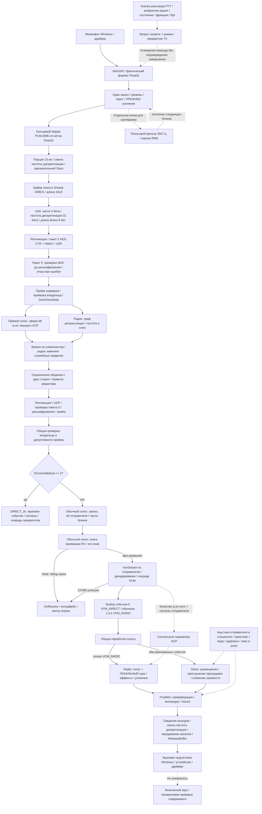
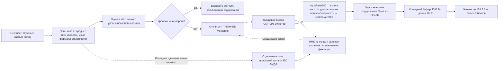
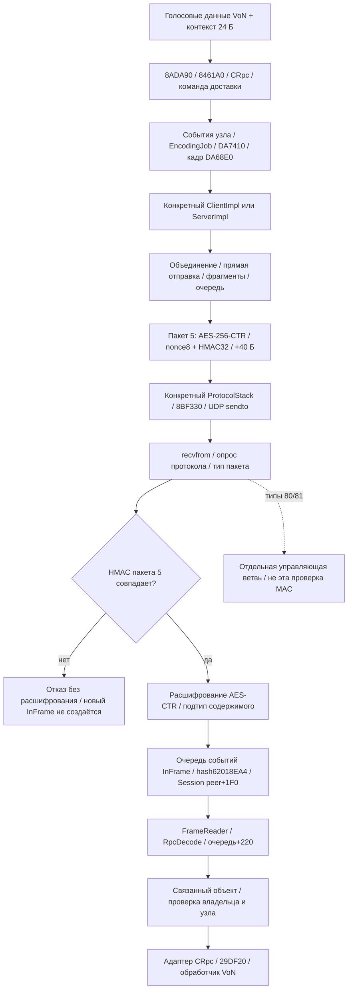
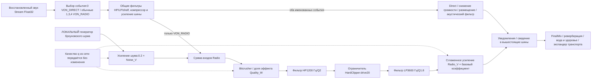

# Штатный VoN: полный поток данных и границы разбора

> **Исторический статический срез Reforger 1.8.0.13.** Этот документ не подтверждает исполнение кода или управление VoN в версии 1.9. Старые адреса, размеры и смещения объектов требуют отдельной проверки для 1.9.
> Текущий статус ресурсов и привязки: [ASSET_PREPARATION](../evidence/native-von-access-20261104/ASSET_PREPARATION_RU.md) и [проверка native 1.9](<C:/Users/Ded/Documents/Projects/ARMA 3 Scripts/Cellular System/output/ricon-von-attachment-20261104/attachment/version19/RESULT_RU.md>). Исходные хеши, выводы и границы исследования ниже сохранены.

2026-11-04. Подготовил `codex.re.docs`. Проверка выбранных ветвей кода и связей между кодом и ресурсами выполнена независимо; технический статус — **STATIC_CODE_DATAFLOW_REVIEWED**. Публикацией основного документа и статусом всей задачи управляет ведущий агент.

> Заметка SRC-SIG1: для единственного штатного объявления функции без реализации подписка не запускает код функции. Вывод действует при условиях, подробно перечисленных в разделе 11; это результат разбора кода, а не наблюдение запущенной игры.

## Что происходит с голосом

Windows передаёт звуковые отсчёты микрофона в поток захвата. Игра сводит одно- или двухканальный звук в один канал, отслеживает его уровень, при определённых условиях пропускает слишком тихий блок и умножает принятые отсчёты на текущий коэффициент усиления. Отдельная отфильтрованная копия помогает подобрать усиление для следующих блоков: **калибровочный фильтр 350 Гц не применяется непосредственно к звуковым данным, уходящим в Opus**. Затем звук попадает в кольцевой буфер PCM, при необходимости меняет частоту дискретизации и кодируется Opus порциями по 10 мс.

Сжатые блоки проходят через буфер ограниченного размера, упаковку VoN и репликацию. На исследованном пути пакета данных 5 содержимое шифруется AES-256-CTR; к нему добавляются 8 байт состояния nonce и 32 байта HMAC-SHA-256 — ровно 40 байт на этот вызов защиты пакета. Получатель проверяет MAC **до расшифрования, создания InFrame и вызова FrameReader**; неверная метка приводит к отказу. Это защита сетевого соединения. Строковый ключ рации ниже относится к отдельным правилам выбора получателей. Не все управляющие UDP-пакеты проверяются именно этим MAC.

Сервер сначала собирает получателей прямого голоса, затем для радиорежимов добавляет получателей из графа радиосвязи с учётом частоты, ключа, расстояния и правил ретрансляции. Допустимая доставка по радио может заменить служебные сведения уже созданной записи прямого голоса для того же компонента VoN. Перед пересылкой проверяются ограничения общения между игроками. В коде прослежены конкретные сетевые объекты и вызовы Winsock sendto/recvfrom.

У клиента-получателя сначала проверяются владелец принимающего компонента и режим связи. DIRECT_AI идёт отдельным путём. Обычная голосовая ветвь требует запись об игроке-отправителе, затем разрешает приёмную рацию и проверяет её mute. **При выключенном звуке приёмника OnReceive всё ещё может вызываться, хотя новый звук пакета не обрабатывается.** Отсутствие сущности персонажа отличается от отсутствия записи об игроке: при сохранённой записи декодирование может продолжиться с прежними пространственными и акустическими параметрами, но с новым показателем качества из сети.

Восстановленный PCM поступает в текущий ресурс ACP. Событие VON_RADIO подключено к **двум звуковым ветвям — Radio и Direct**, а VON_DIRECT — к Direct. Качество радио управляет долей эффекта Bitcrusher, локальным шумом и усилением звуковой шины. Броуновский шум **создаётся у получателя**, а не передаётся как шумовые отсчёты внутри голосового пакета. Эффекты выбранной цепочки применяются **перед** усилением шины, после чего выполняются уведомления и сведение в вышестоящие шины. Путь через FinalMix, выход Voice=2 и буфер звукового устройства прослежен до IAudioRenderClient::ReleaseBuffer. Далее находятся звуковая подсистема Windows, драйвер, устройство и физический звук.

Документ описывает код, исходные тексты и ресурсы. Фактические настройки устройства, личного профиля и переопределений модов, слышимость, задержки, потери пакетов, полное опустошение очередей и независимая передача содержимого A→B не измерялись. Пункт 1.1 не реализован. Игра, сервер, редактор, захват живого звука и отладчик не запускались; память процесса не читалась.

## Версия, источники и сила доказательств

Исследованный модуль: `C:/Program Files (x86)/Steam/steamapps/common/Arma Reforger/ArmaReforgerSteam.exe`, версия 1.8.0.13, SHA256 **`1d221a990fa16c78fe02f685a7ba1330be115ca93cd3b641e67e5d3f1b40d9c9`**. Предпочтительный базовый адрес — `0x140000000`. Все VA — адреса из статического разбора, не из памяти запущенной игры; RVA=VA−базовый адрес. Короткие шестнадцатеричные адреса в таблицах означают RVA: `2A0690` → VA `0x1402A0690`, `11FED50` → VA `0x1411FED50`. Полные девятизначные адреса вида `1414F8E15` уже являются VA; префикс `0x` может быть опущен. Workbench — отдельный исполняемый файл. Сырые результаты дизассемблирования и декомпиляции остаются в `C:/Users/Ded/AppData/Local/Temp/ricon-von-re-20261104/`; здесь приведены собственные схемы и описания.

| Код | Исходный отчёт и доказательства |
|---|---|
| IN | [input_sources/REPORT.md](<../../../Cellular System/output/von-re-20261104/index/input_sources/REPORT.md>), `inputs_graph.json`, `all_native_writer_sites.tsv`: 29 flows/68 hash anchors, 37 actual native named call sites в 14 files |
| OUT | [output_consumers/REPORT.md](<../../../Cellular System/output/von-re-20261104/index/output_consumers/REPORT.md>), `output_graph.json`: 9 flows/37 hash anchors, component RTTI identity |
| C | [CAPTURE_REPORT.md](<../../../Cellular System/output/von-re-20261104/capture/CAPTURE_REPORT.md>), [input_processing.md](<../../../Cellular System/output/von-re-20261104/capture/input_processing.md>): request/WASAPI/input gain/calibration |
| B | [capture/output/REPORT.md](<../../../Cellular System/output/von-re-20261104/capture/output/REPORT.md>): PCM queues/backend/mixer/settings/Windows sink, `native-join-receipt.json`, `windows-render-api.json` |
| T | [FINAL_TRANSPORT_RU.md](<../../../Cellular System/output/von-re-20261104/transport/FINAL_TRANSPORT_RU.md>), [CONTEXT_STAGES_RU.md](<../../../Cellular System/output/von-re-20261104/transport/CONTEXT_STAGES_RU.md>): provider/codec/framing/context |
| NET | [OUTER_SOCKET_CHAIN_RU.md](<../../../Cellular System/output/von-re-20261104/transport/OUTER_SOCKET_CHAIN_RU.md>), [ALTERNATIVE_SEND_RU.md](<../../../Cellular System/output/von-re-20261104/transport/ALTERNATIVE_SEND_RU.md>), [PACKET_SEAL_RU.md](<../../../Cellular System/output/von-re-20261104/transport/PACKET_SEAL_RU.md>), [CRYPTO_PROVIDER_AND_UNSEAL_RU.md](<../../../Cellular System/output/von-re-20261104/transport/CRYPTO_PROVIDER_AND_UNSEAL_RU.md>): submit/job/packet5 seal/verify/socket/ingest/gating |
| R | [NATIVE_RADIO_CONTRACT.md](<../../../Cellular System/output/von-re-20261104/radio/NATIVE_RADIO_CONTRACT.md>), [replication_environment/REPORT.md](<../../../Cellular System/output/von-re-20261104/radio/replication_environment/REPORT.md>), [editor_key.md](<../../../Cellular System/output/von-re-20261104/radio/editor_key.md>) |
| W | [world/REPORT.md](<../../../Cellular System/output/von-re-20261104/world/REPORT.md>), [environment_sources/REPORT.md](<../../../Cellular System/output/von-re-20261104/world/environment_sources/REPORT.md>): RF/world boundary и source/listener audio providers |
| Y | [relay/REPORT.md](<../../../Cellular System/output/von-re-20261104/relay/REPORT.md>), [ai_direct/REPORT.md](<../../../Cellular System/output/von-re-20261104/relay/ai_direct/REPORT.md>), [range/REPORT.md](<../../../Cellular System/output/von-re-20261104/relay/ai_direct/range/REPORT.md>) |
| L | [lifecycle/REPORT.md](<../../../Cellular System/output/von-re-20261104/lifecycle/REPORT.md>), [receive_environment.md](<../../../Cellular System/output/von-re-20261104/lifecycle/receive_environment.md>), [timing/REPORT.md](<../../../Cellular System/output/von-re-20261104/lifecycle/timing/REPORT.md>) |
| A | [audio/REPORT.md](<../../../Cellular System/output/von-re-20261104/audio/REPORT.md>), [OPERATION_CHECKLIST.md](<../../../Cellular System/output/von-re-20261104/audio/OPERATION_CHECKLIST.md>), [DSP_CURRENT.md](<../../../Cellular System/output/von-re-20261104/audio/DSP_CURRENT.md>), [ENVIRONMENT_CURRENT.md](<../../../Cellular System/output/von-re-20261104/audio/ENVIRONMENT_CURRENT.md>), [FINAL_MIX_CURRENT.md](<../../../Cellular System/output/von-re-20261104/audio/FINAL_MIX_CURRENT.md>) |
| SIG | [signature_semantics/REPORT.md](<../../../Cellular System/output/von-re-20261104/tools/signature_semantics/REPORT.md>), [COMPILER_VALUE_BINDING.md](<../../../Cellular System/output/von-re-20261104/tools/signature_semantics/COMPILER_VALUE_BINDING.md>), [NULL_ENTRY_RESULT.md](<../../../Cellular System/output/von-re-20261104/tools/signature_semantics/NULL_ENTRY_RESULT.md>), [null_entry_receipt.json](<../../../Cellular System/output/von-re-20261104/tools/signature_semantics/null_entry_receipt.json>), [source followup](<../../../Cellular System/output/von-re-20261104/index/input_sources/onentrieschanged_followup/REPORT.md>): SRC-SIG1 |
| REV | [review/REPORT.md](<../../../Cellular System/output/von-re-20261104/review/REPORT.md>), [last-joins.json](<../../../Cellular System/output/von-re-20261104/review/last-joins.json>): independent bytes/ranges/direct-flow checks и final ACCEPT SRC-SIG1/NET-ALT/seal; per-artifact manifests |

Поиск IN прочитал 34 202 записи FILE и все **5809 установленных файлов Scripts /27 005 822 байта исходных текстов без ошибок чтения**, включая 3 пустых файла и 1 файл с чтением Latin1. Полный поиск отделяет 37 вызовов от объявлений, действий интерфейса карты и записи ключей сообщений. Только **13 полных файлов** отдельно сравнены с официальной версией Script-Diff `3d77cc212d5cda9922daf5f45635c7300d2d4cce` после нормализации BOM/CRLF. Это подтверждает совпадение текста этих 13 файлов, а не всего Scripts. 759 файлов Core в SIG — отдельная ограниченная выборка. Ресурсы и участки машинного кода имеют собственные контрольные суммы; число разобранных функций не является процентом покрытия всего EXE.

## Общая схема

Сплошные связи подтверждены выбранным кодом или ресурсом. Пунктир показывает управление, дополнительный вход либо явно подписанную внешнюю границу. Таблицы ниже раскрывают порядок действий, единицы, очереди и отказы.



## 1. Кто задаёт входное состояние

Полный перечень мест записи содержится в IN:29 потоков и 37 вызовов. Здесь разделены их источники и условия; неподтверждённый автоматический запуск не добавлен.

| Источник / потоки | Кто создаёт данные и куда они поступают | Условия и граница |
|---|---|---|
| PTT I01–04 | `chimeraInputCommon.conf:8852–8950` → controller listeners826–833 → activate/deactivate; method/TX перед capture | DOWN/UP и long-range selection; unusable entry/!ALIVE может proximity fallback; typed stop может не совпасть с current type; direct toggle после false вновь active. Faction permission cache не radio key writer |
| Inventory/menu/knob I05–11 | GadgetManager940–997 создаёт entry на native TX; menu/entry/RadioComponent пишут frequency/power/mute | Native index 0-based successful catalog order, UI=i+1; knob TX0 с power/animation guards. API frequency kHz, UI MHz=freq/1000. Power bool не watts; mute per transceiver |
| Faction/base/antenna/campaign I12–14, I22, I25 | Faction fields → radio key/frequency; base max (default, antenna range) → relay; mobile lifecycle writer | Campaign OnEntityRequested1543–1627 относится **requested Vehicle,!IsProxy**, не handheld spawn. Mobile power=false только DESTROYED,!IsProxy. Antenna service radios выключаются при переносе range |
| Autotune/group/task I15–21 | Role/faction/config → selected channels; server leader/group guards и allocators → group state → radio writers | Current Campaign prefab явно `m_bEnabled0`; init returns early. Controlled-entity/manual sticky triggers известны; **SRC-SIG1: stock bodyless callback не выполняет user code**. Group defaults38000…54000/1000 и task45000…54000/200 configurable; delay0.5s не native cadence |
| Scenario/tutorial/messages I26–28 | ScenarioAI frequency → TX0; tutorial exact ANPRC68 → TX0/1 literal32000kHz; Campaign/Task message key copies | Message key не radio key mutation/capture. IN сохраняет inactive const branch; это не universal spawn defaults |
| Campaign base lifecycle I29 | MilitaryBaseComponent.Initialize → coverage radio power=true; Disable → power=false | Initialize returns при already initialized или IsProxy; Disable returns при IsProxy; обе ветви требуют найденную coverage radio. Installed source514–537 |
| Native config | Constructor reads effective config: schema key empty, power=false; explicit stock overlay overrides; successful TX construct writes parent+38/index+54 | ANPRC68 static range1300m/freq32000/48000, legal32000…68000/200; declared parent overlays distinct. Effective running/modded instance не прочитан |
| Rpl/request/sync | IsOwner=bit1, IsProxy=bit2, IsMaster=Owner&&!Proxy; Role Authority0/Proxy1 | Native getters именуют operational flags. Key requires IsOwner; frequency/power Proxy redirect request. View+58=complete BaseRpl+80 via0x28; complete remote security не следует из API names |
| User audio I23–24 | Master/VolumeVoiceChat UI → AudioSettings → apply; gameplay DynamicRange → GDynamicRange | Stored voice scalar=`(Master%/100)^2*(VoiceChat%/100)^2`, AudioSystem+1CC. Не mic gain и не полный acoustic product; effective private profile не читался |

**Replication state split (R):** key/power — отдельные native Rpl fields capture/apply/state↔wire, BumpMe-equivalent publication; frequency/range — transceiver slot9/10 plus syncRPC `FA533DE1`; initial extra-state uses local catalog order. Mute отсутствует в этом transceiver payload, setter не bumps revision. Local frequency writer проверяет inclusive min/max, но не quantizes resolution. SetRange ограничивает ordinary finite input до 1…65535m; NaN распространяется из-за SSE operand order. Frequency encodes freq−min bounded bits; range binary16 truncation: **65535→65504,10001→10000**. Decoded range не проходит setter clamp; failed frequency read оставляет 0. Structured serializer version/powered/frequencies — отдельный path, не key/power wire codec.

**Editor key (R):** Base terminal при непустом message key и editor-radio flag требует EditorFactionTransceiver. Config `EditorFaction` (native default literal `USR`) → current FactionManager.GetFactionByKey → Faction+58 key. Это не local faction/cache/base radio+78. Source-editor slot8 — отдельный override: выбранный faction key filters ordinary receivers; editor receivers bypass этот compare; output frequency=requested. Empty-message Base bypass нельзя переносить на override.

## 2. Захват, подготовка звука и кодирование



| Связь | Данные, единицы, порядок и отказ | Адреса и источник |
|---|---|---|
| C01 request→thread | SetCapture нормализует bool, пишет+6A и возвращает script true. Update сравнивает previous+6B, вызывает manager Start/Stop и зеркалирует request без проверки результата | `2A24E0..2A2543`, update `2A2660..2A2B41`, managers `A1CA70/A1CAC0` (C) |
| C02 command→OS | Одна atomic command slot+51F8:1 Start,2 Stop,3 reinit. Start вызывает SetEvent, Stop — ResetEvent. Worker читает доступный input, XCHG→0, COM Start/Stop HRESULT не проверяются | Leaves `EA07D0/EA07F0`, worker `EA03F0..EA07A6`, IAudioCaptureClient+51C0. Stop не равен Reset/Release/full drain (C) |
| C03 format→mono | Input rate+5200 Hz и channels+5204 динамические: mono проходит, stereo=(L+R)/2, иные counts дают return0. Flags&7 не обычные samples | `E9FDB0..E9FF9E`, `E9F7E0..E9F98B`; Windows/driver enhancements ниже OS boundary (C/T) |
| C04 envelope/gate | E←abs (x)+c*(E−abs (x)); c=pow(.01,1/(Fcodec*.005 или .350)). Gate: accepted RMS count>.5/window AND E<.025/currentGain; default count>5 | Provider `E9F040..E9F7DC`, init `E9EAE0..E9ED63`. Return0 не codec error; prior PCM не очищается. Nominal5/350ms при Fcodec применяются к raw Finput (C) |
| C05 waveform/calibration | Original mono×OLD gain пишется в ring первым. Separate350Hz/Q2 band-pass scratch используется для RMS, меняющего future gain. Pre-Opus hardclip в этом prefix нет | AGC `E9ED70..E9F033`, filter prep `F4D760..F4DD12`, recurrence `F4A7F0..F4ADC8`. Rate mismatch меняет effective calibration frequency/time (C) |
| C06 learning | Elapsed=N/Finput; окно>.1s; accepted RMS>10^-2.5 AND>maxRMS/16. Target=10^-1.2/mean; smoothing old weight≈.957007; near count>100 freezes learning | Fields5018…5058, tolerance.12202. Это не гарантированный timer; frozen не останавливает capture/encode; user mic-gain setter не установлен (C) |
| C07 PCM→codec | PCM ring4096 floats перезаписывает старое и насыщает count. Extract Finput/100→смена частоты дискретизации при необходимости→Fcodec/100. Rate nearest8/12/16/24/48kHz, tie lower; mono VOIP | Provider+5124; encoder `1414F6460→1414F6510..1414F8E15`.10ms не send cadence. Initial VBR/constrainedVBR1, AUTO, complexity9, FEC0/DTX0 не исключают later ctl (T) |
| C08 encoded ring | Encoder cap4096B; writer удаляет старейшие records до размещения новой. Ring4096B под lock+5128. Reader cap128B отбрасывает большее; partial2B header сбрасывает состояние | Writer `E9F990..E9FB17`, reader `E9E9B0..E9EAD9`.4096 output cap и 128 reader cap различны; negative nonzero codec return не success (T) |
| C09 pack/send/stop | Count4bits, частота дискретизации32bits,≤8(length8bits, payload); send только при count>0. Falling capture:OnCapture→encode (final1)→app queue reset | Packer `29F310..29F60E`, reset `E9E720..E9E75B` пишет+5010 под lock. Не unconditional empty-stop packet или whole COM/network/decoder drain (C/T) |

Использование кода семейства Opus подтверждено ссылками функций инициализации, кодирования и декодирования на `opus-v1.3.1`. Это не доказывает совпадение библиотеки с исходной версией без изменений. Обычный путь декодирования передаёт FEC0; наличие PLC/FEC в библиотеке само по себе не доказывает восстановление потерянных сетевых пакетов.

## 3. Контекст 24 байта на разных этапах

Полный блок передаётся как 192 бита. Обычный голос игрока и DIRECT_AI используют разные варианты полей. Начальная запись покрывает все 24 байта, включая нулевое заполнение+12/+13; отсутствие отдельного имени поля не означает утечку неинициализированных данных.

| Смещение / тип | Захват→SendVoiceData | Сервер: копия для прямого голоса | Доставка радио→приём | Потребитель в коде |
|---|---|---|---|---|
|+00 float|0|0(server clears qword+00)|graph/deliveryq|TransmissionQuality, OnReceive; direct0 не auto-mute |
|+04 int32|0|0|Base terminal: частота исходного передающего transceiver — sourceTune. Source-editor override записывает requestedfreq; q при этом вычисляется для текущего перехода графа|OnReceive; радиочастота в кГц, не частота дискретизации звука; целочисленное значение копируется без изменения |
|+08 PlayerId|ordinary0; editorcomponent+60|server owner-bound sender except original3/4|same bound sender|sender record/factory/source entity |
|+0C uint32|**source TX radio replicationID**, elseFFFFFFFF|FFFFFFFF|**receiver RX radio replicationID**|radio lookup; null не forcedDIRECT |
|+10 byte|active0/final1|copied|copied|VONAmplitude/finalcallback; не sequence |
|+11 enum|DIRECT0/SQUAD1, editor3/4|clone initially0|message1/4; final loop preserves original3/4|AI2 separate; audio-name zero/nonzero branch distinct |
|+12/+13 bytes|both0 via wide store|copied|copied|semantic read not established |
|+14 uint32|**source TX catalog index**, else0|copied; radioID−1 preventsRXbinding|**receiver RX catalog index**|bounds-checked local accessor |

Context stores: `29F507..29F5AA`; server transforms: `2A0ACA..2A0B1C`; receiver rewrite: `5E48DA..5E48ED`; final loop: `2A1157..2A11B0` (T). Radio ID производится из owner entity BaseRpl node-info, а не PlayerId. Index означает порядок успешного построения local catalog, а не global device identity.

## 4. Репликация, UDP, приём и вызов обработчика



| Связь | Передача данных, очередь и отказ | Сетевые доказательства |
|---|---|---|
| N01 submit/frame |8ADA90→8461A0→CRpc/RoutingCmd_RpcUnicast; peer events→EncodingJob→DA7410/DA68E0 finished frame | RplNetFactory вводит actual Session+160; client ctor83C0F0/table1419D2778, server83C5F0/table1419D27D8. Virtual provenance прослежена |
| N02 alternatives | Active/peer guards; flag&&length≤768 coalescing; иначе≤1153 direct; 1153<length≤3450 immediate fragments; больше queued transfer | Client8431A0..8433B2, Server8433C0..84360B. Bytes, не voice duration; frame может включать иной Rpl state |
| N03 coalesce/fragment | Buckets≤256/больше используют 1/2B prefix (frameLength−1), overflow и peer-end flush; marker5/subtype3/4. Medium fragments≤1150B payload+5B header/transform |83D240→841470/841790; actual peer-end Client/Server slot3 связан сDA7F37; 841520..8416AD. Transform failure пропускает send; reset counter не delivery |
| N04 queued send | Length>0x47AFB85 reject; backpressure+48782 блокирует admission. Pieces≤1147B+6B headers→pending48770/count4877C; worker844710 переносит owned payload вwindow830/838/840/848; retained>512 pressure | Client83FD1E/server840A82 вызывают pump; record deadlines/attempts→protocol slot28. Deadline units/ACK/reassembly policy не придуманы |
| N05 seal/socket | D9ED40 шифрует caller payload AES-256-CTR, затем HMAC-SHA-256 по ciphertext+nonce8, добавляет tag32; length n→n+40. После успеха Concrete ProtocolStack→8BF330 sendto; socket(2,2,17)=IPv4 UDP | Provider D9E070 выбирает встроенный AES-NI D9C890 или portable D9C530; алгоритм одинаков. Capacity/empty failure не send. Prefix5B/65B/plain отдельны от seal overhead; IAT141860BA0 sendto,dynamic endpoint,counters не delivery |
| N06 incoming frame |8BF060 recvfrom(IAT141860BB8),cap1200B→packet5 D9EB80: length≤40/MAC mismatch reject **до decrypt**. Только valid tag→AES-CTR→plaintext subtype→accepted InFrame/vectorCA030→EventQueue/hash62018EA4→peer+1F0 | Client83DD21/status83DD28→83DCB1;Server83E400/status83E407→83E914. Types80/81 идут в отдельный delegate до этого MAC check. Затем SessionIngest91DAA0/845FE0/915ACE0;refs/deleters установлены |
| N07 RPC admission | FrameReaderE644E0/RpcDecodeE647E0:failure skip; success→32B records queue+220/count22C. E65040→E67600 разрешает node; missing skip; owner-peer mismatch discard в role branch | CRpc slot18 восстанавливает arguments, slot20 D9F2D0→29DF20→Send2A0AA0/Receive2A0690. Конкретный guard, не full cryptographic authentication |

WSA nonpositive results сохраняют error:2733→status1,2738→−3, other→−1; positive сохраняет actual byte count. Endpoint/session state не печатается. Scoped code edges до socket OS ABI прослежены; actual delivery/timing/network reachability не измерялись.

### Защита пакета 5, проверка до расшифрования и три пути отправки

Успешный вызов `D9ED40..D9EE01` делает точное преобразование:

```text
payload[n] → ciphertext[n] | nonce_state_u64[8] | HMAC_SHA256[32]
```

`D9EC90..D9ED3D` строит counter blocks и XOR-ит AES-256 output с payload. Once initializer `D9E070..D9E169` по capability выбирает встроенный 14-round AES-NI `D9C890` либо portable AES-256 `D9C530`; actual live selection не измерена. `D9EB00` использует 32B MAC key и HMAC inner/outer SHA-256. Wrapper обновляет nonce-state, шифрует in-place и MAC-ит **ciphertext+8B nonce**, не plaintext. Input n=0 даёт status2; недостаточная capacity для n+40 — status3 до изменения payload.40B — overhead seal invocation: marker/prefix вне переданного span может добавлять свой overhead, поэтому это не универсальный размер полного UDP header.

Reverse `D9EB80..D9EC80`: total≤40→status3; иначе вычисляется MAC по n+8 и сравнивается 32B tag. Mismatch→status4 без plaintext write и length update. Только matching tag достигает decrypt call `D9EC59`; success ставит length=n,status0. Client/server nonzero-result branches не публикуют новый InFrame; handled=true у клиента означает обработанный transport packet, а не application acceptance. MAC comparison timing, handshake/session-key derivation, replay/security assessment и nonce uniqueness не исследовались. Runtime secret values не читались. **BaseRadio string key не является доказанным AES/HMAC key** и принадлежит отдельной radio policy цепочке.

NET-ALT: все три выбранные source→socket ветви теперь имеют owning static closure: `83D240→841470/841790` coalescing/peer-end flush; `841520` immediate fragments; `842A40→83B9E0 pending48770→844710 window/pump→protocol slot28→sendto`. Pump вызывают Client83FD1E и Server840A82; outputs `844C42/844D8D` и дополнительные control callbacks80/81 установлены, а не предположены по имени callback. Это не ACK/runtime claim. Independent re_review принял выбранный pending→window→pump join после чтения exact pending48770/count4877C по 84489B..8448AC, pending-clear844AA5 и protocol slot28 по 844C42/844D8D с actual Client83FD1E/Server840A82 callers. Seal/unseal также прочитаны reviewer: empty2/cap3, overhead40, MAC ciphertext+nonce, comparison32B перед CTR decrypt, mismatch4. Прежний pending абзац REV — историческое состояние, не текущий незакрытый owner join. Это independent static review выбранных связей, не whole-engine/runtime/security acceptance.

## 5. Выбор получателей: прямой голос, рации и ретрансляторы

| Этап | Входы, преобразование и выход | Источник и адреса |
|---|---|---|
| DIRECT radius | Filename.acp→typed AudioProjectRes+270 aggregate→VoN+64; XYZ distance²≤radius². Current static vanilla resource produces **68m** | AggregateB289B0..B28BEF walks Sound port64→Shader port1→Amplitude outerRange+optional shape; buildB279BC; ctor29E6DF/E5; server2A0C30..CB2. Shape None0; 68 не universal/live value (Y) |
| Radio candidates | Modes1/4 sourceTX→XZ50m cells→powered radios→ordinary RX mute skip→3D gate |5DF7E0→5DF7F0, Radio6 5E24A0..5E26B4; transceiver→radio owner→entity GetOrigin, без separate antenna offset в selected getters (R/W) |
| q and merge | q_edge=1−distanceXYZ²/currentHopRange²; max finiteq для того же transceiver; не product/min previous hop |5DFA99..DFAF2, max5DFB8C..B92. Dimensionless, не SNR/BER. Dedicated terrain/material/weather/interferer RF stage отсутствует в полной ordinary radio-specific chain; common world/script writers/other systems bounded (R/W) |
| Relay | Slot5:Relay true, Base/Radio/Intercom false. Nonempty equal keys+unvisited→LIFO expansion; failed expansion не исключает terminal candidate | Pointer visited-set, не fixed TTL. AnyFrequency config default true против ctor0; true common manager query, false exact tune+3D. Candidate policy, не payload retuning (Y) |
| Terminal | Skip source, tune=requested. Empty message key bypass; иначе ordinary key или configured editor-faction key должны быть nonempty/equal. Base terminal не проверяет mute |5DFC30..5DFD7A. Neighbor mute и local decode mute отдельны; source-editor override описан выше (R/Y) |
| Recipient map | Resolve receiving VoN target/hierarchy; key=component pointer. Existing entry безусловно заменяет q/freq/radioID/RXindex/mode; last eligible RX wins | VonMessage5E46A0..5E4933. Maxq per TX не bestq per listener; radio overwrite Direct metadata не ограничивает число shaders (R/T) |
| Social | Bilateral IsRestricted selector3→mask34; sorted pair12B flags; true любой стороны блокирует. Missing-sender/editor branch отдельна | Dispatcher2A04D0..2A0665, predicate19C160..19C218, lookup19C100..19C152. Общий voice gate, не radio-only actuator; bit names не придуманы (T) |

## 6. Приём, окружение отправителя и время жизни потока

| Условие | Фактическое действие кода | Доказательства L/R/A |
|---|---|---|
| Own component | Local controlled entity должен совпадать с receiving VoN entity+58, если нет editor+69; дополнительно predicate27A420 |2A06B8..6F3; Game/controlled-entity leaves1AC220/2798F0. Remote proxy presence не bypass |
| Sender/count | Только ordinary PCM ветвь: missing sender **player-record** returns; count0 returns. Missing entity внутри существующего record — другая ветвь |2A090C..2A095D; не объединять в одно “sender absent” |
| RX/mute | Missing radio/index→RX null, без DIRECT rewrite. Found muted RX идёт к OnReceive, минуя factory/spatial/CF390 |5DD350/5DC880; 2A09B7/9BB→2A0A53. Existing queued PCM не drained |
| Spatial source | Component-local stream[playerId]. Mode1 использует sender entity, mode4 receiving entity; нужен ChimeraCharacter. Missing/wrong type пропускает setter, но decode attempt продолжается |29FA70; 2A09D0..2A0A32; 7CFC90. Нет receiver-radio-position fallback; old stream retains prior spatial/distance, new lower defaults неизвестны |
| Environment signals | CFAC0 сначала пишет fresh networkq. Затем senderId→entity/character→**SignalsManagerComponent type51F4424D**; копирует Interior/RoomSize/UnderPlayerControl/IsInPlayerVehicle |7CFACD..AE6,7CFB65..CFC11. Старое SoundComponent имя для этого query исправлено OUT RTTI. Missing source возвращает только void helper; CF390 продолжается |
| Packet/update distinction | Mode4 packet может использовать receiving entity spatial; следующий component update пытается sender-character refresh без mode check; missing source skips, не resets |2A26A2..26F6; не постоянная receiver-position substitution |
| Retention/control loss | Ctor/append reset2.0; update subtracts world seconds, keep iff>0. Null-control callback stop/reset, releases stream refs, unregisters |7CFD20..7CFD38,29FCF0; dtor29F210 cleanup не standalone stop. Не generation authentication/lease revoke |

### Данные отправителя и слушателя различаются

| Вход и участник | Источник и единицы | Потребитель и граница |
|---|---|---|
| Source Interior/RoomSize | Sender representation SoundComponent→async SoundWorld.CalculateInterirorAt (ownerOrigin+(0,.5,0)); floats; RoomSize m³ DOC | Named SignalsManager→CFAC0→resource. Local CharacterSound может брать listener GInterior/GRoomSize; не все remote sources (W) |
| UnderPlayerControl / IsInPlayerVehicle | Local controlled-entity equality bool→float0/1; VehicleSound local-player-vehicle association cached bool | Не remote ownership/не generic any-vehicle. Missing source skips writes, сохраняет old stream values (W/L) |
| Listener GInterior/GRoomSize | SndSystem.GetListenerPos+144→cached/async request, ready result, movement threshold.5m | Camera/listener, не senderId; room/BSP/portal physics ниже named provider (W) |
| Vehicle/camera globals | Local compartment coverage+E8; vehicle+listener position query→GVehicleInterior; local perspective bool→GIsThirdPersonCam | Acoustic dimensionless factors, не RFdB/q; cabins/camera policy — named boundary (W) |
| GAboveSea/FreshWater | ListenerY−oceanHeight (maxheight,−1000); freshwaterY−height, miss→2; metres | World ocean/private water provider→FinalMix, не packet fields (W) |
| CharacterLifeState | Local display-controlled character enum ALIVE0/INCAP1/DEAD2→AudioSystem global | Listener health, не remote talker health (IN/W) |
| Tinnitus / GTinnitus | Playing SOUND_TINNITUS в ambient Everon/Kolguyev→source PlayTime; trigger Explosions_SubMix>.8 AND Explosions_Acp>.75. GTinnitus — отдельная user setting | Tinnitus→FinalMix wet max; generic PlayTime clock/unit boundary. Active ambient variant/playback не предполагаются (A/W) |

## 7. Порядок обработки звука и локальный шум



В текущем ресурсе VON_RADIO подключён к Radio46098 **и** Direct22546, а VON_DIRECT — к Direct22546. CF390 для mode0 выбирает VON_DIRECT, для любого nonzero — VON_RADIO, включая GAME_MASTER_DIRECT3; DIRECT_AI2 выходит в другую ветвь раньше. Соединения ресурса не доказывают одновременную слышимость. Общий voice processing содержит gain.562/−5dB, HP220Hz/Q1, LP8000Hz/Q1.5, low shelf150Hz/Q1/gain−6 и compressor с serialized threshold−25, ratio8, attack10, release50; units последней пары не назначены по одному имени поля. Численный аудит всех generic shelf/compressor variants не подменён этими resource parameters.

| Операция / управление | Установленный порядок действий | Доказательства A |
|---|---|---|
| q curves | c=clamp (q,0,1); Quality_W=.85−.65c; Radio_V=g(−12)+(1−g(−12))c; Noise endpoints1→.001 overq0..0.8, Power1/3+clamp | InterpolateC98970..C98ADF/helpers; Db2GainE38190..E381B9=10^(clamp (dB,−60,60)*.05). Native operator/defaults joined, current SIG |
| Port contracts | Generator/Bus connected signal **multiplies** base scale, max0. Filter wet/volume connected signal **replaces** control, затем own clamps | E3D420 против E3D3F0. Noise gain=max(0,.2*Noise_V); Quality_W replaces Bitcrusher wetDry0, а не умножается на 0 |
| Bitcrusher | Fully wet=sign (s)*(uint8(abs (roundf(255*s))) & maskByte)/255; mask11010101; effect gain, затем dry+wet*(processed−dry) | F295A0..F296CA; actual effect vectorF7FC50..F802DC, wet0..1/effect field+10 |
| Local Brownian | uint32 LCG seed=214013seed+2531011; white=2*((seed>>16&32767)/32767−.5); state=(state+.02white)/1.02; out=3.5state | Generator→HelperVoice algorithm6→F84380..F845B8, gainF85C60. Not encoded noise и не одинаковый waveform между клиентами |
| HP/LP/clip | Actual normalized biquads HP1200/Q2, LP3600/Q1.8; clip=clamp (x,−T, T)*G, drive20 даёт T≈.1, G≈1.110839 до wet/effect gain | F27B60/F4D990 types2/1, default wet1; clip coefficientsF2F6F0..F2F874, caseF2F17F..F2F357 |
| PCM order | Effect command1B→runtime effect vector+30; Submix FX→actual PCM gain→callbacks+48→parent mix | E39190→F1FD40→F7F8A0; F83D91→F7FC50, затемF83DA1→F802E0/F7E850, затемF83E6C→F80CD0. Callback list не effect vector |
| Direct acoustics/reverb | Source/listener flags→Character_Occlusion; configured cutoff=20000exp(−8(building+vehicle))+500; 1/r attenuation, AirAbsorptionLite. Reverb room/distance weights→3 aux outputs | Current linked assets+W providers. RoomSize compare heuristic не room identity; exterior reverb output105 не подключён в current VoN |
| FinalMix | VON77831→InVehicleExpander256032(water/health fc600/Q1.5, vehicle sidechain, reverbs)→OutputVoice221215. Separate Dialogue+VON sidechain ducks other categories | Current GUIDB764D803219C775E; wet=max (water ramps, Tinnitus, smoothed local LifeState). Unselected Env/Condition/Smoother/acoustic models bounded |

Обратная связь VONAmplitude: общая голосовая шина публикует локальную переменную с источником Amplitude. CFAC0 читает вещественное значение ресурса при final flag0, иначе использует 0, затем записывает именованный сигнал **SignalsManagerComponent исходного персонажа** через 16E9D0/170A30. В 5809 файлах Scripts точных совпадений VONAmplitude нет. Индикатор уровня, синхронизация губ и анимация этим не установлены; алгоритм измерения амплитуды не назван RMS или пиковым без отдельного доказательства.

## 8. Вывод: очереди, выход Voice=2 и буфер Windows

| Связь | Передача данных и отказ | Доказательства B |
|---|---|---|
| B01 decode/append | Mono Float32 при header rate; positive sample count×4B→8EE600 exact handle/name Stream; missing/−1 handle false | CF390→A1C9C0, decoder ctorE9E760; 8EE600..8EE6EB→E3E160, node type decimal13 |
| B02 ownedPCM/publish | E23E20 копирует bytes в owned chunks; last unfinished coalesces при combined≤0x3FFF, не global hard cap. ProjectStream reader освобождает completed и публикует≤4 inflight | E23E20..E23FAB, E23FB0..E24152; F1E770..F1E8FD отвергает>4, command hex13+48B descriptor |
| B03 runtime source | Command table14209A040[hex13]→F1F980→F82A90 сохраняет 40B descriptor в 4-slot ring, index&3; source pull/read/resample/preroll читает его; resample меняет частоту дискретизации | F82A90..F82B73, F82CE0..F82E58, F83380..F83638; format9 bit-copy/deinterleave, не integer conversion |
| B04 graph/master | Sources→готовые по dependencies Submixes→masters; enabled parent edges передают PCM. FinalMix Voice=2; collect list[0,1,2,3,4,6], исключён Internal5 | SchedulerF21AE0..F21F27, enumE2D9E0..E2E1DD, collectF214A0..F21935. Первый buffer copy, остальные sum; matrix/LFE branches отдельны |
| B05 hook/settings | Default AudioSystem+B8 callback slots3..7=RET0:этот planar hook не меняет PCM. Другие future hooks не считаются пустыми. Stored voice scalar — squared Master/VoiceChat percentages | ProvenanceE01380→F22CA0→F205E0/F20B20; settings8EF7D3..8EF8B2. Control scalar не полный final gain |
| B06 format/rate | Internal512 frames/48kHz; endpoint frames=floor (endpointRate*512/48000), смена частоты дискретизации при различии; effective channels1..8; planar→interleaved Float32 | F21FA0..F225EB, F66230..F66304. Конечный writer без extra integer clamp/gain; не Opus quantum или measured hardware latency |
| B07 Windows admission | Default eRender/eConsole, Float32 accepted/probed; shared Initialize EVENTCALLBACK, duration320000×100ns. Padding capacity→GetBuffer→fill→ReleaseBuffer (same frames, flags0), HRESULT проверяются | SetupF23040..F233EC, RenderClientF23BA0..F23D87, fillF235E0..F23820, ReleaseBufferF2371C.88890006/reinit не output proof |
| B08 OS boundary | IAudioRenderClient+210 квалифицирован GUIDF294ACFC…; worker Start/Stop/event wait/reinit/shutdown Release | F23820..F23B73. Windows engine/driver/device/effective format — внешняя boundary. Optional unacquired+1C0 не второй Voice endpoint |

## 9. Уведомления, состояние и отдельный путь DIRECT_AI

OUT содержит 9 потоков и 37 привязок к исходным текстам и коду. Эти получатели используют состояние и уведомления; их работа не доказывает вывод звука:

| Выход | Кто использует данные и что это означает |
|---|---|
| OnCapture→HUD | VoNComponent61–74→VonDisplay138–160 обновляет device/frequency/timeout. Controller toggles также вызывают тот же HUD method; не exclusive native-frame witness |
| Recency→action |500ms transmit/radio timeout; nonnull TX продлевает radio timeout. AvailableActionsConditionData951–963→IsCharacterUsingRadioCondition6–8. В bounded corpus нет vanilla m_OnCaptureVON subscriber/plain IsTransmiting consumer |
| OnReceive→HUD/COMMS | Player map/name/frequency/editor/role/overflow+N/conditional Logitech COMMS. UI/privacy filters могут подавить display; q сохраняется, но quality meter не установлен. Muted native callback возможен |
| OnReceive→nametag | NameTagData469–479 пишет VON flag/priority/timer; ruleset expiry1s. Receiver/frequency/quality игнорируются, actual icon/style зависит от zone config |
| OnVoNUsed→analytics | Module7–19/40–51 ведёт per-player used map и dataEvent.is_verbal_comm=true; disconnect cleanup. Analytics upload не исследовался/не выполнялся |
| Native radio state | Frequency/range/power events, revision/spatial membership, Rpl state, BumpMe, requests/sync. Write/event/request return не remote ACK |
| VONAmplitude→signal | Resource float→sender SignalsManager; zero на final flag. Animation и content не доказаны |

DIRECT_AI2 (Y) — отдельный путь. SoundEventPriority `2A2130` обнуляет 24B и записывает mode2 и replication ID исходного entity в+C; selected TX/capture не используются. Payload содержит event name, signed priority, ignoreQueue1bit, count и пары index/value; index преобразуется CVTSS2SI, value передаётся float32. Сервер использует direct sphere, не radio graph. Получатель разрешает CommunicationSoundComponent и SignalsManagerComponent, **пишет signals до решения об event admission**, затем применяет priority/queue policy. Unsigned priority>199 отвергается; ignoreQueue/current priority выбирают preempt/discard/enqueue. Waiting records имеют 40B, сохраняется максимум 5; FIFO для равного priority не доказан. Это named local event, а не ordinary microphone Opus. AI context+C означает entity ID, а не radio ID из ordinary RADIO таблицы.

## 10. Разные шкалы времени и ограниченные очереди

| Шкала времени | Установленная величина | Что не следует |
|---|---|---|
| WASAPI input | Actual endpoint frames/Finput; COM packets; one-slot commands | Не synchronous Stop ACK и не packet clock |
| Envelope/calibration | Coefficients при Fcodec, raw scan при Finput; N/Finput, window.1s; conditional near count>100 | Не universal actual5/350ms или guaranteed10s freeze |
| Codec | Fcodec/100=10ms input quantum; ≤8 chunks aggregation | Не network send period, latency или bitrate |
| World/retention | World delta=min (input,.1s), writer8BDC50→world+2070; VoNSystem624740→component→stream2.0 world seconds | Не 2 wall seconds,10Hz или fixed-step rate; generic scheduler point/cadence bounded |
| World acoustics | Cached/queued query, movement gate и ready result | Не свежее per-packet world measurement |
| Network | Jobs/pumps/deadlines/attempt counters/event/native RPC queues | Deadline units, ACK success и cadence не придуманы |
| Output |512/48000≈10.667ms internal quantum, смена частоты дискретизации для устройства; worker wait100ms branch | Не hardware latency или roundtrip |
| UI/settings | Capture recency500ms, nametag expiry1s, autotune delay.5s | Не capture completion или codec PLC |
| Tinnitus | Actual playing Sound contributor/source PlayTime contract | Generic clock/unit не выведены из curve knots |

Очереди имеют разные контракты: raw4096 floats с overwrite; encoded4096B с eviction старых records и reader128B discard; network coalescing/fragments/pending window/backpressure; InFrame/events/native RPC queue с object/owner/decode guards; sender stream map/retention; owned PCM с inflight4/runtime4-slot ring; AI waiting queue max5. Их counters и callbacks не заменяют независимый content или physical output.

## 11. Условия результата SRC-SIG1 и границы разбора

**SRC-SIG1: STATIC_BODYLESS_CALLBACK_USER_CODE_NOT_EXECUTED.** Результат получен объединением проверенных ветвей кода для единственного найденного штатного глобального объявления с обычными параметрами и обычной ветви вызова с очищенными flags0x60, без дополнительной реализации, переопределения или позднего изменения адреса кода. В AutoTune265/277 находятся Insert/Remove(OnEntriesChanged), в Controller16–17 — prototype+typedef. В позиции аргумента ожидаемого типа func путь `D999B0→D90FC0` разрешает имя метода, проверяет сигнатуру и создаёт **значение func с индексом метода**, а не передаёт сам псевдоним типа. Полученный дескриптор может быть создан и сохранён в invoker.

После построения сигнатуры ветвь объявления по `D93E2B` записывает qword0 в method+8. Parser `D78100..D78609` принимает объявление с точкой с запятой и AST body+50=null; обычная ветвь завершения функции без тела `D93E90..D942F2` возвращает true без создания кода, поэтому адрес остаётся 0. Это не ошибка компиляции. Вспомогательная функция `89FB20..89FB86` проверена целиком: она сбрасывает хранилище возвращаемого значения и **не создаёт отложенный код функции**. Её прежнее рабочее имя MethodEntryResolve не является установленным смыслом функции.

Prepare `[8F5BA0,8F5CD8)` по `8F5BCB` читает весь qword method+8. Проверка и переход `8F5BCF/8F5BD2` ведут к возврату пустого кадра `8F5CCD/8F5CD7`. Вызывающий код `8A13E8/8A13EB` получает prepare=NULL и обходит копирование аргументов `8A140A` и вызов виртуальной машины `8A141C`. Для ненулевого адреса тот же qword поступает в frame[0] и используется для чтения команды виртуальной машины; это подтверждает его роль адреса исполняемого кода. Поэтому при указанных штатных условиях подписка **не исполняет код функции и не вызывает SetUpdateRadios через этот путь**. Служебная обработка invoker и возвращаемого значения при этом возможна. Вывод не означает сбой игры и не утверждает, что Init или событие действительно происходили.

Точные доказательства: SIG/NULL_ENTRY_RESULT.md и `null_entry_receipt.json`, статус `QWORD_METHOD_ENTRY_ZERO_GUARD_RETURNS_NULL_AND_CALLER_SKIPS_VM`; SHA исходного EXE совпадает с исследованной игрой. SHA256 отчёта: `84d3f6abe2b4fd978f61ced8a5d206427653a2238ba328e60ba64e714777edc5`; квитанции: `5f96fc438902f37138309dcce835bc04a729947539bc50d1e4416c0886f2dab5`. Проверены полная функция Prepare312 байт, полная функция сброса результата 102 байта и 275 байт начала виртуальной машины до первого перехода к обработчику команды; проверены байты инструкций, адреса JE и контрольные суммы результатов batch19. Варианты команд виртуальной машины не разбирались. Добавленная модом реализация, другое разрешённое имя/перегрузка или поздняя запись адреса кода изменят исходные условия; наличие таких изменений не утверждается. Реализованные ControlledEntityChanged и ручные вызовы остаются отдельными путями. Выключенная настройка в Campaign prefab не используется как доказательство поведения компилятора.

| Текущий ресурс | SHA256 и связь с кодом |
|---|---|
|Sounds/VON/von.acp|`a16accc24ccf90c0b5e9a2a46746b5a0716fb253603b20bdd1c917ff41ba8e20`, GUIDB4C3941EC8B2AD20; data009archive`086e89a009b0f53ecfdf772d3a5726143c8480d6f876188f1a047a701b1f27bc` |
|Sounds/VON/Von.sig|`3da1d2686164604562c7ea25ad381d8d77719798140f342a5e5cf8970260f39e`, GUIDCF1F9C4B120DE5F8; currentoperator/defaultsjoined |
|Sounds/FinalMix.afm|`fb0d57cfd2dbfaed84ffb5ea1959dd03a1ecd875d8599c2fa7d37220c219e510`, GUIDB764D803219C775E; data008archive`e90ac9f8bf218fef007f8461cf29a83dfec64af90cbdef912e173ac2a6812132` |
|Linked environment/currentparents|Exactresourcehashes+701ACP/AFMtinnitusreceipt inA; Wproviders; current68mrangejoinedAudioProjectRes+270→VoN+64 inY |

Явно обозначенные границы разбора: Windows COM, звуковая подсистема, драйвер и реализация сетевых вызовов; GetOrigin и общие службы помещений, воды, кабин и камеры; невыбранные варианты обработки звука, арифметики, геометрии сцены, контейнеров и библиотек; изменённые модами реализации функции за условиями SRC-SIG1; фактический профиль, переопределения ресурсов и работа запущенной игры. Это открыто названные пределы, а не скрытый пропуск центральной связи или доказательство невозможности мода.

Этот граф не доказывает наличие поддерживаемого средства RICON для адресного воздействия только на радио, безопасное сохранение прямого голоса, готовность присоединения к текущей игре, отзыва разрешений и сроков действия в рабочем моде. Проверки ключа, mute и ограничений общения действуют в описанных границах; они не становятся отдельным перехватом PCM для каждой пары игроков. Пункт 1.1 не выполнялся.

Итоговая независимая проверка [last-joins.json](<../../../Cellular System/output/von-re-20261104/review/last-joins.json>) принимает SRC-SIG1, все выбранные пути NET-ALT и порядок защиты/проверки пакета 5. Прежние отметки CODE_MISSING и ожидания для этих связей закрыты. Статус документа — **STATIC_CODE_DATAFLOW_REVIEWED** в названных границах. Это не процент покрытия всего движка и не проверка запущенной игры. Ведущий агент отдельно публикует основной документ и статус всей задачи.

Игра, живой звук, независимая передача содержимого и физический вывод не проверялись. Другой EXE, переопределение ресурса или смешение игрового, звукового и сетевого времени изменит условия и сделает обобщение этих выводов неверным.
