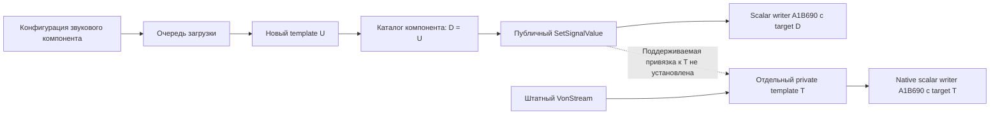

# Подготовка собственных ресурсов VoN — 2026-11-05

<!-- RICON_NATIVE_CALLBACK_CAPTURE01_20261106 -->
**2026-11-06 — capture01: штатный radio callback-path A1→B2 наблюдён.** A дал31 RAW_CAPTURE/30 RAW_USED, B —30 RAW_RX; совпалиrun/generations/ownB receivercatalog/nativeindex0/32000kHz, q0.999999404. START/STOPaccepted1, requestinterval1003ms. Этоnativecallback-path, неPCM/содержание/coverageA/privatewriterB/DSP/DIRECT/ownactorPASS; внутреннееcapture/releaseсостояниеUNKNOWN. Killrequest1522.1349ms, exit1775.9784ms: observedexit<2000, строгие1500 НЕподтверждены. Обаownпроцесса/watchdogsзавершены, ownerWB19984/source134/assets11 сохранены. [Независимыйreview](<C:/Users/Ded/Documents/Projects/ARMA 3 Scripts/Cellular System/output/ricon-goal-plan-20261106/guarded-cli-capture/capture01/review.json>). Следующийdefault-off8lineopaqueVoNrefdiagnosticужеcompiled05exit0/SCRIPT(E)0; rawC ещёнеqualified. ПолнаяGoalне завершена, complete=false; broadgrantactive.

Ниже история предыдущих срезов.

<!-- RICON_PASSIVE_RETAIL_PAIR05_20261106 -->
**2026-11-06 — pair05: два retail участника соединены, пассивная script radio readiness подтверждена.** Штатный CLI -server создал Listen/localA1; retailB присоединился какClient/local2. Одинrun, stablegeneration1, BproxyA совпал с AownRpl, обаowncontroller/entity/VoN иradioentry прочитаны. Сервер видит уникальныеA/Binventory, одинаковыеkeys и32000|48000kHz; Bproxyview остаётсянеполным. Overlapvalidlogwindows не являетсяclockmapping/atomic proof. Callbacks0/capture0; nativeOwnership остаётсяUNQUALIFIED, actualvoice/DSP/A-B/privatewriter иowninheritedactor ещёнеприняты. ОбаownGameиwatchdog завершены, ownerWB19984/source134/assets11 сохранены. [Independentreview](<C:/Users/Ded/Documents/Projects/ARMA 3 Scripts/Cellular System/output/ricon-goal-plan-20261106/paired-passive/pair05/review.json>). GUI больше не нужен: далееодинboundedguardedCLIcapture с сохранениемoneuse/identity/route/freshness/PIDstart/QPC/cutoff. Broadgrantactive; complete=false.

Ниже история прошлых срезов.

<!-- RICON_NATIVE_BASELINE01_20261106 -->
**2026-11-06 — Game baseline01: загрузка RICON/Plain и read-only наблюдение подтверждены.** Exact retail Game1.9 e877 запущен с отдельным профилем; LiveProbe/Core/CoreTests и Plain world загружены, actual module/ASLR/COL/RTTI names проверены. V0/T0 в двух PARTIAL scans по128MiB не доказывают отсутствие объектов; actual RX/voice/DSP/A-B не квалифицированы. SCRIPT(E)=0, 13 loading-layout/Rally resource errors сохранены отдельно. Завершён только собственный PID30756 после stop-request; exit-1 ожидаем для intentional Kill, не normal-clean-exit. Owner WB19984/source134 сохранены. [Outcome](<C:/Users/Ded/Documents/Projects/ARMA 3 Scripts/Cellular System/output/ricon-goal-plan-20261106/native-baseline/baseline01/outcome.json>), [independent review](<C:/Users/Ded/Documents/Projects/ARMA 3 Scripts/Cellular System/output/ricon-goal-plan-20261106/native-baseline/baseline01/review.json>). Далее — пассивная пара WB listen-host A + retail Game B; повторные app-допуски не требуются в рамках broad owner grant. Полная Goal/приёмка/complete=false сохранены.

Ниже сохранена история предыдущих срезов.

<!-- RICON_VERIFY01_BROAD_APPROVAL_20261106 -->
**2026-11-06 — verify01: fresh GUID-only source lookup подтверждён; необходимые действия проекта разрешены владельцем.** Новый Reader загрузил stock и own prefab по одному GUID с правильными full ResourceName. В обоих по 51 компоненту/1 VoN; child Filename — own ACP, original before/after — stock ACP. Wrong GUID нового ID — 0, own startup-unregistered — 0; exit 0/SCRIPT(E)=0, 134 source pins unchanged, Reader завершён, Workbench владельца сохранён. Причина старых register01 diagnostics UNKNOWN, stale cache не доказан. Это source lookup в данном Reader context; actual actor/voice/DSP/A-B ещё не приняты. [Независимый review](<C:/Users/Ded/Documents/Projects/ARMA 3 Scripts/Cellular System/output/ricon-von-attachment-20261104/fixture/von-project-config/verify01/review.json>). Прямые «разрешаю все необходимые действия»/«все можно» внесены в §19 плана и полную Goal: дальнейшие необходимые подготовленные проверки выполнять без новых отдельных запросов; pagefile и защита чужих files/apps сохранены. Следующее — наблюдение actual native template/resource и адресного private порта. Полная цель не завершена.

Ниже сохранена история предыдущих проверок и допусков.

<!-- RICON_REGISTER01_OBSERVED_20261106 -->
**2026-11-06 — register01 исполнен по разрешению владельца: собственная ACP прочитана у нового наследуемого prefab, исходный VoN Filename остался штатным.** Resource Manager вернул успешную регистрацию, создал native GUID `{0DE75817F6D87DD2}` и сообщил `Build successful`. При чтении нового ресурса зафиксированы три `Wrong GUID` в property `identity`; причина UNKNOWN, чистая и повторная GUID-загрузка не квалифицированы. Это положительный результат source-конфигурации, не работающий VoN/DSP. Reader завершён (exit 0, SCRIPT(E)=0), Workbench владельца сохранён, 134 исходника и собственные ACP/SIG/meta не изменились. Одноразовый допуск использован; Spawn/Play/server/mic/capture/transmission/preview не выполнялись. Прежняя граница допуска снята; machine Goal всё ещё наблюдается blocked, полный план и complete=false сохранены. [Результат и ограничения](<C:/Users/Ded/Documents/Projects/ARMA 3 Scripts/Cellular System/output/ricon-von-attachment-20261104/fixture/von-project-config/register01/assessment.json>); [независимая проверка](<C:/Users/Ded/Documents/Projects/ARMA 3 Scripts/Cellular System/output/ricon-goal-plan-20261106/REGISTER01_REVIEW_RU.md>).

Ниже сохранена датированная история предыдущих состояний.

**ТЕКУЩИЙ СТАТУС: Goal active, complete=false; SIG source graph saved/validated на 1.9.0.37.** Own ACP сохранена редактором v2, входы/связи проверены; omitted sample defaults, private VoN и compiled-программа не квалифицированы. Ниже сохранена история; актуальный итог и следующий шаг в конце.

**Ресурсы зарегистрированы и собственная SIG открыта. Обновлённый исполняемый граф и управление private VoN ещё не подтверждены. Текущий итог полной Goal уточнён в блоке статуса выше.**

Владелец отдельно разрешил Resource Manager/Audio Editor для подготовки и пересборки собственных ACP/SIG и Computer Use для Workbench. Это дополняет прежнее разрешение компиляции Script Editor. Play, игровой сервер, preview/воспроизведение, микрофон и передачи не разрешены и не запрашивались.

Регистрацией ResourceManager получены GUID:

- SIG: `{181E1B71C9410BEF}Sounds/RICON_VoNProbe/RICON_VoNProbe.sig`.
- ACP: `{63C2132413FE4337}Sounds/RICON_VoNProbe/RICON_VoNProbe.acp`.

Отложенное открытие по GUID подтвердило фактический документ `$RICON_LiveProbe:Sounds/RICON_VoNProbe/RICON_VoNProbe.sig`. Открытие по пути и accepted-возврат API сами по себе таким доказательством не считались.

Подготовлен граф с `RICON_RadioOnlyProbeGain` и умножением только `Radio_V`. Значение 1 сохраняет прежнее выражение; ветви Quality_W и Noise_V не изменены. Source-дельта прошла отдельное review. Однако compiled-блок остался `processed/ins/ops=11/3/5`, вместо ожидаемых для этого графа `13/4/6`. Save/Rebuild не подтвердили содержимое новой программы. Позже в логе установлен Build successful; native/cache программа UNKNOWN. Черновик **не пригоден для проверки эффекта**.

Computer Use читает дерево элементов, но захват изображения возвращает `window capture timed out`, а click — `coordinate input geometry is unavailable`. Отказы сохраняются после обычного запуска без плагина, явных `-run/-load` и отдельного запуска Workbench Launcher. Windows session 1 проверена как unlocked. Из этих наблюдений не выводится неисправность самого VoN.

Скриншот владельца показал отдельную ошибку Launcher: Missing Addon `5614BBCCBB55ED1C`. Это установленный Enfusion core data. Обе `core.gproj` имеют этот GUID и одинаковый SHA256; целевой CLI с явным `-addonsDir` загружает core (author14 console:20 и :89). Пробный запуск через `sky.launch_app` не передавал addon paths. Штатные проекты и установка игры не изменялись.

Все собственные процессы editor/launcher этой серии завершены. Несогласованный draft сохранён в `after-author14-draft`; рабочие own ACP/SIG восстановлены из проверенных исходных копий, native meta/GUID сохранены. Текущий снимок — `after-author14-working-state.json`; прежний `final-working-state.json` является историческим.

Статический разбор нашёл owner-matched consumer SndLoadCtx: `[1412051E0,1412052DA)`, 250 байт. Он либо повторяет config path, либо передаёт `C+20` в каталог компонента на `1412052B8 → 141207C20(L,C+20)`. Дополнительно проверены 565 байт handoff и 211 байт per-item helper: pointer U из входного массива переносится тем же pointer в каталог `L+28`, без создания копии template в этих телах. Каталог способен принять готовый instance. Происхождение содержимого массива `C+20`, поддерживаемый способ передать туда конкретный private VoN T и доступ к нужному owner остаются OPEN. H в этих телах не назначается. Текущий combined result — `../attachment/OWNER_IDENTITY_CHAIN_RU.md`; исходный 565-байтный срез сохранён как история.

RECEIVER/SERVER, общий временной канал, отдельная клиентская обработка звука и отсутствие автоматического отключения по LOST/Q0 сохраняются. `BLOCKED_NO_ACTUATOR`, калибровка, delivery coverage и приёмка A/B/C/DIRECT остаются открытыми.

Доказательства в том же staging-каталоге: `deferred-opening-confirmed.json`, `graph-draft/receipt.json`, `author05…author14/receipt.json`, `stock-integrity.json`, `after-author14-working-state.json`; независимые проверки — `../review/AUTHORING_RUNTIME_REVIEW_RU.md` и `../review/AUTHOR05_GRAPH_SOURCE_REVIEW_RU.md`; новый static join — `../attachment/OWNER_BIND_TARGET_RU.md`.

Официальная семантика CLI: [-run открывает редактор, -noBackend отключает backend HTTP](https://community.bistudio.com/wiki/Arma_Reforger:Startup_Parameters). Windows flags: [WTSINFOEX_LEVEL1_W](https://learn.microsoft.com/en-us/windows/win32/api/wtsapi32/ns-wtsapi32-wtsinfoex_level1_w).

Первичные файлы этой серии: `C:\Users\Ded\Documents\Projects\ARMA 3 Scripts\Cellular System\output\ricon-von-attachment-20261104`.

## Продолжение 2026-11-05 — происхождение объектов установлено

Полная Goal сохраняется: RECEIVER/SERVER, общий временной канал и отдельная клиентская обработка звука, без автоматического отключения или удаления голоса по LOST/Q0. Предыдущий и текущий goal turns классифицированы как progress по новым проверенным source данным; задача не завершена.

Исследованы 2184 байта queue-specific пути и 648 байт вспомогательной job routing цепи. Worker читает config C+10, item loader получает AudioProjectRes, выделяет0x98 и строит новый AudioSourceTemplate. Новый U попадает в C+20, context публикуется в ready list, а каталог сохраняет D=U. Для этой конфигурационной ветви U создан заново; одинаковый filename не связывает каталог с существующим private VoN T. Прежний условный handoff D=U остаётся верным, но его предпосылка U==T здесь не выполнена. Независимый source review ACCEPT_SCOPED; никакого actual voice эффекта не установлено.

В author15 встроенный cua_repl снова прочитал own SIG title, но screenshot/click завершились timeout/geometry error. В author16 setValue имени собственного Input вернулся без ошибки, однако имя/model/file hashes не изменились; Save не запрашивался. Оба собственных процесса завершены; clean ACP/SIG и meta восстановлены и проверены. Документированный force-compile entry point не найден в checked official/SDK scope. Все шесть проверенных stock SIG имеют непустой compiled block; regeneration после удаления cache не квалифицирована и не выполнялась.

Следующий static access шаг — реальный поддерживаемый external attachment/mutator либо installer уже обнаруженного interception H. Повторение config loaders, общего scheduler/mixer и Save/Rebuild без новой причины не требуется. Private VoN actuator, rebuilt graph, delivery coverage и вся native приёмка остаются открытыми. Без Play, сервера, preview, микрофона/capture и передач.

Первичные результаты: [queue provenance](<C:/Users/Ded/Documents/Projects/ARMA 3 Scripts/Cellular System/output/ricon-von-attachment-20261104/attachment/QUEUE_PROVENANCE_CLOSED_RU.md>), [независимая проверка](<C:/Users/Ded/Documents/Projects/ARMA 3 Scripts/Cellular System/output/ricon-von-attachment-20261104/review/CONTINUATION_REVIEW_RU.md>), [SIG API/format граница](<C:/Users/Ded/Documents/Projects/ARMA 3 Scripts/Cellular System/output/ricon-von-attachment-20261104/fixture/NATIVE_SIG_COMPILE_METHOD_RU.md>).

## Проверка двух конкретных H-кандидатов

SetCallbackMask проверен по реальной регистрации public wrapper: он заменяет только младшие четыре бита callback flags S+F0. Вызванный после catalog handoff финализатор141206A40 удаляет регистрацию context из pending queue и исправляет индексы. В этих391 байтах нет прямого присваивания H или нового callee к installer. Это не универсальное отсутствие более поздних attachments: внешние destructor/lifecycle effects и другие installers остаются за проверенной границей. Независимый review ACCEPT_SCOPED. Полная Goal active/complete=false; actual private VoN control не квалифицирован.

Одинаковая реализация writer не объединяет D и T. Проверенный config producer создаёт отдельный U, поэтому загрузка той же ACP не устанавливает нужную связь. Текущая граница требует конкретного поддерживаемого attachment/mutator либо interception contract; flags, queue cleanup и общее имя Input его не заменяют.

[H-path source](<C:/Users/Ded/Documents/Projects/ARMA 3 Scripts/Cellular System/output/ricon-von-attachment-20261104/attachment/H_PATH_BOUNDED_RU.md>) · [H-path review](<C:/Users/Ded/Documents/Projects/ARMA 3 Scripts/Cellular System/output/ricon-von-attachment-20261104/review/H_PATH_REVIEW_RU.md>).

## Исторический итог до ручного Save и возобновления — GOAL BLOCKED

Goal tool подтвердил blocked после независимого аудита трёх последовательных Goal-turn с одним CUA-препятствием. Предыдущий статический прогресс и положительная проверка author18 сохранены. Полная RECEIVER/SERVER temporal-цель и все критерии приёмки неизменны; complete=false.

Уточнение evidence: author09 содержит Build successful для собственных SIG/ACP. Неизменённый serialized source11/3/5 не доказывает native-cache failure. Author18 с reviewed helper c0d7693f скомпилировался, загрузил exact own SIG и завершился exit0/SCRIPT(E)0; ToBaseContainer=null, compiled counts не прочитаны, программа UNKNOWN. В teardown24 retained UI resource entries, без вывода о crash или безошибочном shutdown.

Author17 принял отдельный INI и записал7711байт, но capture/geometry failure сохранились. Проверенные Sound/SndComponent metadata, concrete notify/registry и cached ctors не дали нового обоснованного private-VoN installer target. Это граница проверенных путей, не универсальная невозможность другого attachment.

Подготовлен reviewed own SIG draft. Текущая SIG — b4acd8… (DRAFT_READY_MANUAL_SAVE), не clean snapshot. Чистая3da1d… сохранена; ACPa16accc2… по-прежнему ссылается на stock SIG, обе native metadata сохранены. Source3 и Core не менялись. APPLIED, graph/native voice PASS и full goal completion не заявлены.

Уточнение истории: приведённая ниже инструкция Input value 1→0.5 устарела и не повторяется. В выбранном Input UI 1.9 нет поля Value; владелец уже сделал Name→tmp→исходное имя с Save. Новая SIG source validation подтверждена отдельным receipt; ручной Save не требуется повторять.

[Историческая команда и ручное действие](<C:/Users/Ded/Documents/Projects/ARMA 3 Scripts/Cellular System/output/ricon-von-attachment-20261104/authoring/manual-sig-handoff/MANUAL_SIG_REBUILD_RU.md>): в own Input RICON_RadioOnlyProbeGain изменить1→0.5 и Save, затем вернуть1 и Save. После этого нужны проверка saved graph/descriptor/defaults/links/meta и отдельная квалификация native VoN port. Это снимает только authoring-часть. Preview/Play/server/microphone/capture/transmissions не разрешены.

[Machine Goal](<C:/Users/Ded/Documents/Projects/ARMA 3 Scripts/Cellular System/output/ricon-von-attachment-20261104/machine-goal-blocked.json>).

[Blocked audit](<C:/Users/Ded/Documents/Projects/ARMA 3 Scripts/Cellular System/output/ricon-von-attachment-20261104/authoring/GOAL_BLOCKED_AUDIT_RU.md>).

[Runtime read review](<C:/Users/Ded/Documents/Projects/ARMA 3 Scripts/Cellular System/output/ricon-von-attachment-20261104/review/RESOURCE_READ_RUNTIME_REVIEW_RU.md>).

[Owner binding review](<C:/Users/Ded/Documents/Projects/ARMA 3 Scripts/Cellular System/output/ricon-von-attachment-20261104/review/OWNER_BINDING_REVIEW_RU.md>).

[Manual handoff review](<C:/Users/Ded/Documents/Projects/ARMA 3 Scripts/Cellular System/output/ricon-von-attachment-20261104/review/MANUAL_SIG_HANDOFF_REVIEW_RU.md>).

## Продолжение 2026-11-05 — Goal active, собственная SIG сохранена в 1.9

Полная RECEIVER/SERVER temporal-цель возобновлена, complete=false; [fresh Goal receipt](<C:/Users/Ded/Documents/Projects/ARMA 3 Scripts/Cellular System/output/ricon-von-attachment-20261104/authoring/version19/goal-resumed.json>). Прежний blocked-аудит и ожидание ручного Save ниже/выше сохраняют исторический смысл и не описывают текущую остановку. Предыдущий Goal-turn — PROGRESS: ручной Save дал новый проверенный исходный граф.

[Проверка сохранения](<C:/Users/Ded/Documents/Projects/ARMA 3 Scripts/Cellular System/output/ricon-von-attachment-20261104/authoring/manual-sig-handoff/after-save-validation-20261105.json>): SIG SHA256 `7d02acb201f83cb89048cbb721a84387ec4b21c1fbb3ae3e992008fe95916707`, 13 исходных узлов (4 входа с константами, 6 операций, 3 выхода); `Input_Order` включает Input 18, default 1, `Interpolate14 × Input 18 → Mul19 → Radio_V12`. Quality_W/Noise_V сохранены. Версия manual startup 1.9.0.37; встроенного compiled-блока в этой сериализации нет. Историческое ожидание текстовых processed/ins/ops=13/4/6 больше не критерий этого сохранения. Native compiled program и фактическое звучание UNKNOWN/NOT_RUN; Build success именно этого Save в журнале не установлен.

Сохранение собственной ACP редактором 1.9 подтверждено: текущий SHA256 `9e396d6432a25a1f519c43414faea1f69316d6a416d4a071fd22d90854ca0573`, 15405 байт, AudioClass v2. Редактор фактически открыл own ACP и показал оба входа TransmissionQuality/RICON_RadioOnlyProbeGain; ports 1/18, defaults 1/1, min 0/0, max 1/1, outputs 5/8/12 сохранены. SIG 7d02 и обе metadata неизменны. [Проверка Save](<C:/Users/Ded/Documents/Projects/ARMA 3 Scripts/Cellular System/output/ricon-von-attachment-20261104/authoring/version19/after-editor-save/receipt.json>) и [независимая проверка](<C:/Users/Ded/Documents/Projects/ARMA 3 Scripts/Cellular System/output/ricon-von-attachment-20261104/review/version19/SAVED_ACP_REVIEW_RU.md>). Предыдущая source ACP 731d и apply receipt остаются историей до native Save; повторять ручные действия не требуется. Редактор убрал четыре дублирующих path, изменил две координаты и не записал шесть троек Probability/Index/SampleMetadata. Все остальные явные параметры и связи совпали; семантика пропущенных defaults пока UNQUALIFIED, полная эквивалентность ресурсов не заявлена.

Ближайший этап — установить current 1.9 принадлежность private VoN instance и поддерживаемый путь адресного управления его радиоветвью. Обычный public writer подтверждён в трёх функциях (383 байта и 30 байт регистрации), но выбирает D из каталога SndComponent; D==private VoN T, delegate H и конечный scalar store не квалифицированы. [Текущий source-разбор](<C:/Users/Ded/Documents/Projects/ARMA 3 Scripts/Cellular System/output/ricon-von-attachment-20261104/attachment/version19/RESULT_RU.md>) и [independent byte review](<C:/Users/Ded/Documents/Projects/ARMA 3 Scripts/Cellular System/output/ricon-von-attachment-20261104/review/version19/NATIVE_WRITER_REVIEW_RU.md>). Новый адаптер до подтверждения порта не создаётся. Native compiled program, покрытие доставки, фактическое VoN воздействие и полная приёмка RECEIVER/SERVER остаются открытыми. Play, preview, сервер, микрофон и передачи не запускались.

Свежие 1.9 stock ACP/SIG побайтно совпали с историческим asset baseline: [bounded extraction receipt](<C:/Users/Ded/Documents/Projects/ARMA 3 Scripts/Cellular System/output/ricon-von-attachment-20261104/authoring/version19/prepared/receipt.json>). Это подтверждает только два ресурса. [Срез installed API 1.9](<C:/Users/Ded/Documents/Projects/ARMA 3 Scripts/Cellular System/output/ricon-von-attachment-20261104/fixture/version19/REPORT_RU.md>) — SCOPED_NO_NEW_PRIVATE_VON_MUTATOR: девять exact basenames, 11 bounded payloads, восемь уникальных сравнений; нового поддерживаемого выбора private incoming VoN/Radio gain в этой области не найдено. Scoped отсутствие не доказывает невозможность интеграции. Native адреса/раскладки 1.8 не переносятся на 1.9 без проверки. Покрытие доставки A, радиоуправление B и полная приёмка остаются открытыми.

## Current 1.9 VoN ownership и changelog

Две функции (1610 байт) и отдельный initializer (278 байт) заново прочитаны и проверены независимо. VonStream создаёт свежий AudioSourceTemplate размером 0x88 и сохраняет его в V+20. Initializer может заменить T+28 на alternate resource и передаёт основную работу двум непрочитанным ветвям. Связь T с public catalog D не показана; поздние effects UNKNOWN. [Creation proof](<C:/Users/Ded/Documents/Projects/ARMA 3 Scripts/Cellular System/output/ricon-von-attachment-20261104/attachment/version19/voN-membership/RESULT_RU.md>), [creation review](<C:/Users/Ded/Documents/Projects/ARMA 3 Scripts/Cellular System/output/ricon-von-attachment-20261104/review/version19/voN-membership/REVIEW_RU.md>), [initializer proof](<C:/Users/Ded/Documents/Projects/ARMA 3 Scripts/Cellular System/output/ricon-von-attachment-20261104/attachment/version19/voN-membership/initializer/RESULT_RU.md>) и [initializer review](<C:/Users/Ded/Documents/Projects/ARMA 3 Scripts/Cellular System/output/ricon-von-attachment-20261104/review/version19/voN-membership/initializer/REVIEW_RU.md>).

[Карта официальных изменений 1.9](CHANGELOG_19_RU.md) направляет qualification и будущие regression: DIRECT, движение TX при проверке radio route cache, unpossess чужого персонажа на hosted server. Отдельный полный Tools журнал в проверенных каналах не найден. Публикации не квалифицируют ACP/SIG serialization/defaults. Следующая точечная проверка — current generic Input update kernel; новый адаптер без адресного порта не создаётся. Ручные Save завершены; полный RECEIVER/SERVER scope и no-LOST-mute сохранены, complete=false. Play/audio/server/capture не запускались.

## Выбор VoN project и подготовленная source-проверка

Current четыре prefab от US_Rifleman до Character_Base проверены по FILE/RDB. Поле SCR_VoNComponent.Filename выбирает stock ACP; CommunicationSound — другой компонент. Подготовлен один TOOL_ONLY reader, который в отдельном режиме проверит clone entity kind, независимость контейнеров и изменение только clone Filename на own ACP с readback оригинала. Это data-only source preparation, не private stream control. [Подробный результат](VON_PROJECT_CONFIG_RU.md).

Compile01 завершён: exit0, SCRIPT(E)=0, COMPILE_ONLY_REACHED / RESOURCE_OPERATIONS_NOT_REQUESTED. Все шесть scripts unchanged, Reader20008 завершён, owner19984 сохранён; [independent review](<C:/Users/Ded/Documents/Projects/ARMA 3 Scripts/Cellular System/output/ricon-von-attachment-20261104/review/von-project-config/COMPILE01_REVIEW_RU.md>). Две служебные Wrong GUID diagnostics и 24 retained UI entries сохранены отдельно; clean shutdown не заявлен. Clone-inspect не запускался и ждёт точного owner допуска: прежний ScriptEditor допуск был только compile, исключение authoring — own ACP/SIG. Async-запрос владельцу уже отправлен; повторный запрос не требуется.

Current init dispatch (1983 байта) независимо проверен: resource/state mutations и вызовы items с T/R contexts; public membership не доказан, external effects UNKNOWN. Input candidate slot90 дал только три машинных байта, имя Update и return ABI не квалифицированы; qualified current Update methods=0. Дополнительный API inventory AudioHandle/SndBaseModule/SCR_AudioSource не дал нового existing-private-VoN mutator; Create/Play нового звука не подменяет его. Полная Goal active/complete=false.

## Текущая остановка: ожидание допуска clone-inspect

Goal tool вернул blocked после третьего последовательного наблюдения одной границы допуска и независимого аудита. Первые два turn сохранили свой настоящий прогресс подготовки; текущая проверка не нашла нового разрешённого действия перед уже готовым inspect. [Audit](<C:/Users/Ded/Documents/Projects/ARMA 3 Scripts/Cellular System/output/ricon-von-attachment-20261104/goal/version19/prefab-permission-blocked-audit.md>), [machine result](<C:/Users/Ded/Documents/Projects/ARMA 3 Scripts/Cellular System/output/ricon-von-attachment-20261104/fixture/von-project-config/machine-goal-blocked.json>). Допуск владельца ещё не получен, inspect01 не запускался. Все критерии полной Goal сохранены, complete=false.
