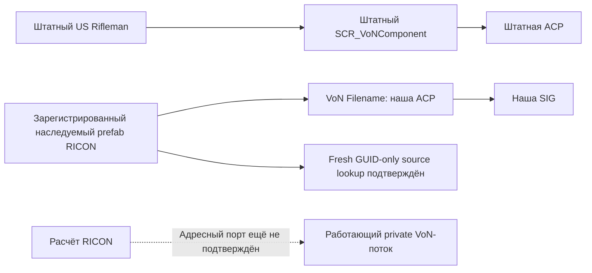

# Выбор собственного ресурса VoN: подготовленная проверка

<!-- RICON_VERIFY01_BROAD_APPROVAL_20261106 -->
**2026-11-06 — verify01: fresh GUID-only source lookup подтверждён; необходимые действия проекта разрешены владельцем.** Новый Reader загрузил stock и own prefab по одному GUID с правильными full ResourceName. В обоих по 51 компоненту/1 VoN; child Filename — own ACP, original before/after — stock ACP. Wrong GUID нового ID — 0, own startup-unregistered — 0; exit 0/SCRIPT(E)=0, 134 source pins unchanged, Reader завершён, Workbench владельца сохранён. Причина старых register01 diagnostics UNKNOWN, stale cache не доказан. Это source lookup в данном Reader context; actual actor/voice/DSP/A-B ещё не приняты. [Независимый review](<C:/Users/Ded/Documents/Projects/ARMA 3 Scripts/Cellular System/output/ricon-von-attachment-20261104/fixture/von-project-config/verify01/review.json>). Прямые «разрешаю все необходимые действия»/«все можно» внесены в §19 плана и полную Goal: дальнейшие необходимые подготовленные проверки выполнять без новых отдельных запросов; pagefile и защита чужих files/apps сохранены. Следующее — наблюдение actual native template/resource и адресного private порта. Полная цель не завершена.

Ниже сохранена история предыдущих проверок и допусков.

<!-- RICON_REGISTER01_OBSERVED_20261106 -->
**2026-11-06 — register01 исполнен по разрешению владельца: собственная ACP прочитана у нового наследуемого prefab, исходный VoN Filename остался штатным.** Resource Manager вернул успешную регистрацию, создал native GUID `{0DE75817F6D87DD2}` и сообщил `Build successful`. При чтении нового ресурса зафиксированы три `Wrong GUID` в property `identity`; причина UNKNOWN, чистая и повторная GUID-загрузка не квалифицированы. Это положительный результат source-конфигурации, не работающий VoN/DSP. Reader завершён (exit 0, SCRIPT(E)=0), Workbench владельца сохранён, 134 исходника и собственные ACP/SIG/meta не изменились. Одноразовый допуск использован; Spawn/Play/server/mic/capture/transmission/preview не выполнялись. Прежняя граница допуска снята; machine Goal всё ещё наблюдается blocked, полный план и complete=false сохранены. [Результат и ограничения](<C:/Users/Ded/Documents/Projects/ARMA 3 Scripts/Cellular System/output/ricon-von-attachment-20261104/fixture/von-project-config/register01/assessment.json>); [независимая проверка](<C:/Users/Ded/Documents/Projects/ARMA 3 Scripts/Cellular System/output/ricon-goal-plan-20261106/REGISTER01_REVIEW_RU.md>).

Ниже сохранена датированная история предыдущих состояний.

2026-11-05. Версия игры и Tools 1.9.0.37. Статус: **SOURCE_SELECTOR_CONFIRMED / COMPILE_ONLY_ACCEPTED / CLONE_INSPECTION_PENDING_OWNER_APPROVAL / PRIVATE_VON_UNQUALIFIED**.

В текущих данных персонажа штатная ACP выбирается полем `Filename` компонента `SCR_VoNComponent` с ID `{520EA1D2F659C856}`. Проверена вся цепочка `Character_US_Rifleman → Character_US_BaseLoadout → Character_US_Base → Character_Base`: дочерние prefab не переопределяют этот компонент, итоговое значение — `{B4C3941EC8B2AD20}Sounds/VON/von.acp`. Источник и GUID каждого звена проверены по current RDB/FILE; сырые копии и hashes — [selection receipt](<C:/Users/Ded/Documents/Projects/ARMA 3 Scripts/Cellular System/output/ricon-von-attachment-20261104/fixture/von-project-config/selection-receipt.json>). Это проверка исходной конфигурации, не наблюдение работающего VoN.

Отдельный `SCR_CommunicationSoundComponent` содержит проекты команд/анимаций и `LocalVariables_Voice`, а не этот VoN project. Его обычный signal setter не становится управлением private VoN из-за соседства компонентов на одном персонаже.

В source подготовлена другая возможность выбора: создать отдельную копию конфигурации, поменять только её `SCR_VoNComponent.Filename` на `{63C2132413FE4337}Sounds/RICON_VoNProbe/RICON_VoNProbe.acp` и проверить неизменность оригинала. Current API nominally допускает `IEntitySource → CloneContainer → Resource`; native entity kind и независимость вложенных components ещё не проверены. Чтение declarations не заменяет такой результат.

Подготовлен один TOOL_ONLY plugin `RICON_VoNPrefabCloneProbePlugin.c`, SHA256 `ba7e549d0087a8fa0383d300289bda596300c7ecde5578fd018d196985563425`. Режим `compile-only` завершает работу до Resource.Load/Clone/Set. Отдельный `clone-inspect` после задержки проверяет тип source, единственный VoN, stock Filename, различие Resource/root/всех component containers; только затем меняет поле на clone и читает clone/original. Общие контейнеры, неверный тип или неуникальный VoN дают STOP до Set. SaveContainer, Spawn, Play/audio и регистрация ресурсов отсутствуют. Меняется только память отдельного Reader process; сохранение шаблонов не предусмотрено.

**Выполнена только компиляция.** [Compile01 receipt](<C:/Users/Ded/Documents/Projects/ARMA 3 Scripts/Cellular System/output/ricon-von-attachment-20261104/fixture/von-project-config/compile01/receipt.json>): exit0, SCRIPT(E)=0, `COMPILE_ONLY_REACHED / RESOURCE_OPERATIONS_NOT_REQUESTED`; deferred/Set/readback не выполнялись. Все шесть Reader scripts неизменны, собственный Reader PID20008 завершён, owner Workbench PID19984 сохранён. Независимый [compile review](<C:/Users/Ded/Documents/Projects/ARMA 3 Scripts/Cellular System/output/ricon-von-attachment-20261104/review/von-project-config/COMPILE01_REVIEW_RU.md>) принял именно этот scope. Два служебных Wrong GUID сообщения и 24 retained UI resource entries записаны отдельно; clean shutdown не заявлен.

**Следующий запуск требует точного допуска владельца.** В owner Goal Script Editor ограничен компиляцией; позднее исключение касалось ResourceManager/AudioEditor и собственных ACP/SIG. Новая проверка prefab clone/Set этим явно не разрешена. Владелец уже получил один async-запрос: выполнить только подготовленный data-only clone-inspect без сохранения шаблона, персонажа/игровой сцены, Play, сервера, микрофона и воспроизведения. До ответа ветка не исполняется. Это основано на прямом ограничении владельца, не на skill или локальном approval workflow.

Даже положительный readback докажет только возможность изолированно подготовить конфигурацию с нужным VoN resource reference. Он не докажет выбор ресурса живым потоком, доставку исходных голосовых фрагментов, sender/receiver identity, MP replication, управление private Input, native DSP или полную RICON интеграцию. Полная RECEIVER/SERVER temporal-цель, общий приёмник и отсутствие автоматического mute/drop по LOST/Q0 сохранены; complete=false.

## Команда следующего запуска подготовлена, но не выполнена

Launcher поддерживает только compile-only и clone-inspect; default остаётся compile-only. Mode нормализуется, префикс attempt обязан соответствовать режиму; parser и 10 допустимых/отрицательных случаев проверены без приложения. Исходный launcher выполненной compile01 сохранён byte-for-byte. [Source review launcher](<C:/Users/Ded/Documents/Projects/ARMA 3 Scripts/Cellular System/output/ricon-von-attachment-20261104/review/von-project-config/launcher-mode-review.md>).

После точного допуска готов вызов `run-compile.ps1 -Attempt inspect01 -Mode clone-inspect`; полный путь и SHA — [prepared inspection](<C:/Users/Ded/Documents/Projects/ARMA 3 Scripts/Cellular System/output/ricon-von-attachment-20261104/fixture/von-project-config/prepared-inspection.json>). Пока owner approval отсутствует, команда не исполняется. Повторно компилировать неизменный plugin или повторять запрос владельцу не требуется. Goal active/complete=false; scope проверки и все запреты выше сохранены.

## 2026-11-06 — разрешение получено, один inspect01 выполнен

Исходное ожидание допуска выше историческое: владелец ответил «Разрешаю». Подготовленный plugin ba7/launcher9f6 запущен ровно один раз в clone-inspect. Обе Resource→ToEntitySource конверсии, отдельность root/class и counts51/1VoN прошли. Cross-collection guard нашёл shared component и завершил STOP/exit3, SCRIPT(E)=0; SET_BEGIN/READBACK не достигнуты. Это не proves shared именно VoN и не утверждение непригодности CloneContainer вообще.

[Outcome](<C:/Users/Ded/Documents/Projects/ARMA 3 Scripts/Cellular System/output/ricon-von-attachment-20261104/fixture/von-project-config/inspect01/outcome.json>) и [независимый review](<C:/Users/Ded/Documents/Projects/ARMA 3 Scripts/Cellular System/output/ricon-von-attachment-20261104/review/von-project-config/INSPECT01_REVIEW_RU.md>). ReaderPID42216 завершён, owner19984 preserved,6sources/ownACP/SIG/metas/4stock prefab payloads unchanged. Две служебные WrongGUID diagnostics/24retainedUI отдельно; clean shutdown не заявлен. На этом одно разрешённое выполнение закончено; дополнительных запусков/ослабленияguard не было. Можно подготовить только offline source inheritance alternative, не объявляя её registered/compiled/runtime/MP-ready. Machine Goal наблюдается blocked; полный objective сохранён, private VoN A/B и полная приёмка не квалифицированы.

## Source-only альтернатива после inspect01

Подготовлен [RICON_VoNProbeCharacter.et](<C:/Users/Ded/Documents/Projects/ARMA 3 Scripts/Cellular System/output/ricon-von-attachment-20261104/fixture/von-project-config/inherited-prefab/RICON_VoNProbeCharacter.et>): 7 строк, exact Rifleman parent, единственный inherited SCR_VoNComponent.Filename override на own ACP. Root source review и static contract check проверили четыре stock hashes/ancestry, правильные parent/component IDs и отклонили четыре ошибочных варианта. Остальные компоненты в draft не переписаны; native isolation этим не доказана. Новый GUID/.meta не создавались, registration/engine parsing/MP/spawn/native selection NOT_RUN/NOT_QUALIFIED. Одно разрешённое inspect01 уже использовано; регистрация этого source draft им не разрешается.

## 2026-11-06 — register01: наблюдённый source-результат

Владелец разрешил ровно одну подготовленную регистрацию и чтение нового prefab. Скопирован семистрочный source с единственным inherited VoN Filename override; GUID вручную не задавался. Native Resource Manager создал `.meta` с Name `{0DE75817F6D87DD2}Prefabs/RICON_VoNProbeCharacter.et`. В исходном и новом шаблонах прочитано по 51 компоненту и по одному SCR_VoNComponent. У нового Filename `{63C2132413FE4337}Sounds/RICON_VoNProbe/RICON_VoNProbe.acp`, у исходного до и после `{B4C3941EC8B2AD20}Sounds/VON/von.acp`, originalUnchanged=1.

console.log:185–190 содержит successful registration, RegisterReturn=1, Build successful и native ID; строки 191–193 — три RESOURCES(E) Wrong GUID именно этого нового ID/property identity; строки 194–196 — child/readback/OBSERVED. Положительный readback не доказывает разрешение GUID без fallback, постоянство ID в свежем процессе или готовность к использованию персонажем. Причина diagnostics пока UNKNOWN. Две последующие служебные Wrong GUID и retained UI entries учитываются отдельно.

[Raw receipt](<C:/Users/Ded/Documents/Projects/ARMA 3 Scripts/Cellular System/output/ricon-von-attachment-20261104/fixture/von-project-config/register01/receipt.json>), [console log](<C:/Users/Ded/Documents/Projects/ARMA 3 Scripts/Cellular System/output/ricon-von-attachment-20261104/fixture/von-project-config/register01/logs/console.log>), [квалифицированный итог](<C:/Users/Ded/Documents/Projects/ARMA 3 Scripts/Cellular System/output/ricon-von-attachment-20261104/fixture/von-project-config/register01/assessment.json>), [независимый review](<C:/Users/Ded/Documents/Projects/ARMA 3 Scripts/Cellular System/output/ricon-goal-plan-20261106/REGISTER01_REVIEW_RU.md>). Reader PID 35816 завершён, owner PID 19984 с прежним временем старта сохранён; 134 source pins, четыре собственных audio assets и четыре stock prefab payload сохранены. Actor instance, исходящий/входящий голос, доставка A, адресный актуатор B, DIRECT и DSP этим не проверялись. Повтор регистрации не разрешён текущим одноразовым допуском.

## Подготовленная проверка существующего GUID, без регистрации

**Следующая проверка подготовлена, но не запускалась.** Read-only триаж подтвердил совпадающую запись GUID/path в собственных `.meta` и `resourceDatabase.rdb`. Причина трёх diagnostics и маршрут прежнего GUID+path Load остаются UNKNOWN; устаревший mapping в том же процессе — только гипотеза. Подготовлен один fresh Reader `verify01 / prefab-inspect-existing`: сначала stock GUID-only positive control, затем own GUID-only load, ResourceName/Filename readback. Если штатный контроль не пройдёт, результат STOP_CAPABILITY/own-not-tested. Helper прошёл независимое source review; compile04 exit 0/SCRIPT(E)=0, 134 source pins unchanged, Reader 30644 завершён, owner 19984 сохранён. Compile-only не вызывал новый resource worker. Загрузка по одному GUID ещё не квалифицирована. В новом worker нет регистрации/Clone/Set/Save/Spawn/Play; loadedResourceName и raw diagnostics требуют ручной оценки, terminal OBSERVED не означает clean GUID автоматически. [Подготовленная команда и ограничения](<C:/Users/Ded/Documents/Projects/ARMA 3 Scripts/Cellular System/output/ricon-goal-plan-20261106/load-only/preparation.json>), [source review](<C:/Users/Ded/Documents/Projects/ARMA 3 Scripts/Cellular System/output/ricon-goal-plan-20261106/load-only/review.json>). Старый одноразовый допуск использован; новый load-only запуск ждёт отдельного согласия владельца. Полная Goal, RECEIVER/SERVER, no-LOST-mute и complete=false сохранены.

Native LiveProbe resourceDatabase.rdb после register01: 5958 байт, SHA256 `17a13e853ffb535aacbcec48978fc9cf0455dafd6e9a8ff58f6e1d8eedeb6f05`; path offset 1218, GUID little-endian offset 1259. Startup register01 до регистрации видел own resource unregistered/null GUID (console.log:67), а окончание записало RDB. Это подтверждает сохранение записи на диске, но не доказывает причину diagnostics. SDK ResourceName.IsInternal описывает GUID-only форму, Resource.Load — data/cache load; явная гарантия GUID-only resolution в просмотренной документации отсутствует.
