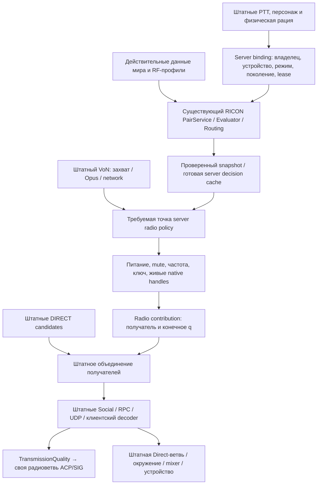

# Как подключать RICON к штатным VoN и Radio

Дата: 2026-11-04. Статус: **DESIGN_REVIEW_ACCEPTED / ENGINE_CAPABILITY_NOT_QUALIFIED**. [Независимая проверка](review/REVIEW_RU.md).

## Решение простыми словами

Сохраняем штатный путь звука: микрофон, подготовку голоса, Opus, передачу через игровую сеть, декодирование, пространственный звук и вывод на устройство. RICON должен принимать решение о радиосвязи: какое настоящее устройство передаёт, как проходит маршрут, кому доступна передача и какое качество следует применить.

Точная архитектурная граница — серверная радиоветвь до добавления её результатов к списку получателей обычной речи. Здесь можно оставить штатную доставку и звуковые эффекты, заменив источник решения о радиоканале. Однако **нахождение этого места в native-коде не означает, что обычному Workshop-моду открыт доступ к нему**. Такой публичный контракт пока не найден. Ниже отделены доступные механизмы, исследуемые варианты и требуемое расширение.

Общие цели сохранены: встроенная связь Reforger, серверный расчёт, независимое управление парами, сохранение прямой речи и действий пользователя, использование существующего RICON. Пункт 1.1 извлечения движка не возвращается. Игра/Workbench/движок, capture и сервер в этой работе не запускались.

## 1. Что переиспользовать, дополнить и модернизировать

| Действие | Что именно | Почему |
|---|---|---|
| Переиспользовать | Native capture, нормализацию и тихий gate, Opus, буферы, RPC/UDP, защиту пакетов, декодер, VonStream | Не создавать второй голосовой транспорт и не терять стандартную совместимость |
| Переиспользовать | Реальные рации, питание, пользовательские частоты/ключи/mute, инвентарь и PTT | Устройство остаётся понятным игроку; чужое состояние нельзя присваивать адаптеру |
| Переиспользовать | Штатную окончательную проверку получателя, платформенные ограничения общения, owner checks, обычную речь | Решение RICON не должно обходить разрешения и менять соседние разговоры |
| Переиспользовать | Native качество в context и его передачу в отдельный VonStream данного отправителя у данного клиента | Серверное качество уже имеет готовый путь до радиошума/фильтров без собственного кодека |
| Дополнить | Привязку native handle/Rpl ID к logical device RICON, его поколению и действующей передаче | PlayerId, ID объекта и локальный индекс канала — разные идентификаторы |
| Дополнить | Проекцию проверенных результатов существующего PairService в radio candidates | Заменить решение о связи, сохранив остальную цепочку |
| Модернизировать | Только радиочасть ACP/SIG в собственных ресурсах мода | Получить управляемую кривую шума/искажений, не менять Direct shader и общую громкость |

Основной native-разбор: [граф VoN/Radio](<C:/Users/Ded/Documents/Projects/ARMA 3 Scripts/RICON-Reforger/docs/analysis/VON_RADIO_DATAFLOW_RU.md>). Источники по вариантам: [routing](routing/OPTIONS_RU.md), [DSP](dsp/OPTIONS_RU.md), [hooks](hooks/OPTIONS_RU.md).

## 2. Что уже готово в RICON

| Существующая часть | Использование | Граница готовности |
|---|---|---|
| `RICON_BaseRadioObservationReader.TryRead` | Читает питание, native частоту, ключ, выбранный трансивер; проверяет server authority и принадлежность handle | Последовательные getters не являются атомарным снимком; antenna position приходит отдельно и не должна автоматически считаться origin |
| `RICON_RadioQueryBuilder` / `RICON_LinkEvaluator` | Создают запрос и вычисляют бюджет | Профили и данные мира должны иметь действительное происхождение; TEST_ONLY не становится измеренной физикой |
| `RICON_PairService.Evaluate` | Проверяет transmission binding, players/devices/endpoints, поколения, время и доступ; оценивает пары | Не создаём второй реестр пользователей, устройств или разрешений |
| `RICON_LinkPublication` / snapshot receiver | Публикация, ordering, identity, TTL/resync | Публикация не является сетевым или звуковым ACK |
| Lifecycle и lease state | Начало/окончание передачи, terminal events, поколения | Не подменяем действующий контракт новым независимым таймером |
| `RICON_VoNIntegration.ApplySnapshot` | Существующая проверяемая граница эффекта | Сейчас корректно возвращает `BLOCKED_NO_ACTUATOR`; смена enum без реального применения запрещена |

Сопоставлены актуальные исходники `addons/RICON_Core/Scripts/Game/RICON/{Core,Device,Network,Propagation}`. Уже подготовлен [native shadow bridge](<C:/Users/Ded/Documents/Projects/ARMA 3 Scripts/Cellular System/output/ricon-native-shadow-integration-staging/review-handoff.json>): SOURCE_ACCEPTED, 27 offline checks, SDK/native NOT_RUN. Его следует продолжить, а не переписывать аналогичную прослойку.

**Отдельный нерешённый вопрос:** production-кривая разборчивости RICON остаётся `BLOCKED_CALIBRATION` в `REQ-link-eval.md:101–102`. `RICON_LinearTestIntelligibility` — проверочная фикстура. Native `TransmissionQuality`, RICON SINR и разборчивость речи нельзя объявить одной физической величиной.

## 3. Что можно сделать обычным модом

| Механизм | Доступ и реальная область | Вывод |
|---|---|---|
| Controller/PTT и собственные RPC | Скрипты позволяют организовать запрос передачи, привязку и доставку решений RICON | Подходит для control plane; не меняет сам по себе обработку native voice packets |
| Частота/ключ/питание/range/mute | Управление устройством/каналом и глобальной геометрической областью | Подходит для настоящих настроек и ограниченных опытов; не общий per-pair актуатор |
| Собственные ACP/SIG | Звуковые ресурсы и радиоветвь можно дополнить | Нужен проверенный вход именно в экземпляр голоса A у слушателя B |
| SignalsManager на локальном proxy A | Отдельный клиент имеет своё представление A; публичный API хранит пользовательские сигналы | Generic entity→SoundComponent binding не доказывает binding приватного VoN clone; это один точный capability gap |
| Global Audio Variable / OutputState | Управление общей переменной/выходом | Без selector отправителя затрагивает A и C вместе; непригодно для произвольных q_AB и q_CB |
| Local Audio Variable | Переменная экземпляра звука | По официальному контракту недоступна для script set/get; нельзя считать её готовым управляющим портом |
| OnReceive | Native вызывает после обычной CF390 обработки, либо по muted bypass | Наблюдение/UI, не предварительный veto. Пустой override не отменит уже принятую обработку |
| OnVoNUsed | В SendVoiceData вызывается после обхода и dispatch recipient map | Analytics/наблюдение. Его изменение не пересчитает текущих получателей |
| ScriptedRadioMessage.OnDelivery | Callback собственных generic radio messages | Полезен для информации/диагностики; обычный microphone VoN использует другой native handler |

Официальные источники: [VoNComponent API](https://community.bistudio.com/wikidata/external-data/arma-reforger/ArmaReforgerScriptAPIPublic/interfaceVoNComponent.html), [Audio Signals](https://community.bistudio.com/wiki/Arma_Reforger%3AAudio%3A_Signals), [Audio Variables](https://community.bistudio.com/wiki/Arma_Reforger%3AAudio_Editor%3A_Audio_Variables), [изменения audio 1.6](https://reforger.armaplatform.com/news/modding-update-november-4-2025). Их обещания сверены с установленными declarations в отчётах вариантов. В частности, возможность добавить signal на entity и возможность изменить приватный native VoN stream — разные факты.

## 4. Рекомендуемая архитектура полной интеграции

**Это целевая конструкция, не сообщение о существующем публичном hook.** Чистый Workshop-доступ к узлу server radio policy ещё не подтверждён.

### A. Сначала проверить источник передачи

Native incoming RPC проверяет владельца вызываемого объекта. Это не равно проверке, что source radio ID из payload принадлежит этому же отправителю. RICON должен проверить точную связку `(server sender, controlled entity, logical TX device, native radio ID, native index, generation, действующая lease)` и допустимый режим. Обычный игрок не получает editor/AI права из одного присланного enum. Используется текущая authoritative идентификация; утверждение клиента не становится привязкой.

Эта проверка выполняется до использования неподтверждённого source radio. Нарушенный source binding — технический/permission отказ, не рассчитанная RF-потеря. Допустимый обычный Direct остаётся под штатной политикой; неверный/поддельный запрос не получает обход под видом fallback.

### B. Заменить источник radio candidates, сохранить остальную доставку

В native SendVoiceData сначала собираются DIRECT candidates, затем radio может перезаписать запись того же VoN component. Поэтому вмешательство должно происходить **до radio overlay**, а не удалять окончательную общую запись постфактум.

Для RICON-managed передачи берём текущие подтверждённые pair results и формируем radio candidates. Действительные проверки native power/mute/frequency/key, соответствие живого receiver и supported editor policy сохраняются. При обходе штатного discovery нельзя потерять проверки, которые раньше находились в Radio slot6/manager: terminal slot8 сам по себе не заменяет powered/mute filtering. Для неуправляемых поддержанных устройств требуется явная заранее выбранная policy, а не неявное обходное разрешение.

Порт должен уметь принимать получателей RICON, включая допустимые моделью маршруты за пределами штатного геометрического поиска. Механизм, который только удаляет элементы уже найденного stock-списка, годится для дополнительного ограничения, но не для полной замены радиомодели. При этом частота/ключ должны соответствовать выбранному маршруту; дополнительные преобразования ретранслятора требуют явного контракта. В отправляемом context radio ID/index должны указывать на выбранный **приёмник**, а не оставаться копией TX metadata.

На каждого listener выбирается один определённый native RX/маршрут. Существующее native поведение last-writer-wins не используется как критерий лучшей связи. Правило выбора должно принадлежать существующему RICON routing layer и учитывать доступные устройства/активную передачу.

При valid MODEL_LOST radio contribution отсутствует. Если DIRECT был допустим по штатным правилам, его исходная запись сохраняется. При valid разрешённом результате native callback добавляет/обновляет radio record с настоящим RX и нужным качеством. Общая стадия Social/platform checks, owner addressing и отправка обычного VoN остаётся штатной.

Точные proof anchors: `Rpc_SendVoiceData 0x1402A0AA0`; direct accumulation до radio; graph call `0x1402A0F0A`; radio delivery `0x1402A0FC1`; per-listener dispatcher `0x1402A04D0`; final OnVoNUsed после dispatch. Адреса относятся только к закреплённому game EXE, не к серверному бинарнику другой сборки и не являются стабильным SDK.

### C. Передавать качество по готовому native полю

Штатный context уже несёт quality float, который на клиенте попадает в отдельный VonStream по senderId и записывается в `TransmissionQuality`. Путь `CFAC0 → A1B690 → E9DFB0 → 9FAB40` подтверждён. Не нужен новый кодек, собственный PCM-транспорт или вмешательство в AES/UDP.

RICON выдаёт отдельный параметр управления радиозвуком, полученный через версионированный mapping из model result. Он не объявляется автоматически равным физической разборчивости. **q=0 не означает запрет передачи:** native radio resource всё ещё производит звук/шум. Запрет доставки и ухудшение разрешённого сигнала — разные решения.

На границе проверяются конечность числа и диапазон q `[0,1]`; некорректное значение даёт technical failure. После применения портом RICON q штатный пересчёт расстояния не должен перезаписывать его. Смена snapshot revision, expiry и generation должна действовать и на неподвижные устройства: ожидание движения/retune из native cache не обеспечивает своевременное изменение политики.

### D. Дополнить ресурсы радиозвука

Создать собственные ресурсы мода на основе изученной структуры. Поменять только Radio shader/control branch: кривые шума, искажения и усиления должны получать выбранный radio quality. Direct shader, reverb, окружение и общая пользовательская громкость сохраняют свои источники. Не считать весь VON_RADIO event чисто радиособытием: в нём есть также Direct shader.

Начальный эксперимент допускает штатные эффекты и явную TEST_ONLY mapping-кривую. Для production нужны отдельно выбранные и проверенные слуховые/информационные критерии; физические RF-единицы и настройки DSP не смешиваются.

## 5. Минимальный контракт недостающего порта

Ниже — предложение API, **не существующий Enforce метод**:

| Сторона | Данные |
|---|---|
| Вход из native | Bound sender/peer и entity; исходный comm method; разрешённые идентификаторы TX; текущий server clock/build/capability revision |
| Lookup в RICON | Действующая epoch/lease, device/entity generations, принятый snapshot/seq, актуальные physical observations и policy config |
| Выход RICON | `not-managed / deny / allow / technical-failure`; ограниченный список настоящих receiver bindings и конечное audio-control q; версии и диагностические причины |
| Native применение | Проверить handles/поколения; сохранить нужные native filters; внести только radio contribution и q; не удалять DIRECT по MODEL_LOST |
| Подтверждение | Отдельно различать model result, принятие policy, построение native recipient record, удалённый RX и фактический output |

Модель рассчитывается заранее с понятным бюджетом; в голосовом callback используется готовый неизменяемый результат. Не выполнять terrain raycasts/полный пересчёт всех пар на каждый encoded chunk. TTL и invalidation используют уже существующий lifecycle/publication контракт; второй allocator/реестр не создаётся.

При истёкшем/невалидном результате управляемая радиоветвь не получает нового разрешения. Причина сохраняется как technical/stale, не подделывается в `valid MODEL_LOST`. Наличие native extension и его возможности проверяются до включения managed mode. `BLOCKED_NO_ACTUATOR` не становится `APPLIED` от одной публикации модели.

## 6. Почему простые обходы не дают полной цели

| Вариант | Конкретное ограничение |
|---|---|
| Один native range по q RICON | Один радиус не представляет независимые A→B и A→C с разным рельефом; нельзя обратить противоречивые пары одной настройкой |
| Питание/mute общего RX | Изменяет всех отправителей этого устройства. A→B потерян и C→B доступен на одном RX требуют иной точности |
| Social.SetMuted(A) | Затрагивает общую voice-коммуникацию с A; не radio-only, Direct не отделён |
| OnReceive/OnVoNUsed override | Поздние уведомления. Существующий callback нельзя объявить pre-gate по названию |
| Свой RPC с именем native | Не заменяет зарегистрированный C++ holder private Send/Receive |
| Global external RICON_Q | Один value без sender selector смешивает независимые разговоры |
| Обычный SoundComponent с новым PlayEvent | Новый handle существует, но его Stream не соединён поддерживаемым контрактом с PCM native VoN |
| Внутренние carrier radios | Может программировать native q/gate при согласованных клиентах; sourceRadioID/index не связан native сервером с sender, поэтому один key/hidden ID не даёт требуемой server authority |

Carrier underlay не запрещён как будущий исследовательский вариант, но сейчас классифицирован **cooperative-only**. Для production сначала нужен trusted exact source binding. Нельзя считать socket owner check проверкой выбранной в payload рации. Отдельно потребуются ownership/inventory, cache invalidation, HUD/mute/power mapping, исключение proxies из физической модели, N² entities/replication budget и выбор единственного RX. После доказанного trust stop эти дорогие исследования не выполнялись.

## 7. Что доступно без изменения native-кода и что требует расширения

1. **Уже можно готовить обычным модом:** подключение реальных устройств к существующему Core, server model/publication, наблюдение, PTT/lifecycle glue и собственные радиоресурсы. Это реальные полезные части, но без effect hook они не управляют произвольной native voice pair.
2. **Один оставшийся Workshop DSP-кандидат:** пользовательский signal на локальном proxy A действительно управляет только его приватной native радиоветвью у B. Его надо проверить; общий API SignalsManager не подтверждает этот binding. Даже успех DSP-кандидата не становится server recipient filtering.
3. **Для полной архитектуры:** официальный engine policy callback либо квалифицированное server-native расширение, предоставляющее описанный порт. Это точка реализации, а не уже доступный SDK. Установка DLL/patching не выполняется этим документом.

InterceptAR рассмотрен только как возможный носитель расширения. Его README ограничивает plugins dedicated server/Workbench и исключает клиентов; актуально просмотренный release Alpha8 заявляет Reforger1.7 Experimental. Совместимость 1.8.0.13 и доступ к требуемому VoN policy не подтверждены. [README](https://github.com/intercept/interceptAR), [release](https://github.com/intercept/interceptAR/releases). Не принимать факт native proto bridge за возможность менять recipient list. Старое локальное досье: `docs/evidence/E-native-extension-feasibility.md`.

Серверный порт с конечным q позволяет сохранить обычный клиент как минимальную архитектуру. **Мгновенную тишину при revoke он не гарантирует:** in-flight packets, decoder/PCM и device buffers имеют хвост. Если нужны hard pre-playout revoke и строгое соответствие packet generation текущей lease, отдельно потребуется client pre-audio contract/корреляция. Это дополнительное требование, не обещанная способность одной server policy.

## 8. Практический порядок продолжения

| Шаг | Конкретный результат | Условие перехода |
|---|---|---|
| 1 | Довести уже подготовленный native shadow bridge, не переписывая Core | Собранный настоящий Enforce + реальные observations→PairService; тестовые профили явно помечены |
| 2 | Один custom-signal capability test обычного Workshop-мода | Положительно доказанный isolated radio-only per-source binding либо конкретный отрицательный результат; не повторять всю историю VoN |
| 3 | Квалифицировать port access | Официальный/поддержанный policy hook или отдельно совместимый носитель расширения с маленьким фактическим тестом. Нет доступа — не писать большой фиктивный adapter |
| 4 | Подключить policy к существующему snapshot/lease cache | Exact source binding, current generations, technical reason отдельно от model loss |
| 5 | Gate без нового DSP | A→B запрет/восстановление, C→B и A→C сохранены, Direct до/во время/после |
| 6 | Конечное q и собственная radio branch | На B меняется только A radio; C и Direct сохраняются; mapping не выдаётся за калиброванную физику |
| 7 | Lifecycle/нагрузка/мир | Respawn/drop/reconnect/late packets/expiry, затем несколько одновременных говорящих и реальные RF-inputs |

Это продолжает утверждённый план. Шаг 2 — отдельный параллельный DSP-кандидат, а не обязательная зависимость шага 3: серверный порт может передать q обычному клиенту через готовое штатное поле без пользовательского signal bridge. Шаги с engine/runtime сейчас **NOT_RUN**. Для минимального двухпользовательского опыта допускается отдельно ограниченный device-wide native gate, если RX эксклюзивен; он не закрывает общую независимость пар и не заменяет шаг5.

## 9. Проверка, которая различает настоящую интеграцию и общий mute

Минимум три участника A/B/C. B использует один приёмник для A и C. Native источники/handles/частота/ключи и жизненный цикл заранее проверены.

| Ситуация | Требуемый результат |
|---|---|
| Модель разрешает A→B и C→B | Обе radio-передачи проходят выбранный независимый критерий |
| RICON теряет A→B, сохраняет C→B | B теряет только A radio; C остаётся |
| A→C разрешён при запрещённом A→B | C продолжает принимать A |
| A рядом с B говорит Direct | Штатная обычная речь сохраняется до/во время/после radio gate |
| RICON снижает качество только A→B | У B меняется A radio quality/effects, C и Direct неизменны |
| A выбирает чужой native radio/carrier ID | Запрос не получает чужое разрешение/quality; причина binding refusal, не RF loss |
| Нет текущего snapshot/профиля/lease | Нет нового управляемого radio allow; диагностируется technical/stale причина |
| User mute/power или respawn/rebind | Не снимается чужое ограничение; старое решение не применяется к новому endpoint |

Raw OnCapture/OnReceive и q считаются metadata, не heard content. Контрольный результат заранее выбирается: независимое информационное распознавание через ordinary VoN либо квалифицированное аудио. Current proof однажды совпавшего short/long не подменяет серию. Device-wide OFF/ON baseline не подменяет A/B/C-проверку.

## Итог текущего design-этапа

**Лучшее место полной интеграции установлено: server radio policy до radio overlay, с передачей конечного RICON audio-control q по существующей native цепочке.** Большая часть стандартной связи переиспользуется. Для чистого Workshop-мода необходимый pre-route/per-source управляющий доступ пока не доказан; три группы анализа фиксируют конкретные границы и один оставшийся DSP-кандидат.

Следующий инженерный результат — подтверждение недостающей маленькой возможности, а не новый voice backend или большой adapter, который только сообщает `APPLIED`. Код продукта, pure seam и калибровочные статусы этой работой не изменены.
